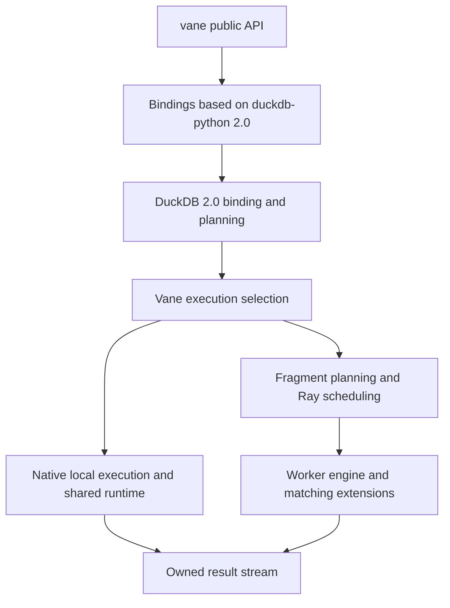

# DuckDB 2.0 integration design and roadmap

Vane will adopt pristine DuckDB 2.0 and its matching official Python client as
new source baselines, then migrate Vane capabilities in small, independently
verified steps. Existing behavior and regression tests guide the migration;
historical commits provide implementation context rather than a patch queue
to replay wholesale.

Status as of 2026-10-26: the pure engine and official Python client imports
are complete on `integration/duckdb-2.0`. Native build integration and Vane
capability migration have not started. This branch is not yet a buildable or
releasable Vane installation.

This document owns the migration decisions, roadmap, and completion record.
[Development](DEVELOPMENT.md) owns build and test commands;
[Source provenance](SOURCE_PROVENANCE.md#duckdb-engine-baselines) owns source
identities and attribution. Existing feature documents describe behavior to
recover, not capabilities already available on this branch.
The [capability inventory](DUCKDB_2_MIGRATION_INVENTORY.md) maps reference
implementation paths, dependencies, and tests to the remaining stages.

## Source baselines

| Component | Immutable reference | Migration role |
| --- | --- | --- |
| Current Vane migration reference | `06cfbd5cc39f8b2c19531676f2bdcfff64e1a6e4` | Main synchronized on 2026-10-26; reference implementation, tests, and committed 1.5.5 customizations |
| Original import starting point | `95acdea830eb1fff407f0e09f4b97ee7b0a02e83` | Historical branch origin; superseded as the migration reference |
| Official DuckDB v2.0.0 | `d54cbbe3df17e8e5ce68312f483b4155836112aa` | Imported engine baseline |
| Official engine tree | `c671df12df7e48e80306cb6a42d4761417c01695` | Verified contents and file modes of the pristine subtree |
| Vane engine import | `d1ca8da47e8eb9298b8ecfc8d47e547e07e06d20` | Import commit with an official squash snapshot parent |
| Official duckdb-python v2.0.0 | `83c719961098611e769dc4bab0bda2bf149a2d1e` | Imported client baseline |
| Official client tree | `b2e1819b1bd881106f5b3af31a62bc61ff8110d3` | Verified contents, file modes, and engine gitlink of the pristine client |
| Vane client import | `362db617be3ed09a9fcba9aaf23f37372a56f899` | Pure client import, separate from build adaptation |

The Python target comes from the official
[v2.0.0 release](https://github.com/duckdb/duckdb-python/releases/tag/v2.0.0)
and its [release commit](https://github.com/duckdb/duckdb-python/commit/83c719961098611e769dc4bab0bda2bf149a2d1e).
The tag and client tree have been verified. Its engine gitlink selects
`d54cbbe3df17e8e5ce68312f483b4155836112aa`, exactly the imported engine
revision. Keep that gitlink as upstream metadata without checking out a second
engine. A root `.gitmodules` mapping allows Git metadata operations to resolve
the nested path while disabling default updates and recursive fetches. Do not
substitute a moving branch or allow its build to select another engine revision.

The initial integration branch was created from the older 2026-10-12 Vane
commit above. The baseline correction merges the 45 subsequent main commits
through `06cfbd5cc39f8b2c19531676f2bdcfff64e1a6e4` without rewriting the
published branch. Vane-owned implementation, tests, and build configuration
follow that main revision; both vendor subtrees retain their exact official
2.0 trees. Main's 1.5.5 engine changes stay available in the merged history
for later capability migration. This synchronization does not qualify them
on 2.0.

Changes committed after the current pinned Vane reference, and uncommitted
work in other worktrees, are separate migration inputs. Record their source
revision and tests before adopting them. Future main synchronizations must
update this reference and the capability inventory together, preserving the
accepted engine/client migration work rather than importing 1.5 engine files.

The pristine tree check applies to the initial import. Once Vane engine patches
resume, retain that import as the comparison baseline and derive a new SourceID
for the modified tree. Later 2.0 patch releases require separate baseline
updates with their own provenance and regression results.

## Goals and scope

The migration must produce an installable `vane-ai` package with the `vane`
Python namespace, a private native module, and an explicit native execution
path before restoring distributed execution. The completed integration must
recover the supported Vane capabilities or document each intentionally changed
public contract and its migration path.

Keep the established boundaries for runner selection, result ownership,
bounded execution, cancellation, extension identity, and coordinator commits.
Port each behavior using 2.0 interfaces; retain an old implementation only when
its assumptions still hold.

The roadmap does not include replacing Ray with Quack, redesigning the public
AI product API, maintaining simultaneous 1.5 and 2.0 runtimes inside one Vane
installation, or making every new upstream operator distributable immediately.
An unsupported distributed operation must fail clearly before side effects.

## Target integration boundaries

Here, **native execution** means DuckDB's in-process execution. At the current
Vane reference, `local` selects this path; `local-fast` is a compatibility alias.
The former public local FTE runner was removed in
[#1040](https://github.com/AstroVela/vane/pull/1040). Restore the shared local
runtime, admission, model ownership, and managed result contracts in P3, after
the basic P2 bindings. A native SQL smoke test alone does not qualify those
contracts. Ray fragment execution and recovery belong to P4/P5. See
[local runtime](LOCAL_MODEL_RUNTIME.md#selecting-local-execution).

| Area | Intended responsibility |
| --- | --- |
| `external/duckdb` | Engine baseline and the smallest reviewed set of Vane engine changes |
| `external/duckdb-python` | Auditable official client snapshot, with later integration patches recorded separately |
| `src/vane_py` | Vane-specific native adapters after the old inherited binding implementation is retired from the build |
| `vane` | Public API, runner policy, Python sources and sinks, AI providers, and extension resolution |
| Root CMake and packaging | Select one engine tree, build the private module, package the intended sources and licenses |
| `tests` and engine tests | Preserve observable contracts and qualify each migration stage |

P1 adopted this client directory after verifying the upstream layout. Preserve
the pure import commit, then make module naming, build, and registration
adaptations in separate commits. P2 must direct client CMake to the sibling
engine tree and adapt the upstream packaging backend's independent submodule
and version assumptions to Vane's identity rules.
Do not compile both the old inherited pybind11 client and the new nanobind
client as competing implementations of Vane connections and relations.

### Engine and object identity

Both driver and workers must use the same Vane engine SourceID and matching
extension artifacts. An official `duckdb` installation may coexist in the
process, but its engine-owned connections, relations, and binding-specific
capsules must not cross into Vane's engine. Supported data interchange through
Arrow or Python values retains its own ownership checks. Preserve the private
`vane._native` and Vane-owned ADBC entrypoint boundaries.

The current pybind11 isolation flags are implementation details, not proof of
isolation under nanobind. P2 must establish the corresponding native type and
symbol isolation, including both import orders and rejection of foreign native
objects. It must also restore source and fork identity reporting without
committing generated identity manifests.

### Query and result ownership

The coordinator owns binding, session state, runner selection, and the query
lifetime. Official client query construction must feed that boundary without
introducing implicit local execution or repeated side effects. Parameters,
temporary objects, registered Python data, and UDF registrations must survive
the selected execution path.

Result streams must own the resources they need until exhaustion, close, or
cancellation. Define connection reuse, partial consumption, iterator teardown,
Arrow release callbacks, and error propagation before exposing the migrated
fetch methods. P2 must establish callback entry and connection locking rules
for the migrated input/result APIs. P3 extends that boundary to the shared
local runtime: request/task/data admission, retained input/output leases,
resident models, and cancellation must share the owning session's lifetime.
Preserve database runtime ownership across Vane's private execution engines
without admitting foreign official DuckDB objects. Use the current
[local runtime contract](LOCAL_MODEL_RUNTIME.md) and its regression tests.

Distributed plans and fragments need an explicit versioned
transport contract; the old physical-operator serialization format is not
assumed compatible with 2.0.

### Execution and extension contracts

Restore bounded buffering and readiness before enabling distributed Python
sources or UDFs. A blocked native task must release execution capacity, retain
its pending state, and wake safely on readiness or cancellation. Validate
those rules against 2.0 asynchronous I/O rather than retaining two independent
blocking protocols by accident. See [Python source execution](DATASOURCE_EXECUTION.md).

Extensions retain explicit distributed scan and write contracts. Workers may
produce attempt-scoped artifacts; the coordinator owns publication and catalog
mutation. Restore exact artifact verification before plan deserialization and
before dynamic providers participate in distributed queries. See
[Distributed extensions](DISTRIBUTED_EXTENSIONS.md).

## Compatibility decisions

The official Python 2.0 client uses nanobind, requires Python 3.11 or later,
represents relations using SQL text, and changes result streaming and parts of
the fetch API. These are integration inputs, not behavior changes already
accepted for Vane. See the [official client migration notes](https://github.com/duckdb/duckdb-python/releases/tag/v2.0.0).
DuckDB 2.0 also requires a [C++17 compiler](https://duckdb.org/docs/2.0/dev/building/overview).

| Decision | Proposed direction | Must be settled by |
| --- | --- | --- |
| Python support | Start development on 3.12; adopt a 3.11 minimum for the 2.0 line unless a separate support requirement changes the plan. Derive the final upper bound from Vane's dependency and CI matrix. | P2 packaging and CI changes |
| Native language standards | Move engine consumers to at least C++17; retain C++20 where Arrow Flight requires it and review existing mixed-standard assumptions. | P2 build integration |
| Connection and result API | Classify existing methods as preserved, adapted, or deliberately changed; document ownership and replacement APIs for changed methods. | P2 native API acceptance |
| Relation and runner boundary | Adapt SQL-text relations to a coordinator-owned execution boundary; preserve bound parameters and explicit runner selection. | P3 local semantics and P4 plan transport |
| Wheel ABI | Use an explicitly tested CPython matrix first. Upstream stable-ABI wheels do not establish ABI compatibility for Vane's custom native code. | P2 wheel design, P8 release |
| SQL and storage behavior | Test intentional upstream behavior changes separately from Vane regressions; use isolated database copies for validation and rollback. | P2 compatibility inventory, P8 migration guide |

DuckDB 2.0 changes parser behavior and disables the old single-arrow lambda
syntax by default. New database files use a format older versions cannot read;
existing older-format files retain their storage version when used by 2.0.
Test storage compatibility explicitly for shared data and rollback. See the
[engine migration guide](https://duckdb.org/docs/2.0/operations_manual/migration).

## Roadmap and acceptance criteria

P0 and P1 are complete. Each later stage depends on the preceding accepted stage
and may contain several focused commits. Completion requires the listed
behavior and recorded evidence, not just successful compilation. Estimate
remaining effort after P2 and P4 expose the binding and execution changes.

| Stage | Status | Deliverable | Exit criteria |
| --- | --- | --- | --- |
| P0 Pure engine import | Complete | Official 2.0 subtree, source identities, historical Vane reference | Exact upstream tree match, correct subtree metadata, preserved old history |
| P1 Official Python client import | Complete | Pinned client snapshot, source provenance, capability migration inventory | Client files match the chosen upstream tree; engine selection and source layout are documented; no Vane behavior is claimed restored |
| P2 Minimal native Vane installation | Next | One engine and one client implementation packaged as Vane | Non-editable wheel installs; public import and explicit native SQL work; basic result and conversion tests, engine identities, coexistence, and source-license checks pass |
| P3 Local Vane data and UDF semantics | Planned | FILE and Tensor contracts, local sources and sinks, UDF adapters, native local runtime and runner selection | Native-path correctness, shared admission, callback safety, managed result ownership, readiness, bounded buffering, and cancellation regressions pass |
| P4 Distributed read execution | Planned | Fragment planning, transport, worker preparation, exchange, and Ray reads | Multi-worker scans, projection/filter, joins, aggregates, ordered limits, and UDF reads match their declared semantics |
| P5 Ray recovery and resource lifecycle | Planned | Retry, worker failure handling, bounded resources, and progress observation | Fault injection, early termination, cancellation, teardown, and resource reclamation tests pass without duplicate or missing results |
| P6 Distributed writes and extension integration | Planned | COPY, DataSink and extension write paths; catalog and provider integration | Attempt outputs are committed through the coordinator; retries and failures preserve write contracts; identity mismatches fail before execution |
| P7 Multimodal and application parity | Planned | Optional native media, AI inference paths, and remaining supported integrations | Representative image/audio/video and provider workflows pass with explicit optional dependencies and matching artifacts |
| P8 Release qualification | Planned | Supported platform wheels, extension wheels, migration guide, and complete acceptance record | Required release and fast suites, native tests, artifact validation, coexistence, and selected workload comparisons pass on the declared support matrix |

### P1 import scope

Import the selected official Python client as a source-only change. Record its
full commit, tree identity, notices, and any upstream engine or submodule pins.
Keep the already imported engine tree unchanged. Inventory the affected Python
package modules, binding entrypoints, hand-maintained type stubs, tests, and
build inputs. The results are recorded in the
[P1 inventory](DUCKDB_2_MIGRATION_INVENTORY.md).

For each Vane capability, record its reference files or commits, dependency on
other capabilities, planned stage, representative tests, and disposition:
port, adapt to an upstream mechanism, or remove with a documented public change.
Preserve the old tests as behavioral evidence when retiring old binding files.
The subsequent build adaptation must be a separate change from the pure import.

### P2 native installation scope

Adapt CMake, the client module, package imports, and extension selection so the
minimal wheel can run native SQL without depending on removed Vane engine
extensions. Treat unsupported Vane entrypoints explicitly during this stage;
do not silently route a requested distributed query to native execution.

Restore source identity generation and adapt source-license checks to the new
baselines. Review actual changes to the copyleft inventory and retained notices
before updating hashes. Qualify the minimal source and wheel contents even
though optional media and distributed artifacts arrive in later stages.

The first build target is Linux x86-64 with Python 3.12. Record assumptions
needed by macOS arm64 and Windows x86-64 so the later matrix does not rely on
unexamined Linux-only symbol or allocator behavior.

### P3 through P5 execution scope

Port FILE and Tensor value representation before dependent UDF and media
conversions. Adapt vector access and buffer ownership to the 2.0 interfaces,
including the upstream typed vector iterators and writers. Recover native
source, sink, and scalar/batch UDF behavior before
enabling their distributed forms. Keep asynchronous dispatch, output schema,
NULL handling, ownership, and memory limits with their regression tests.
P3 also restores native local runtime configuration, session and cursor
ownership, resource graphs, resident model pools, and managed result delivery.
Qualify bounded input/output retention and callback reentry before exposing
these APIs. The current main tests, including the local serving acceptance
scenario, define these contracts; the removed local FTE entrypoint does not.

P4 restores the shared fragment execution architecture and first qualifies
successful distributed reads. P5 qualifies Ray recovery, resource cleanup,
and progress on those same primitives. Local execution remains native.
Compare ordered queries with their specified order and unordered results by
their contents and multiplicities. Include empty inputs, nested values, partial
result consumption, and failures while tasks are blocked.

### P6 through P8 integration scope

Implement distributed publication and transaction boundaries before enabling
catalog-backed writes. Rebuild static and optional extensions against the
actual modified engine SourceID; binaries from the pristine upstream or 1.5
line are not interchangeable with the Vane build.

Restore storage connectors, including Gravitino Fileset batch writes and the
VaneFS adapter's durability and same-host Ray contracts, within their existing
documented access boundaries. Qualify media and AI paths after
their types, I/O, UDFs, and provider dependencies are available. External-service
and GPU checks remain separate from the base CPU release gate.
Include typed multimodal embeddings, resident MLX/LiteRT-LM engines, HTTP
providers, and the persistent embedding service with its PyZMQ/shared-memory
ownership boundaries. Their current main sources and tests are migration inputs.

Before P8 completes, account for every capability in the P1 inventory, including
any intentional exclusions. Run the complete applicable gates and record
performance and resource results for representative workloads. Define workload
budgets before comparing results; a broad import or compile success is not a
performance result.

## Validation and CI

Use installed-package test launchers and build instructions from
[Development](DEVELOPMENT.md). Native and Python tests must exercise the new
branch's installed artifact. An existing 1.5 installation is not a substitute.
Keep the non-Ray, shared-Ray, and cluster-owning test processes separate.

| Area | Existing starting points |
| --- | --- |
| Package and process isolation | [package metadata](tests/fast/test_package_metadata.py), [coexistence validator](scripts/verify_duckdb_coexistence.py), [teardown](tests/fast/test_vane_teardown.py) |
| Native local runtime and callbacks | [local runtime](tests/fast/test_local_query_runtime.py), [resource graph](tests/fast/test_local_resource_graph.py), [managed results](tests/fast/test_local_query_results.py), [input callbacks](tests/fast/test_python_callback_entry.py), [serving acceptance](LOCAL_SERVING_ACCEPTANCE.md) |
| Local values and UDFs | [FILE](tests/fast/test_file.py), [Tensor](tests/fast/test_variable_tensor.py), [process UDF](tests/fast/test_udf_process.py), [source readiness](tests/fast/test_datasource_readiness.py) |
| Planning and read semantics | [runner dispatch](tests/fast/test_bound_plan_runner.py), [distributed plans](tests/fast/test_ray_relation_to_distributed_plan.py), [aggregates](tests/fast/test_distributed_aggregates.py), [ordered limits](tests/fast/test_ray_ordered_limit.py) |
| Failures and resource ownership | [FTE fault injection](tests/fast/test_ray_fte_fault_injection.py), [UDF lifecycle](tests/fast/test_ray_udf_resource_lifecycle.py), [result contracts](tests/fast/test_ray_result_contract.py) |
| Writes and extension identity | [DataSink](tests/fast/test_datasink.py), [ordered COPY](tests/fast/test_ray_ordered_copy.py), [provider resolution](tests/fast/test_dynamic_extension_resolver.py), [extension wheels](tests/fast/test_extension_wheel.py), [Gravitino writes](tests/fast/test_gravitino_write.py), [VaneFS on Ray](tests/fast/test_vane_fs_ray.py) |
| Optional media | [native media](tests/fast/test_native_media_extensions.py), [Ray media](tests/fast/test_ray_native_media_extensions.py), [multimodal values](tests/fast/test_native_multimodal.py) |
| Embeddings and resident services | [outputs](tests/fast/test_embedding_outputs.py), [service transport](tests/fast/test_embedding_service_transport.py), [MLX service](tests/fast/test_mlx_service_runtime.py), [LiteRT service](tests/fast/test_litert_service.py) |

These are migration inputs, not a complete acceptance suite. Add regressions
for changed ownership, binding, and scheduling behavior where existing coverage
cannot distinguish a correct implementation from a plausible failure.

P0 and P1 use source and provenance checks. From P2 onward, integration-branch CI
must build and test the capabilities restored so far, with the missing stages
listed explicitly. The current workflow does not run on integration-branch
pushes by default; define branch coverage or dispatch runs as part of P2.
Do not weaken mainline release gates or remove regressions to obtain a green
intermediate branch. Run the complete release gate once its covered capabilities
are restored, and all required release, fast, native, and artifact checks at P8.

## Known gaps and migration risks

| Item | Required response |
| --- | --- |
| Root build still selects pybind11, C++11, and removed custom extensions | Replace those build dependencies and assumptions in P2; inspect all consumers and test targets |
| License header checker still uses the old 1.5.0 baseline | Make the baseline and subtree path handling match the new import; preserve upstream attribution |
| Root formatting and license tools do not yet classify the new client subtree | Exclude untouched upstream files from Vane header/format rewrites and adapt source/artifact inventories in P2; preserve the exact import |
| Copyleft inventory references removed libpg_query files and changed Mbed TLS, Zstandard, and inventory content | Review notices and source scope before updating the reviewed hashes in P2 |
| SQL-text relations and streaming results change ownership assumptions | Settle API behavior before porting runner dispatch and result consumers |
| Asynchronous I/O overlaps Vane readiness and backpressure | Test cancellation and wakeup races under resource pressure; avoid duplicate scheduling mechanisms |
| Clean merges or successful builds can miss semantic regressions | Require behavior and failure tests at each execution stage |
| Old and new native extensions have incompatible identities | Rebuild and validate providers; keep every query's driver and workers on matching artifacts |
| Main continues after the pinned migration reference | Record each synchronization and update the inventory; retain later engine changes as migration inputs until explicitly ported |

## Working sequence and rollback

Keep the integration branch isolated from the existing development worktree.
Each implementation change should name its stage, the capability it restores,
the reference behavior, and the checks that qualify it. Separate pure imports,
build changes, and capability migrations so their diffs remain reviewable.
Update this roadmap's status and evidence when a stage completes.

Revert or replace a failed migration step on the integration branch without
rewriting the historical Vane reference. Use distinct build directories and
virtual environments for comparisons. Database-format changes and published
write effects require their own data rollback plan; checking out an older
commit only rolls back code.

### Completion record

| Stage | Evidence |
| --- | --- |
| P0 | Import `d1ca8da47e8eb9298b8ecfc8d47e547e07e06d20`; provenance update `3b2ad50f089cc9f58da454df9a2eb770d619bcec`; official tree `c671df12df7e48e80306cb6a42d4761417c01695`; SourceID and subtree metadata verified; existing Git history preserved |
| P1 | Import `362db617be3ed09a9fcba9aaf23f37372a56f899`; official client tree `b2e1819b1bd881106f5b3af31a62bc61ff8110d3`; matching engine gitlink verified; engine subtree unchanged; [capability inventory](DUCKDB_2_MIGRATION_INVENTORY.md) records source layout, dependencies and tests; no runtime qualification claimed |
| Main baseline correction | Merge main `06cfbd5cc39f8b2c19531676f2bdcfff64e1a6e4` into the P0/P1 branch after `dbb66351138ba54a76d38b0cf6cafc2d05e9eccc`; preserve both official subtree identities and import ancestry; update the reference contracts to current main, including native local execution; source verification only, P2 remains next |

The next implementation step is P2: connect the new client and single engine
to a minimal native Vane wheel, resolve the public API differences, and verify
identity, isolation, result ownership and source/artifact checks. Vane-specific
data types, UDFs and distributed behavior follow in their own stages.
