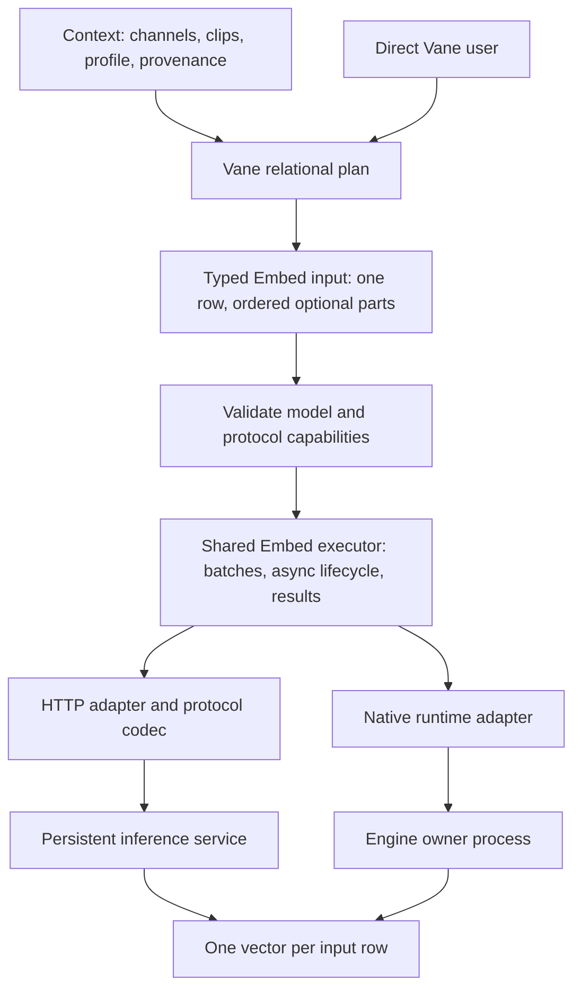
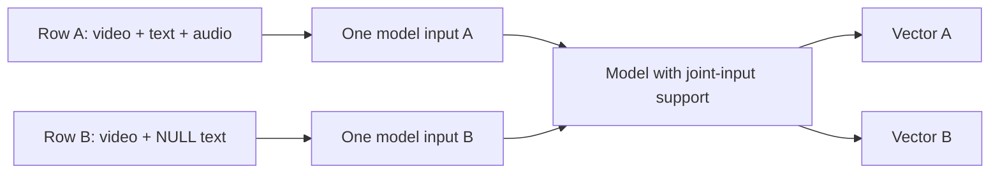
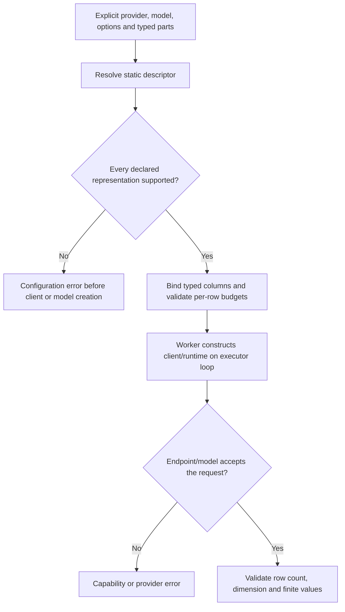
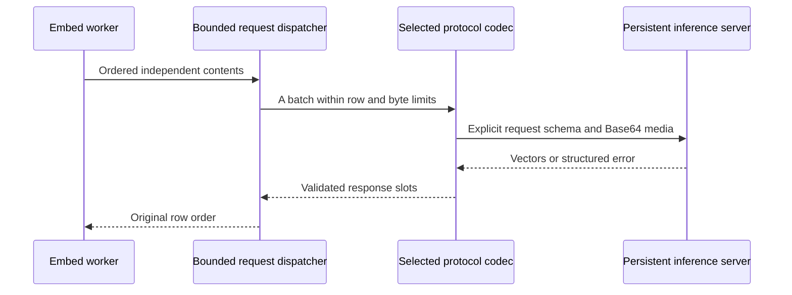
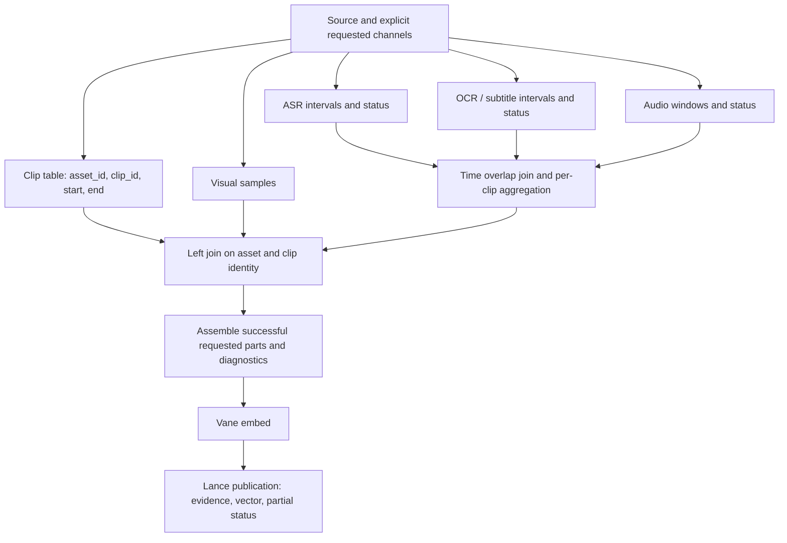
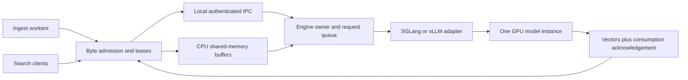
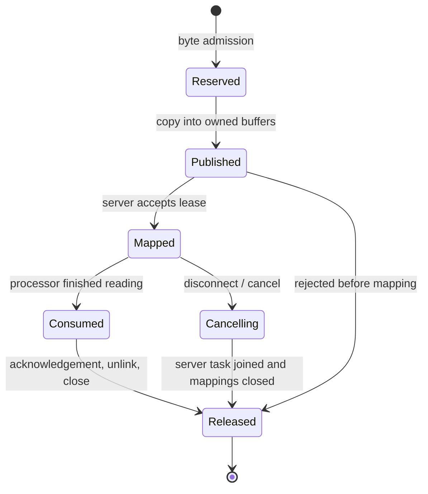

# Unified embedding design and delivery roadmap

Status: milestone 1 implemented; validation results are recorded in the PR. This document separates the target design
from capabilities delivered by each milestone. No compatibility aliases, model
substitution, protocol guessing, or fallback transports are part of the design.

## 1. Problem and decisions

The Python API previously exposed `embed`, `embed_image`, `embed_video` and
`embed_audio`. Joint models additionally lived in `media_models`, outside the
standard embedding expression lifecycle. That duplicated entry points and made
joint batching, request errors and model ownership differ from ordinary Embed.

The public execution API becomes **`vane.ai.embed`** for text, images, video,
audio and combinations. Typed inputs describe content; a provider describes
execution and credentials; a protocol codec describes the actual wire schema;
model metadata describes semantic and resource limits. These are separate axes.

Context continues to own channel extraction policy, clip boundaries, alignment,
provenance and search profiles. Vane executes the relational plan and model
requests. Neither layer invents a fused vector by averaging unrelated spaces.



## 2. Current code and first delivery boundary

Baseline inspection: Vane `43cbcabf7`, Context `647f9fe12` on `context-dev`.
Context's development branch is not the mirror repository's default branch.

| Area | Existing code | First milestone |
| --- | --- | --- |
| Python functions | `vane/ai/functions.py` | One public function and one expression builder |
| Relation helpers and stubs | `_relation_patch.py`, `_native/__init__.pyi` | Only `Relation.embed` |
| Runtime lifecycle | `_EmbeddingBatch`, `_embedding_requests.py` | Reuse for joint inputs; no new event loop |
| Decoded input conversion | `_video_embedding.py`, `_audio_embedding.py` | Preserve typed arrays, timestamps and existing limits |
| Provider metadata | `provider.py`, `protocols.py` | Add explicit multimodal descriptor contract |
| Google | `providers/_google_multimodal.py` | Joint parts and direct encoded media through standard Embed |
| Native SGLang/vLLM | `providers/_native_inference.py` | Existing single decoded modality support via typed inputs |
| Context joint dispatch | `video_runtime.py`, `video_plan.py` | Migrate in milestone 3 |
| SQL functions | `_sql.py`, `src/vane_py/ai_sql_functions.cpp` | Still active; consolidate in milestone 5 |

The local SGLang batching/SHM experiments are evidence for later work, not an
implemented standard provider. They depend on a specific runtime backport and
must not be copied wholesale or described as stock-runtime support.

## 3. Public input contract

```python
from vane.ai import (
    embed, TextInput, ImageInput, VideoInput, AudioInput, MultimodalInput,
)

# A column is a batch of independent rows. Newlines do not create extra inputs.
queries = embed(query_rows, TextInput(vane.col("question")),
                provider="openai", model="text-embedding-3-small")

# Decoded inputs retain their typed representation.
visual = embed(VideoInput(vane.col("frames")),
               provider="sglang", model=video_model, dimensions=dimension)
images = embed(ImageInput(vane.col("image")),
               provider="transformers", model=image_model)
sound = embed(AudioInput(vane.col("audio")),
              provider="transformers", model=audio_model)

# Encoded BLOB: original bytes go to the selected codec without local decoding.
video = VideoInput(vane.col("mp4_bytes"), mime_type="video/mp4")
audio = AudioInput(vane.col("wav_bytes"), mime_type="audio/wav")
image = ImageInput(vane.col("jpeg_bytes"), mime_type="image/jpeg")
joint = embed(MultimodalInput([
    video, TextInput(vane.col("transcript")), audio,
]), provider="google", model="gemini-embedding-2", dimensions=768)
result = clips.select("clip_id", "start_time", "end_time", joint.alias("vector"))
```

The names `video_model`, `image_model`, `audio_model`, and `dimension` above are
explicit deployment configuration, not model inference from the data.

| Input | Decoded representation | Encoded representation |
| --- | --- | --- |
| TextInput | VARCHAR | Not applicable |
| ImageInput | IMAGE, typed pixel storage | BLOB plus explicit image MIME |
| VideoInput | Ordered LIST of frame_index, frame_time, data IMAGE | BLOB plus explicit video MIME |
| AudioInput | STRUCT(sample_rate, data rank-two TENSOR) | BLOB plus explicit audio MIME |

`mime_type=None` selects decoded media. Supplying a MIME selects bytes. Neither
a filename nor a URL masquerades as bytes. Explicit upload/URI references are a
later representation; the first milestone does not fetch arbitrary strings.
Sampling or clipping is explicit upstream work. Already sampled frames must not
silently become a different temporal sequence inside a transport codec.

`MultimodalInput.parts` is an immutable ordered tuple, assembled from a list or
tuple of typed expressions. Each column contributes at most one part per row.
NULL parts and blank text are absent; all absent is a configuration error before
model execution, including with `on_error="ignore"`. Invalid media, bad types
and exceeded input budgets also raise; they are not converted into absent parts.
Single decoded input expressions retain SQL NULL propagation. Use
`MultimodalInput([part])` when nonempty-content enforcement is required.

An absent value does not explain whether extraction failed. Context records that
state separately. A part declared in the plan must be supported even if its
column happens to be all NULL. Optional data does not waive capability checking.

## 4. Cardinality, fusion and vector identity



Combining parts means model-level joint encoding. HTTP requests may contain many
independent inputs but cannot concatenate different rows into one content. A
protocol that accepts only one content per request uses bounded concurrent
requests. Response indices, when present, must be a permutation of input indices;
otherwise the documented ordered response contract must hold.

Independent channel vectors use separate expressions, for example
`embed(VideoInput(...)).alias("visual_vector")` and
`embed(TextInput(...)).alias("speech_vector")`. Scheduling these expressions is
the execution planner's job; writing them next to each other is not a guarantee
of simultaneous GPU execution. Model scheduling and GPU memory still constrain
concurrency.

Context's persisted profile identity must include model/revision, dimensions,
normalization, query/document instructions, processor and sampling configuration,
and the effective protocol representation. Equal dimensions do not establish
space compatibility. Query vectors must use the paired model/profile. A frame
sequence, an encoded video decoded by a server, and text-only content are not
assumed numerically equivalent. Reindexing is explicit when identity changes.

## 5. Capability and provider design

The registry continues to identify providers such as `openai`, `google`,
`transformers`, `sglang` and `vllm`. A model vendor is not an execution provider:
Google's open EmbeddingGemma model served by SGLang belongs to the SGLang runtime.

Single decoded modality factories are internal backend strategies, still used
by SQL and existing models. `get_multimodal_embedder` returns a descriptor with
dimensions, resource requirements and a closed `MultimodalInputSpec`.
The descriptor must be serializable and require no model or network I/O.



Capabilities are the intersection of the model, installed runtime and concrete
API. Supported modalities alone are insufficient: representations, combinations,
counts, byte/token budgets and batching semantics matter. Static facts reject at
planning time. Dynamic mismatches produce explicit runtime errors. No retry may
switch endpoint schemas, models, modalities or transports.

## 6. HTTP codec layer

| Protocol | Row mapping | Media representation | Planned adapter |
| --- | --- | --- | --- |
| OpenAI-compatible text | `input` entries to response indices | Text | Reuse current OpenAI adapter |
| SGLang embedding extension | Independent multimodal objects in `input` | Protocol-supported Base64/Data URLs | SGLang HTTP mode |
| vLLM multimodal embeddings | Endpoint-specific content/messages | Explicit image/video/audio forms supported by that deployment | vLLM HTTP mode |
| Google native embeddings | One Content with ordered parts per row | `inline_data` bytes, explicit MIME | Google provider |

Shared transport owns asynchronous client lifecycle, request admission, timeout,
retry classification, request-byte limits, cancellation and response validation.
Codecs only encode/decode the actual protocol. Model metadata supplies prefixes,
dimensions, processor requirements and limits. A vendor can select different
explicit codecs for different APIs; there is no requirement for one entire
provider implementation per model.

HTTP media uses Base64 when supported. Raw Base64 and Data URLs are different
wire formats. Base64 output-vector encoding is unrelated. Bound the serialized
request, accounting for Base64 expansion, JSON and all rows; bound decoded
memory separately. An oversized input fails without truncation or automatic
upload. Explicit URI/upload modes can be added where documented.



First-milestone Google execution uses the existing async SDK and request runner,
one Content per RPC with bounded concurrency. Encoded video/audio/image bytes
go to `Part.from_bytes` unchanged; the SDK handles Base64. Decoded video retains
the existing timestamped PNG-frame representation, limited to six image/frame
parts per content. Decoded audio is explicitly 16 kHz PCM encoded as WAV with clip-local origin
zero. Callers must put accompanying video timestamps in that same coordinate
system; this API does not infer an audio source offset.
The local input and serialized-content budget is 16 MiB; text has the existing
8,192-byte local bound. These are local guardrails, not claims of service-wide
maximums. The endpoint validates compressed duration and its multimodal token
budget. One video and one audio input per row are supported initially.

Google Gemini Embedding 2's Developer API documents combined parts and ignores
audio embedded in video. Include a separate audio part when wanted. Text-only
retrieval instructions must be configured consistently with queries; don't
prepend them indiscriminately to multimodal text. Google cloud and on-device
EmbeddingGemma models are distinct deployments. See the
[Google embedding guide](https://ai.google.dev/gemini-api/docs/embeddings).

SGLang's embedding extension and vLLM's multimodal request formats require
separate codecs and pinned runtime acceptance. Do not infer identical batch or
audio support from the term OpenAI-compatible. See the
[SGLang embedding API](https://docs.sglang.io/docs/basic_usage/openai_api_embeddings)
and [vLLM embedding API](https://docs.vllm.ai/en/latest/models/pooling_models/embed/).

## 7. Context channel processing and joins

Context selects channels explicitly. This design does not add auto, priority or
fallback policies. Extraction is independent of fusion: ASR produces text; raw
sound remains audio; OCR and subtitles remain text with their time provenance.



Context defines this plan; Vane executes joins and aggregation. Clips are the
left side. Use `(asset_id, clip_id)` or explicit half-open time overlap
`segment.start < clip.end AND segment.end > clip.start`, not positional zip.
Aggregate many matching segments before embedding so one-to-many extraction
does not multiply vectors. Stable ordering and interval clipping/association
must be explicit, including gaps and boundary timestamps.

Persist requested channels, produced channels, participating channels and errors.
No speech is a normal empty result; ASR failure is an error. A surviving visual
part can produce a partial-success fused result while preserving the ASR error.
All parts absent cannot become a zero vector or an unrelated text embedding.
Profile and query pairing remain stable across single ingest, batch ingest,
restart and search. Partial channel success does not authorize replaying an
uncertain atomic Lance write.

## 8. Native Python and shared memory

One persistent engine owner per model configuration serves ingest and search.
SGLang and vLLM adapters run inside that process. Clients send control metadata,
text and descriptors; CPU arrays live in bounded shared memory. Arbitrary Python
engine objects or CUDA tensors are not transported as a general RPC mechanism.



Descriptors include request ID, owner/lease ID, shape, dtype, strides or required
contiguity, byte length, frame timestamps and audio sample rate. Validate bounds
before mapping and prohibit arbitrary path/object deserialization. Access
requires the same supported host/IPC namespace and explicit service identity.



Client timeout alone is not proof the server stopped reading. Reclaim only after
acknowledgement, joined cancellation or owner-death recovery. Bound bytes and
in-flight requests, including abandoned producers. Keep queue wait, copies,
processor time, inference time and cleanup metrics separately. CPU preprocessing
and transfer to GPU can still copy; SHM is not a zero-copy performance promise.
vLLM's internal multimodal SHM cache does not implement this external ingress.

## 9. Errors, observability and cleanup

Configuration errors include unsupported representations, missing dimensions,
empty multimodal rows and invalid input budgets. They stop before model work.
Provider errors preserve the selected model/protocol and credential-safe cause.
Transient retries stay within that exact request contract. `on_error="ignore"`
can yield NULL for provider failures under the existing Embed policy; it never
substitutes another model, content or vector.

Metrics should expose rows, parts/modalities, decoded bytes, serialized bytes,
request count, queue wait, inference/RPC time, retries, failed rows, cancellations
and resource reclamation. No input text, raw media, secrets or upload credentials
should appear in ordinary diagnostics. Context additionally records partial
extraction and atomic write outcomes.

Delete superseded public wrappers, option classes, stubs and examples alongside
their replacements. Keep active SQL/provider internals until their callers are
migrated. Remove the Context-specific joint dispatch and model wrappers in its
migration milestone, not while Context still imports them.

## 10. Roadmap and acceptance gates

Each milestone is independently reviewable. Implementation and formatting come
first; two consecutive clean review passes follow; then only related builds and
tests run. Any code correction resets the review count. Install noneditably.
PRs use the repository template and state limitations and dependencies.

| Milestone | Deliverable | Acceptance | Status |
| --- | --- | --- | --- |
| 1 | Unified Python Embed, all four typed modalities, optional parts, Google joint/direct bytes; remove replaced APIs | Planning without I/O, bounded inputs, row/cardinality and lifecycle tests, real executor with local protocol fixtures, affected typing/examples | Implemented in this PR |
| 2 | Explicit HTTP runtime modes; shared request machinery with SGLang and vLLM codecs | Real installed protocol fixtures, Base64 byte equality, batching/order, malformed/auth/413/cancel cases, pinned model smoke tests | Planned |
| 3 | Context uses unified Embed and explicit channel joins; remove independent joint execution | Single/batch/search, partial ASR/OCR failure, alignment without row multiplication, profile identity, restart/receipts | Planned; depends on 2 |
| 4 | Persistent native service plus shared-memory ingress for SGLang and vLLM | Producer/server failure, cancellation while mapped, byte backpressure, ingest/search share one engine, real processor equality | Planned; depends on 1 and 2 |
| 5 | SQL consolidation and removal of remaining obsolete internal paths | Unified SQL type binding, Python/SQL parity, relevant incremental native build and executor tests | Planned after consumers migrate |
| 6 | Frozen 100-video correctness and performance comparison | Same inputs/checkpoints/sampling, repeated warm runs, vector and provenance parity, request/queue/CPU/GPU breakdown | Planned after 3 and 4 |

Milestone 1 does not claim SGLang HTTP, vLLM HTTP, Context partial-success
migration, shared-memory service, or GPU throughput acceptance. Their worktrees
and design do not imply implementation. Existing single-modality native paths
continue through their actual provider contracts; multi-part unsupported
providers fail explicitly.

Benchmark 6 compares encoded-video service decoding separately from already
sampled identical-frame inputs. Original-video duration, clip count, selected
frames, ASR/OCR settings, concurrency, model/processor identity and hardware must
be recorded. Report preparation, transfer, inference, write and end-to-end time;
include search latency under ingest load. A faster transport that changes model
inputs is not an equivalent implementation.

## 11. Breaking change and dependency plan

Remove the Python names `embed_image`, `embed_video`, `embed_audio`, corresponding
Relation methods and per-modality public option classes. Use typed parts and
`EmbedOptions`. The functional keyword becomes `input=` instead of `text=`.
Do not add aliases, warnings that delegate to old code, or automatic migration.

The SQL functions remain executable because the current native binder uses them;
they are not Python compatibility wrappers. Context's internal descriptor calls
and currently imported joint wrappers remain active until milestone 3 replaces
their consumers. Dependency PRs must pin a Vane build containing the required
contract and use matching native/extension identities. Documentation links should
point to this design instead of duplicating it across repositories.
