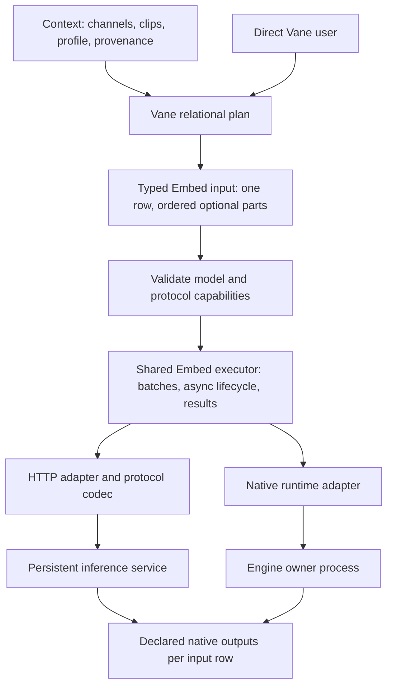
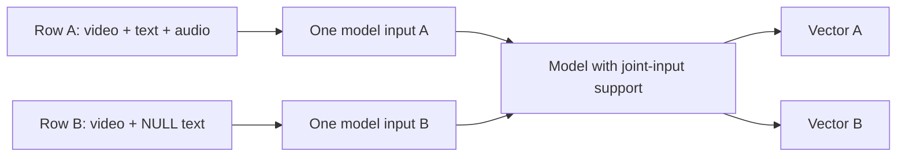
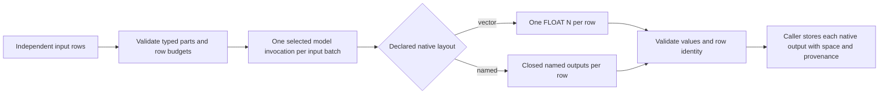
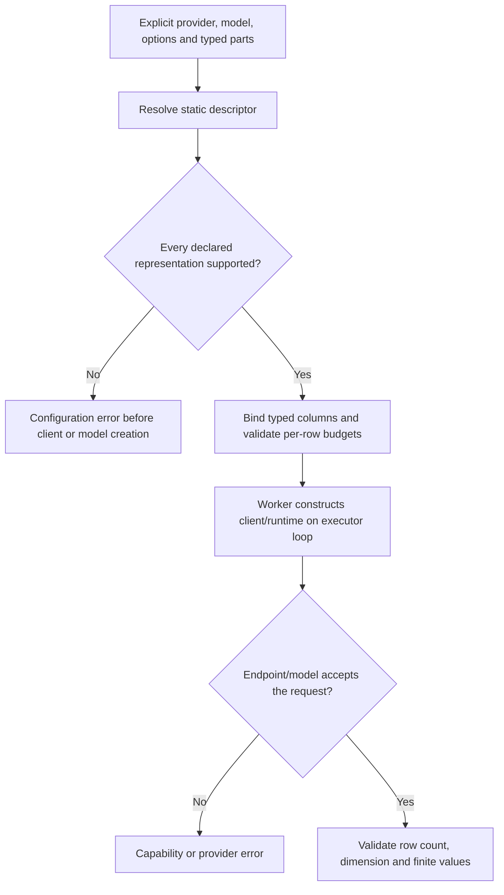
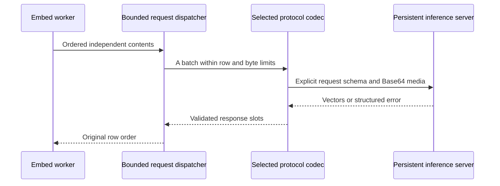
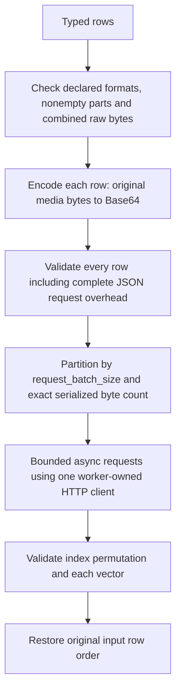
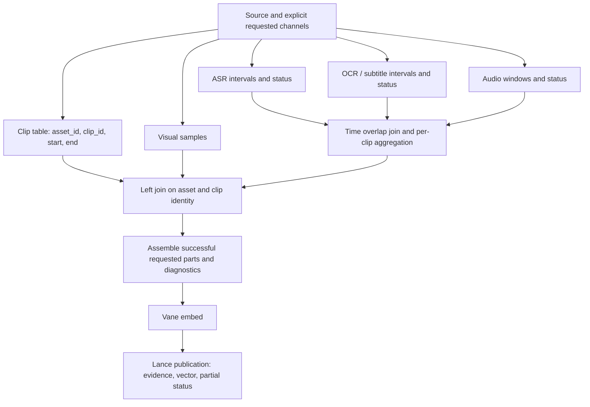
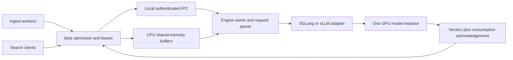
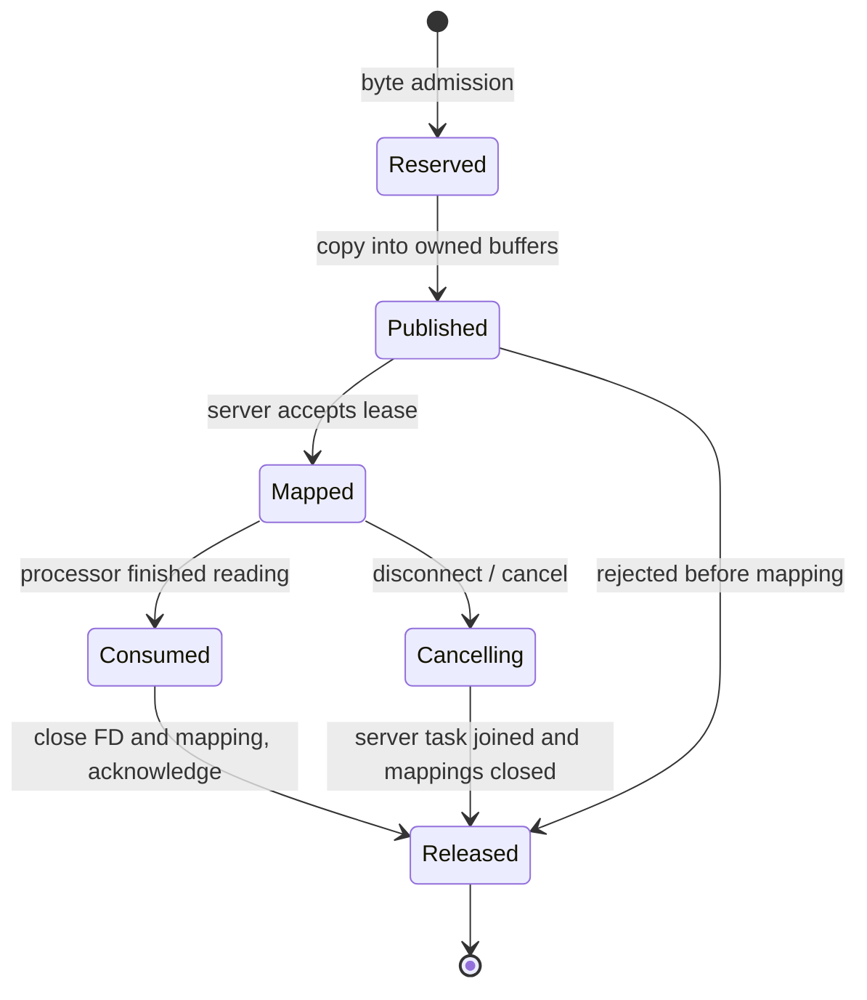
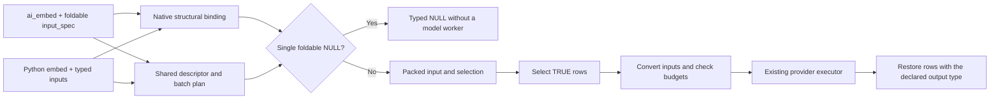

# Unified embedding design and delivery roadmap

Status: Vane milestones 1 (#1024), 2 (#1026), and 4 (#1028) are merged.
SQL consolidation (milestone 5, #1029) targets main directly. Validation results
and runtime acceptance limits are recorded in each PR.
This document separates the target design
from capabilities delivered by each milestone. No compatibility aliases, model
substitution, protocol guessing, or fallback transports are part of the design.

## 1. Problem and decisions

The Python API previously exposed `embed`, `embed_image`, `embed_video` and
`embed_audio`. Joint models additionally lived in `media_models`, outside the
standard embedding expression lifecycle. That duplicated entry points and made
joint batching, request errors and model ownership differ from ordinary Embed.

The public execution API becomes **`vane.ai.embed`** for text, images, video,
audio and combinations. Typed inputs describe content; a provider describes
execution and credentials; a protocol codec describes the actual wire schema;
model metadata describes semantic and resource limits. These are separate axes.

Context continues to own channel extraction policy, clip boundaries, alignment,
provenance and search profiles. Vane executes the relational plan and model
requests. Neither layer invents a fused vector by averaging unrelated spaces.



## 2. Current code and first delivery boundary

Baseline inspection: Vane `43cbcabf7`, Context `647f9fe12` on `context-dev`.
Context's development branch is not the mirror repository's default branch.

| Area | Existing code | First milestone |
| --- | --- | --- |
| Python functions | `vane/ai/functions.py` | One public function and one expression builder |
| Relation helpers and stubs | `_relation_patch.py`, `_native/__init__.pyi` | Only `Relation.embed` |
| Runtime lifecycle | `_EmbeddingBatch`, `_embedding_requests.py` | Reuse for joint inputs; no new event loop |
| Decoded input conversion | `_video_embedding.py`, `_audio_embedding.py` | Preserve typed arrays, timestamps and existing limits |
| Provider metadata | `provider.py`, `protocols.py` | Add explicit multimodal descriptor contract |
| Google | `providers/_google_multimodal.py` | Joint parts and direct encoded media through standard Embed |
| Native SGLang/vLLM | `providers/_native_inference.py` | Existing single decoded modality support via typed inputs |
| Context joint dispatch | `video_runtime.py`, `video_plan.py` | Migrate in milestone 3 |
| SQL functions | `_sql.py`, `src/vane_py/ai_sql_functions.cpp` | One `ai_embed` entrypoint, sharing Python's typed executor plan |

The local SGLang batching/SHM experiments supplied transport evidence. Milestone
2 now implements standard HTTP providers separately; SHM remains milestone 4.
The experimental EmbeddingGemma 2 server uses a model backport, which must not
be described as stock SGLang 0.5.17 model support.

## 3. Public input contract

```python
from vane.ai import (
    embed, TextInput, ImageInput, VideoInput, AudioInput, MultimodalInput,
)

# A column is a batch of independent rows. Newlines do not create extra inputs.
queries = embed(query_rows, TextInput(vane.col("question")),
                provider="openai", model="text-embedding-3-small")

# Decoded inputs retain their typed representation.
visual = embed(VideoInput(vane.col("frames")),
               provider="sglang", model=video_model, dimensions=dimension)
images = embed(ImageInput(vane.col("image")),
               provider="transformers", model=image_model)
sound = embed(AudioInput(vane.col("audio")),
              provider="transformers", model=audio_model)

# Encoded BLOB: original bytes go to the selected codec without local decoding.
video = VideoInput(vane.col("mp4_bytes"), mime_type="video/mp4")
audio = AudioInput(vane.col("wav_bytes"), mime_type="audio/wav")
image = ImageInput(vane.col("jpeg_bytes"), mime_type="image/jpeg")
joint = embed(MultimodalInput([
    video, TextInput(vane.col("transcript")), audio,
]), provider="google", model="gemini-embedding-2", dimensions=768)
result = clips.select("clip_id", "start_time", "end_time", joint.alias("vector"))
```

The names `video_model`, `image_model`, `audio_model`, and `dimension` above are
explicit deployment configuration, not model inference from the data.

| Input | Decoded representation | Encoded representation |
| --- | --- | --- |
| TextInput | VARCHAR | Not applicable |
| ImageInput | IMAGE, typed pixel storage | BLOB plus explicit image MIME |
| VideoInput | Ordered LIST of frame_index, frame_time, data IMAGE | BLOB plus explicit video MIME |
| AudioInput | STRUCT(sample_rate, data rank-two TENSOR) | BLOB plus explicit audio MIME |

`mime_type=None` selects decoded media. Supplying a MIME selects bytes. Neither
a filename nor a URL masquerades as bytes. Explicit upload/URI references are a
later representation; the first milestone does not fetch arbitrary strings.
Sampling or clipping is explicit upstream work. Already sampled frames must not
silently become a different temporal sequence inside a transport codec.

`MultimodalInput.parts` is an immutable ordered tuple, assembled from a list or
tuple of typed expressions. Each column contributes at most one part per row.
NULL parts and blank text are absent; all absent is a configuration error before
model execution, including with `on_error="ignore"`. Invalid media, bad types
and exceeded input budgets also raise; they are not converted into absent parts.
Single decoded input expressions retain SQL NULL propagation. Use
`MultimodalInput([part])` when nonempty-content enforcement is required.
Standalone `TextInput` also preserves empty and whitespace-only strings for the
selected model, including native and service execution. Its UTF-8 byte budget
still applies. The transport validates types and budgets; it does not apply the
multimodal omission rule to a standalone text input.

An absent value does not explain whether extraction failed. Context records that
state separately. A part declared in the plan must be supported even if its
column happens to be all NULL. Optional data does not waive capability checking.

The Apple Silicon `mlx` provider supports four independent decoded input kinds
for `mlx-community/embeddinggemma-2-bf16` at revision
`1a4ffddb7905d3f63486748deabe091a01fb6201`. Each produces one normalized
768-dimensional vector in the paired checkpoint space. Descriptor construction
needs no SDK/model access; a subprocess actor loads BF16 weights on Metal with
`num_gpus=0`, since Vane GPU resources identify CUDA devices. Text retains its
explicit document/query roles. Image, audio and video options carry no text role.

Audio accepts mono float32/float64 `(samples, 1)` PCM at 16 kHz, 161–480000
samples, at most 4 MiB and finite values in `[-1, 1]`. Video accepts 1–12 RGB
uint8 HWC frames with equal H/W per clip, at most 16 Mi pixels per frame and
64 MiB per clip. Indices strictly increase; finite nonnegative times are
nondecreasing. The SDK does no further frame sampling and receives no injected
timestamp tokens. Audio masks, video grids and full expanded token budgets are
validated before model forward, with truncation disabled. Unsupported short
audio tails fail; valid silence remains an audio input.

Context selects separate text/image/video/sound profiles, preserves source
locators and saves the actual PNG/PCM used for retrieval. Text queries pair with
audio/video, and image queries pair with video. This adapter supplies no joint
encoding, ASR, OCR or Analyze model, and adds no query schema. Model failures
follow the existing fatal/publication semantics. See [MLX qualification](DEVELOPMENT.md#incremental-package-build)
for fixed dependencies, real SDK/Metal tests and input decoding extras.

## 4. Cardinality, fusion and vector identity



Combining parts means model-level joint encoding. HTTP requests may contain many
independent inputs but cannot concatenate different rows into one content. A
protocol that accepts only one content per request uses bounded concurrent
requests. Response indices, when present, must be a permutation of input indices;
otherwise the documented ordered response contract must hold.

Independent channel vectors use separate expressions, for example
`embed(VideoInput(...)).alias("visual_vector")` and
`embed(TextInput(...)).alias("speech_vector")`. Scheduling these expressions is
the execution planner's job; writing them next to each other is not a guarantee
of simultaneous GPU execution. Model scheduling and GPU memory still constrain
concurrency.

Context's persisted profile identity must include model/revision, dimensions,
normalization, query/document instructions, processor and sampling configuration,
and the effective protocol representation. Equal dimensions do not establish
space compatibility. Query vectors must use the paired model/profile. A frame
sequence, an encoded video decoded by a server, and text-only content are not
assumed numerically equivalent. Reindexing is explicit when identity changes.

### Native output descriptors

This is the Vane foundation of the Context ingestion roadmap's native-output
milestone. Context's consumer work is a separate change: persist output names,
spaces and channel provenance, pair search encoders, then remove its
`separate`/`fused`/`both` mode branches. The descriptor does not perform that
storage or pipeline migration. Existing HTTP/native-service codecs continue to
declare a single vector; a multi-output wire protocol requires its own adapter.

Every embedding descriptor exposes `get_output_spec(dimensions=...)` without
model loading or network access. The `EmbeddingOutputSpec` declares a native
`vector` or `named` layout and a closed tuple of `EmbeddingOutput` declarations.
Each output has a stable name, positive dimension, provider-owned semantic
`space`, contributing `source_modalities` and an explicit `optional` flag.
Source modalities describe input provenance; they are independent of Context's
ASR/OCR/subtitle channel names and of the number of independent request rows.

The existing built-in adapters return a single `embedding` vector in their
model's space. Their result remains `FLOAT[N]`. A descriptor with named native
outputs returns `STRUCT(name FLOAT[N], ...)`, with independently declared sizes
and spaces. A named result may contain one output or several. Every result row
must contain exactly the declared keys; only optional outputs may be NULL. At
least one output must be present. Non-NULL outputs must have contributing input
parts in that row. No model implementation is given new output capabilities by
this contract; the named-output acceptance uses an authored provider fixture.

```python
from vane.ai import EmbeddingOutput, EmbeddingOutputSpec

# Implemented by a model adapter that actually returns these two outputs.
outputs = EmbeddingOutputSpec(
    (
        EmbeddingOutput("joint", 768, "model-revision/joint", ("video", "audio", "text")),
        EmbeddingOutput("sound", 512, "model-revision/sound", ("audio",), optional=True),
    ),
    layout="named",
)
```

The same typed output passes through expression, Relation and SQL Embed APIs.
NULL/unselected rows retain the whole result's type and do not call a model.
Shape, keys, dimensions, finite values, input provenance and row cardinality are
validated before exposure. `normalize=True` normalizes each native output
independently. A malformed named result nulls the whole input row under
`on_error="ignore"`; it does not partially accept malformed outputs or repeat
an otherwise attributable row. Resource failures remain fatal and sanitized.

Named outputs reject scalar `dimensions=` and character chunk averaging. Their
dimensions are the native descriptor's per-output declarations. Single-vector
models retain explicit size overrides without consulting the default size.
Query and document descriptors must explicitly identify compatible output
spaces; a name/dimension match alone does not establish compatibility. Context
must persist the selected deployment, model revision, preprocessing, role,
output space/name and actual channel contributors with every stored output.



## 5. Capability and provider design

The registry continues to identify providers such as `openai`, `google`,
`transformers`, `sglang` and `vllm`. A model vendor is not an execution provider:
Google's open EmbeddingGemma model served by SGLang belongs to the SGLang runtime.

Single decoded modality factories are internal backend strategies, still used
by SQL and existing models. All embedding descriptors share the native output contract. `get_multimodal_embedder` returns a descriptor with
dimensions, resource requirements and a closed `MultimodalInputSpec`.
The descriptor must be serializable and require no model or network I/O.



Capabilities are the intersection of the model, installed runtime and concrete
API. Supported modalities alone are insufficient: representations, combinations,
counts, byte/token budgets and batching semantics matter. Static facts reject at
planning time. Dynamic mismatches produce explicit runtime errors. No retry may
switch endpoint schemas, models, modalities or transports.

## 6. HTTP codec layer

| Protocol | Row mapping | Media representation | Planned adapter |
| --- | --- | --- | --- |
| OpenAI-compatible text | `input` entries to response indices | Text | Reuse current OpenAI adapter |
| SGLang embedding extension | Independent multimodal objects in `input` | Protocol-supported Base64/Data URLs | SGLang HTTP mode |
| vLLM multimodal embeddings | Endpoint-specific content/messages | Explicit image/video/audio forms supported by that deployment | vLLM HTTP mode |
| Google native embeddings | One Content with ordered parts per row | `inline_data` bytes, explicit MIME | Google provider |

Shared transport owns asynchronous client lifecycle, request admission, timeout,
retry classification, request-byte limits, cancellation and response validation.
Codecs only encode/decode the actual protocol. Model metadata supplies prefixes,
dimensions, processor requirements and limits. A vendor can select different
explicit codecs for different APIs; there is no requirement for one entire
provider implementation per model.

HTTP media uses Base64 when supported. Raw Base64 and Data URLs are different
wire formats. Base64 output-vector encoding is unrelated. Bound the serialized
request, accounting for Base64 expansion, JSON and all rows; bound decoded
memory separately. An oversized input fails without truncation or automatic
upload. Explicit URI/upload modes can be added where documented.



First-milestone Google execution uses the existing async SDK and request runner,
one Content per RPC with bounded concurrency. Encoded video/audio/image bytes
go to `Part.from_bytes` unchanged; the SDK handles Base64. Decoded video retains
the existing timestamped PNG-frame representation, limited to six image/frame
parts per content. Decoded audio is explicitly 16 kHz PCM encoded as WAV with clip-local origin
zero. Callers must put accompanying video timestamps in that same coordinate
system; this API does not infer an audio source offset.
The local input and serialized-content budget is 16 MiB; text has the existing
8,192-byte local bound. These are local guardrails, not claims of service-wide
maximums. The endpoint validates compressed duration and its multimodal token
budget. One video and one audio input per row are supported initially.

Google Gemini Embedding 2's Developer API documents combined parts and ignores
audio embedded in video. Include a separate audio part when wanted. Text-only
retrieval instructions must be configured consistently with queries; don't
prepend them indiscriminately to multimodal text. Google cloud and on-device
EmbeddingGemma models are distinct deployments. See the
[Google embedding guide](https://ai.google.dev/gemini-api/docs/embeddings).

SGLang's embedding extension and vLLM's multimodal request formats require
separate codecs and pinned runtime acceptance. Do not infer identical batch or
audio support from the term OpenAI-compatible. See the
[SGLang embedding API](https://docs.sglang.io/docs/basic_usage/openai_api_embeddings)
and [vLLM embedding API](https://docs.vllm.ai/en/latest/models/pooling_models/embed/).

### 6.1 Implemented SGLang / vLLM HTTP mode

Install `vane-ai[embedding_http]` on clients and workers. HTTP execution reserves
zero worker GPUs and imports neither inference runtime. Keep the inference
service running independently. `runtime="native"` remains the default;
`runtime="http"` requires an explicit `base_url`, served `model`, and output
`dimensions`. For text/multimodal formats the base URL includes the API prefix (usually `/v1`),
and the codec appends `/embeddings`. SGLang's explicit `encode` format instead
uses a server-root base URL and appends `/encode`. It does not discover endpoints or change formats on error.

```python
from vane.ai import MultimodalInput, TextInput, VideoInput, embed
from vane.ai.providers.sglang import SGLangProvider

# Set SGLANG_API_KEY in the application environment when authentication is needed.
# The provider captures credentials before any subprocess/Ray serialization.
provider = SGLangProvider()
service = dict(
    provider=provider,
    model="served-multimodal-model",       # explicit deployed model identity
    dimensions=768,                        # declared output size, checked on return
    runtime="http",
    base_url="http://localhost:30000/v1",
    http_input_format="multimodal",
    media_mime_types=["video/mp4"],          # formats enabled for this deployment
    batch_size=8,                          # rows per Vane execution batch
    request_batch_size=1,                  # SGLang multimodal default: one row per HTTP request
    max_concurrency_per_actor=4,
    max_input_bytes=16 * 1024**2,           # original bytes per row, summed over parts
    max_request_bytes=32 * 1024**2,         # entire serialized HTTP request
    timeout=60.0,
)
documents = clips.select(
    "clip_id",
    embed(MultimodalInput([
        VideoInput(vane.col("mp4_bytes"), mime_type="video/mp4"),
        TextInput(vane.col("transcript")),
    ]), **service).alias("vector"),
)
queries = questions.select(embed(TextInput(vane.col("query")), **service).alias("vector"))
```

`http_input_format="text"` (default) sends a batch of plain strings. Explicit
`"multimodal"` applies the service's multimodal template even to text-only query
rows, so query and document profile settings can stay paired. No retrieval
instruction is inserted automatically. Deploy a matching model, processor and
template on the server; declare supported media formats in `media_mime_types`.
This declaration is an application contract, not model capability discovery.
The server enforces its model's combinations, token counts and media limits.

SGLang also supports `http_input_format="encode"` for its native HTTP endpoint.
It carries encoded video and raw audio together, including WAV/MP3 Base64 data
URLs. This endpoint is separate from `/v1/embeddings`, whose schema still has no
audio field. Select it explicitly; Vane does not change endpoints on an error.
For an EmbeddingGemma 2 deployment, configure:

```python
runtime="http",
base_url="http://localhost:30000",  # server root, without /v1
http_input_format="encode",
media_mime_types=["video/mp4", "audio/wav"],
http_media_tokens={"video": "<|video|>", "audio": "<|audio|>"},
```

`/encode` does not apply a chat template. `http_media_tokens` supplies the exact
model-specific placeholders for every declared media modality. Vane prepends one
marker for each present media part, in input order, then the supplied text; absent
parts add no marker. Text containing configured markers is rejected to prevent
ambiguous media counts. Retrieval instructions remain explicit input text; no
model names, prefixes or tokens are inferred. Select a new profile/storage when
changing the wire format or template, as those choices affect vector identity.

Single-row calls send `text`, `image_data`, `video_data`, and `audio_data`, with
unused media set to null; a batch uses matching column lists. The response is a
single object or an input-ordered list with `embedding` and `meta_info` fields.
Raw/serialized budgets, bounded async concurrency, retries, error redaction and
vector validation use the existing HTTP lifecycle. Both SGLang multimodal and
encode formats default to one row per HTTP request because they share the
server's media-preparation lifecycle; explicitly larger batches require deployment
validation. No SGLang code change is needed.

For SGLang's multimodal HTTP format, `request_batch_size` defaults to **1**, with
up to **4** concurrent requests per actor (`max_concurrency_per_actor`). This
also applies to text-only queries using that format. SGLang 0.5.17 can lose
completed request state while preparing later media rows in a multirow request,
causing an HTTP 500. Concurrent single-row requests avoid that lifecycle race
and let the persistent server batch inference. Vane's `batch_size=8` still
processes eight rows per execution batch; it does not put eight clips in one
HTTP request. Text format and vLLM retain a default `request_batch_size` of **8**.
An explicit `request_batch_size` overrides these defaults for deployments whose
multirow behavior has been validated. Dispatch is selected before requests are
sent; it does not probe server versions or change strategy after a failure.

| Contract | SGLang 0.5.17 | vLLM 0.31 |
| --- | --- | --- |
| Text format | `input: [string, ...]` | `input: [string, ...]` |
| Multimodal format | `input: [{text, image, video}, ...]` | `messages: [[{role, content}], ...]`, one conversation per row |
| Encoded image | PNG / JPEG Base64 data URL | PNG / JPEG Base64 data URL |
| Encoded video | MP4 / MOV / WebM / NUT Base64 data URL | MP4 / MOV / WebM / NUT Base64 data URL |
| Encoded audio | Rejected before execution; embedding schema has no audio field | WAV / MP3 `input_audio`, raw Base64 plus format |
| Decoded image | Lossless PNG when `image/png` is declared | Same |
| Decoded video / PCM | Rejected; no implicit transcoding or resampling | Same |
| Part cardinality/order | At most one nonempty text, image and video per row; named fields, ordering owned by server template | Ordered content parts, at most 16 per row |

The pinned schemas are
[SGLang EmbeddingRequest](https://github.com/sgl-project/sglang/blob/v0.5.17/python/sglang/srt/entrypoints/openai/protocol.py)
and [vLLM EmbeddingBatchChatRequest](https://github.com/vllm-project/vllm/blob/v0.31.0/vllm/entrypoints/pooling/embed/protocol.py).
These versions are wire targets, not promises that every model accepts every
listed MIME type. In particular, SGLang's schema cannot carry two text parts;
Context must explicitly assemble its ASR/subtitle/OCR text before embedding.
An optional absent part is omitted; a second present part is never discarded.
Both protocols require response indices to be a full permutation of input rows.



`max_input_bytes` defaults to 16 MiB per row; `max_request_bytes` defaults to
32 MiB per request and includes Base64 expansion, Unicode/JSON escaping, model
metadata, commas and all rows. Either byte limit can be set up to 256 MiB.
All rows in the current Vane batch are validated before creating a client or
issuing any request. Request packing reduces rows per request to stay within
the limit. One oversized row raises `EmbeddingConfigurationError`, including
with `on_error="ignore"`. Memory admission is per execution batch and per
worker, not a shared global quota; total prepared media scales with `batch_size`
and active workers. Request concurrency defaults to four per worker.

Output `dimensions` is a declaration by default; set
`supports_overriding_dimensions=True` only for a deployed model that accepts a
dimension override. Responses are float vectors with exact length and finite
values. Native engine/processor arguments are rejected in HTTP mode; configure
them on the independently managed server.

The existing request runner handles bounded retries, `Retry-After`, cancellation
and row error attribution. With `on_error="ignore"`, genuine remote 400/413/422
batch rejections may isolate smaller batches using the same codec and model;
authentication/account failures and exhausted transient errors do not fan out.
Local validation never enters this error policy. Cancellation drains the local
HTTP tasks before executor cleanup; it is not an acknowledgement that remote GPU
work has stopped. No shared-memory lease is involved in this transport.

Use `vane.ai.load_provider("sglang", api_key=...)` /
`vane.ai.load_provider("vllm", api_key=...)`, the corresponding provider
constructors, or the respective
`SGLANG_API_KEY` / `VLLM_API_KEY` on the application, for optional bearer auth.
Keys are captured and redacted like other provider descriptors. Workers do not
read ambient OpenAI credentials or proxy settings; redirects are not followed.
Serialized descriptors still contain the actual credential; use the existing
trusted worker boundary.

## 7. Context channel processing and joins

Context selects channels explicitly. This design does not add auto, priority or
fallback policies. Extraction is independent of fusion: ASR produces text; raw
sound remains audio; OCR and subtitles remain text with their time provenance.



Context defines this plan; Vane executes joins and aggregation. Clips are the
left side. Use `(asset_id, clip_id)` or explicit half-open time overlap
`segment.start < clip.end AND segment.end > clip.start`, not positional zip.
Aggregate many matching segments before embedding so one-to-many extraction
does not multiply vectors. Stable ordering and interval clipping/association
must be explicit, including gaps and boundary timestamps.

Persist requested channels, produced channels, participating channels and errors.
No speech is a normal empty result; ASR failure is an error. A surviving visual
part can produce a partial-success fused result while preserving the ASR error.
All parts absent cannot become a zero vector or an unrelated text embedding.
Profile and query pairing remain stable across single ingest, batch ingest,
restart and search. Partial channel success does not authorize replaying an
uncertain atomic Lance write.

## 8. Native Python and shared memory

One persistent engine owner per model configuration serves ingest and search.
SGLang and vLLM adapters run inside that process. Clients send control metadata,
text and descriptors; CPU arrays live in bounded shared memory. Arbitrary Python
engine objects or CUDA tensors are not transported as a general RPC mechanism.



Descriptors include request ID, owner/lease ID, shape, dtype, strides or required
contiguity, byte length, frame timestamps and audio sample rate. Validate bounds
before mapping and prohibit arbitrary path/object deserialization. Access
requires the same supported host/IPC namespace and explicit service identity.



Client timeout alone is not proof the server stopped reading. Reclaim only after
acknowledgement, joined cancellation or owner-death recovery. Bound bytes and
in-flight requests, including abandoned producers. Keep queue wait, copies,
processor time, inference time and cleanup metrics separately. CPU preprocessing
and transfer to GPU can still copy; SHM is not a zero-copy performance promise.
vLLM's internal multimodal SHM cache does not implement this external ingress.

### Explicit service configuration

Milestone 4 implements `runtime="service"` for the registered `sglang` and
`vllm` providers. The existing default `runtime="native"` still constructs an
engine in each owning UDF worker; `runtime="http"` remains the separate encoded
media protocol. There is no transport detection, local-engine startup by a
service client, or fallback. A service client reserves zero worker GPUs.

Install `vane-ai[embedding_service]` in the service and client environments. The
transport uses PyZMQ over loopback TCP and Python `SharedMemory` on Windows,
macOS and Linux. Each native model SDK still determines which systems can host
its engine; the transport does not make SGLang or vLLM engines portable.
The generic Vane `subprocess_actor` / `subprocess_task` launcher still uses POSIX
file-descriptor passing. This service transport replacement does not qualify
those execution backends on Windows.

Create a private directory (`0700` on POSIX, a user-private ACL on Windows) and
start one process per model configuration. This POSIX example uses `/tmp`;
on Windows use an absolute path in a private user directory:

```bash
mkdir -m 700 /tmp/my-embedding
python -m vane.ai.embedding_service --config service.json
```

`service.json` (replace the model, dimension and engine options with those of
the supported checkpoint):

```json
{
  "path": "/tmp/my-embedding/engine.json",
  "service_id": "retrieval-model-revision-1",
  "family": "sglang",
  "model": "my-supported-embedding-checkpoint",
  "dimensions": 768,
  "max_bytes": 268435456,
  "max_inflight": 8,
  "max_connections": 128,
  "publication_timeout": 30,
  "options": {
    "input_modalities": ["text", "image", "video"],
    "max_frames": 64,
    "max_input_bytes": 67108864,
    "engine_args": {"tp_size": 1}
  }
}
```

For vLLM use `family="vllm"` and `engine_args.tensor_parallel_size=1`.
The same native adapters target SGLang 0.5.17 / vLLM 0.31, as the in-process
path does. Runtime support for a checkpoint and every declared modality is
still required. A transport implementation does not add a model to either
runtime's model registry. In particular, the earlier EmbeddingGemma 2 benchmark
used a local SGLang backport; this change does not ship that backport.

Both clients use the same endpoint and identity:

```python
from vane.ai import MultimodalInput, TextInput, VideoInput, embed

service = dict(
    provider="sglang", model="my-supported-embedding-checkpoint", dimensions=768,
    runtime="service", service_path="/tmp/my-embedding/engine.json",
    service_id="retrieval-model-revision-1",
)
clip_vector = embed(MultimodalInput([
    VideoInput(vane.col("frames")), TextInput(vane.col("transcript")),
]), **service)
query_vector = embed(TextInput(vane.col("query")), **service)
```

The native joint adapter renders the ordered parts once, then submits one
embedding request per row. SGLang receives one combined `processor_output`
bundle with the original processor token IDs; duplicating it across modality
fields would duplicate visual/audio tensors. vLLM receives `multi_modal_data`
and explicit processor arguments. Compatible requests overlap on the persistent
engine and its scheduler batches them; an Arrow batch is not a single fused
document. Separate image/audio inputs use this same transport. Audio requires
`"audio"` in `input_modalities`, explicit `sample_rate` and `max_samples` on
both service and client, and mono decoded floating PCM. Resample/downmix before
embedding. Unsupported media, encoded BLOBs and conflicting processor options
fail explicitly. Native joint audio uses the Transformers `audio` processor
argument; model-specific custom processor contracts are not inferred.

### Transport and lease ownership

PyZMQ STREAM sockets carry length-prefixed control records over loopback TCP.
STREAM delivers bounded TCP chunks without assembling peer-controlled ZMTP
multipart messages. A four-byte length is checked before buffering the body:
authentication records are at most 64 bytes, and authenticated records contain
at most 1 MiB of JSON plus a 32-byte HMAC. Receive high-water marks bound queued
chunks, and each connection permits only a reservation, its publication and a
signed receipt after the terminal response. A terminal error before publication
also requires that receipt; it never permits another reservation.
This completion handshake uses rendezvous protocol `vane-embedding-stream-3`;
install matching service/client packages and restart the service when upgrading.
After byte/count admission, the server allocates a named `SharedMemory` block and
returns its name and size. The client copies decoded arrays and UTF-8 text into
that block, closes its mapping and publishes the request. The server takes a private snapshot,
validates it and gives the snapshot to the native processor. Named shared memory
has no write seals: the private snapshot keeps later producer writes from
changing data while the processor reads it. The previous Unix socket/memfd
protocol has been removed; there is no transport selection or fallback.

Text shares the buffer with decoded media, so the separate 1 MiB JSON control
limit and JSON escaping do not limit text rows. Offsets must be contiguous,
nonoverlapping and cover the complete buffer. Frame indices/timestamps and
sample rate remain metadata; text descriptors contain only offsets and lengths.
Video timelines preserve strictly increasing frame indices and nondecreasing
timestamps, including repeated timestamps. Processor-specific timing constraints
are checked separately. `max_input_bytes` bounds the combined input bytes.
Service admission charges **twice** that size for the shared block and private
snapshot; configure `max_bytes` accordingly. Empty text consumes one admission
byte/slot without allocating a block. Invalid UTF-8 fails before model work.
Neither side accepts media paths, pickles, arbitrary objects or CUDA handles.

`path` / `service_path` names a private rendezvous JSON file containing a random
loopback TCP endpoint and a fresh authentication key. A bounded mutual HMAC
challenge-response authenticates each connection before JSON processing. The
fresh server challenge and client request ID bind the proof and session key to
that connection; every request and response uses the session key for its HMAC.
Proofs and signed records cannot be replayed on a different connection. This is
authentication without encryption. On POSIX the file must be owned by the current
UID with mode `0600` in a private directory; Windows relies on the directory's
user-private ACL. Keep that file private. This remains a trusted same-user, same-host boundary.
Ray workers must run on the service host with access to the file and shared
memory. Remote endpoints and arbitrary multi-node placement are unsupported.
`service_id`, family, model and dimensions must match. Choose a new service ID
when processor/checkpoint options change. Existing rendezvous files are never
replaced automatically: after an ungraceful exit, remove the stale file only
after confirming its service has stopped.

The server owns each block through request completion. Clients attach without
resource-tracker ownership, so an independently launched client exiting cannot
unlink the server's block. Python 3.13+ uses `track=False`; older supported POSIX
versions attach directly to the existing mapping without registering a tracker.
Both attachment paths validate Darwin's allocation against the requested length
rounded up to `mmap.PAGESIZE`, while retaining exact lengths on Linux and the
existing allocation-granularity allowance on Windows. Clients can access only
the logical input bytes; page padding is never published as input.
Windows releases a block when its last handle closes. POSIX service allocations
remain registered with Python's resource tracker for cleanup after owner death.
No cleanup can reclaim a Windows block still held by another live process.

`publication_timeout` bounds unfinished authentication, the initial control
request, admission waiting and the subsequent wait for publication from stalled
clients. Disconnects before a complete valid publication abort those waits and
release any reservation without waiting for that deadline. Once a complete valid
publication commits, its queue handoff and inference drain even if EOF, repeated
handler cancellation, shutdown or the publication deadline occurs before the
handler resumes. Publication is accepted only while the reservation is ready;
starting abort cleanup closes that gate before yielding. Accepted requests retain
their buffers and credits until the model coroutine finishes. A stuck model retains
credits because timeout does not prove reading stopped. Graceful shutdown drains
accepted work before closing the engine and removing the rendezvous file.
After receiving a complete terminal response, the client sends its signed
receipt and waits for server EOF before returning or reporting the error.
The server then returns the connection slot without waiting for client EOF.
This receipt also prevents STREAM close from discarding a queued terminal
response. A missing receipt expires within `publication_timeout`.
`max_connections` bounds tracked peers and waiting metadata; byte and in-flight
limits include accepted requests whose clients have gone away. Limits govern
ingress buffers, not processor allocations, unrelated applications or GPU memory.

Client metrics record queue/admission, copy and request time plus input bytes.
Service metrics record queue, request/model and cleanup time plus counts. The
native adapter also measures local processor preparation time; vLLM processing
inside its engine remains included in model time. These counters do not claim
GPU kernel timing or a zero-copy path. Input/configuration errors and model/host
OOM are fatal even with `on_error="ignore"`; other provider failures may yield
NULL. The public Embed wrappers preserve allocation failures from initialization,
inference and vector conversion; they do not isolate/replay rows or substitute
NULL for these failures. The service client never retries an individual request
after uncertain completion, even when Embed's `max_retries` is configured.
Native request retries and NULL substitution also stop on allocation failures.
The common classifier retains ENOMEM/ENOSPC and recognized model allocator
errors through cause chains and sanitized diagnostics, including failures
during socket setup, shared-memory publication and vector conversion.
Ray's enclosing task/fragment retry policy is independent and may start a new
request; exhausting those attempts still aborts the query on a resource error.

Native image inputs retain Vane's UInt8, UInt16 and Float32 IMAGE modes and
pixel values for the selected processor, including `do_rescale=False` for
already scaled Float32 input. Native validation enforces image shape, finite
pixels, declared modalities and the combined row byte budget. The shared-memory
service's wire format separately requires uint8 RGB images and video frames;
choosing the native runtime does not apply that transport restriction.

## 9. Errors, observability and cleanup

Configuration errors include unsupported representations, missing dimensions,
empty multimodal rows and invalid input budgets. They stop before model work.
Provider errors preserve the selected model/protocol and credential-safe cause.
Transient retries stay within that exact request contract. `on_error="ignore"`
can yield NULL for provider failures under the existing Embed policy; it never
substitutes another model, content or vector.

Metrics should expose rows, parts/modalities, decoded bytes, serialized bytes,
request count, queue wait, inference/RPC time, retries, failed rows, cancellations
and resource reclamation. No input text, raw media, secrets or upload credentials
should appear in ordinary diagnostics. Context additionally records partial
extraction and atomic write outcomes.

Delete superseded public wrappers, option classes, stubs and examples alongside
their replacements. Keep active SQL/provider internals until their callers are
migrated. Remove the Context-specific joint dispatch and model wrappers in its
migration milestone, not while Context still imports them.

## 10. Roadmap and acceptance gates

Each milestone is independently reviewable. Implementation and formatting come
first; two consecutive clean review passes follow; then only related builds and
tests run. Any code correction resets the review count. Install noneditably.
PRs use the repository template and state limitations and dependencies.

| Milestone | Deliverable | Acceptance | Status |
| --- | --- | --- | --- |
| 1 | Unified Python Embed, all four typed modalities, optional parts, Google joint/direct bytes; remove replaced APIs | Planning without I/O, bounded inputs, row/cardinality and lifecycle tests, real executor with local protocol fixtures, affected typing/examples | Merged in #1024 |
| 2 | Explicit HTTP runtime modes; shared request machinery with SGLang and vLLM codecs | Real installed protocol fixtures, Base64 byte equality, batching/order, malformed/auth/413/cancel cases, pinned model smoke tests | Merged in #1026; exact acceptance and model limits recorded in its validation |
| 3 | Context uses unified Embed and explicit channel joins; remove independent joint execution | Single/batch/search, partial ASR/OCR failure, alignment without row multiplication, profile identity, restart/receipts | Implemented in Context #91; includes fatal resource classification and partial channel diagnostics |
| 4 | Persistent native service plus shared-memory ingress for SGLang and vLLM | Producer/server failure, cancellation while mapped, byte backpressure, ingest/search share one engine, real processor equality | Merged in #1028; CPU protocol/processor acceptance, GPU model and 100-video measurement remain milestone 6 |
| 5 | SQL consolidation and removal of remaining obsolete internal paths | Unified SQL type binding, Python/SQL parity, relevant incremental native build and executor tests | Implemented in #1029, targeting main |
| 6 | Frozen 100-video correctness and performance comparison | Same inputs/checkpoints/sampling, repeated warm runs, vector and provenance parity, request/queue/CPU/GPU breakdown | Planned after 3 and 4 |

Milestones 2–4 add explicit transports, unified Context integration and a
persistent native service. Their CPU acceptance is not a throughput result.
The frozen 100-video benchmark remains milestone 6, after model/runtime
qualification. Unsupported checkpoint/modality combinations fail explicitly.

Benchmark 6 compares encoded-video service decoding separately from already
sampled identical-frame inputs. Original-video duration, clip count, selected
frames, ASR/OCR settings, concurrency, model/processor identity and hardware must
be recorded. Report preparation, transfer, inference, write and end-to-end time;
include search latency under ingest load. A faster transport that changes model
inputs is not an equivalent implementation.

## 11. Breaking change and dependency plan

Remove the Python names `embed_image`, `embed_video`, `embed_audio`, corresponding
Relation methods and per-modality public option classes. Use typed parts and
`EmbedOptions`. The functional keyword becomes `input=` instead of `text=`.
Do not add aliases, warnings that delegate to old code, or automatic migration.

SQL now exposes only `ai_embed`; `ai_embed_image`, `ai_embed_video`,
`ai_embed_audio` and their separate hidden validators are removed. The modality
descriptor interfaces remain active for models supporting only one modality;
both public APIs use one shared executor-plan builder. Context's embedding
consumers migrated in milestone 3. Dependency PRs must pin a Vane build containing the required
contract and use matching native/extension identities. Documentation links should
point to this design instead of duplicating it across repositories.

## Conditional rows in a shared pipeline

`embed(..., where=boolean_expression)` preserves every input row and returns
NULL for FALSE/NULL predicates. Only TRUE rows pass through embedding input
conversion, byte/frame validation and provider execution. Configuration and
logical input types remain validated for the plan; arbitrary SQL expressions
are still evaluated normally. A selected multimodal row with no content still
fails, including with `on_error="ignore"`.

This supports several profile columns in one pipeline without repeating upstream
ASR/OCR work or sending missing inputs to a model. A non-NULL struct carries the
predicate and typed fields through binding; the worker filters it before input
conversion, then restores vector positions. An entirely unselected batch never
instantiates its provider client. Existing task/actor lifecycle, cancellation,
normalization, retries and credentials remain owned by Embed.

## Unified SQL embedding

```sql
-- A bare value is text, as in Python embed(col("text")).
SELECT ai_embed(text, provider := 'openai', model := 'text-embedding-3-small') FROM documents;

-- Decoded frames: no encoding or implicit file reads.
SELECT ai_embed(frames, input_spec := {kind: 'video'},
    provider := 'sglang', model := 'your-supported-checkpoint', dimensions := 768,
    options := {runtime: 'service', service_path: '/tmp/my-embedding/engine.json',
                service_id: 'retrieval-model-revision-1'}) FROM clips;

-- Encoded bytes use an explicit MIME type and a protocol supporting it.
SELECT ai_embed(video_bytes, input_spec := {kind: 'video', mime_type: 'video/mp4'},
    provider := 'google', model := 'gemini-embedding-2') FROM clips;

-- One joint vector per selected row; field order matches the specification.
SELECT clip_id, ai_embed({clip: video_bytes, transcript: text},
    input_spec := [{kind: 'video', mime_type: 'video/mp4'}, {kind: 'text', mime_type: NULL}],
    "where" := selected, provider := 'google', model := 'gemini-embedding-2') AS vector FROM clips;
```

`input_spec` is a foldable STRUCT for one typed input, or a nonempty LIST of
STRUCTs for an explicit multimodal input. Each part has `kind` and an optional
`mime_type`; other fields are rejected. A list requires an input STRUCT with
exactly one field per part, in declaration order. Field names are local labels.
Even a one-part list selects multimodal semantics. Omitted/NULL `input_spec`
means text. Prepared statement parameters are supported; per-row layouts are not.

Without a MIME type, `image` requires IMAGE, `video` requires ordered frame
records, and `audio` requires decoded PCM with its sample rate. With a MIME
type, media requires BLOB. The provider/model must explicitly support the
declared representations; the binder neither decodes nor reads files.
`provider` defaults to `openai` for every layout, matching Python.

`"where"` defaults to TRUE and accepts BOOLEAN/NULL without implicit casts.
Input logical types and model capabilities are checked during planning even
for FALSE/NULL predicates. Only selected rows undergo conversion and budget
checks. A non-NULL packed struct protects optional constant NULLs from native
NULL folding. Missing joint parts are omitted; selected all-empty content is
an input error, including with `on_error := 'ignore'`. A foldable single text or
decoded-media NULL is reduced to a typed NULL result after input, predicate and
model configuration validation. It leaves no model UDF or GPU requirement in the
execution plan, matching Python. Joint and encoded-media inputs keep nonempty
content validation. SQL options retain the inline-credential prohibition and
the connection's actor execution backend.



The existing model/protocol configuration chooses HTTP, native, or service
transport. This SQL change does not qualify new checkpoints or measure GPU
throughput; those remain milestone 6. Run the installed SQL embedding tests,
existing Prompt/Embed SQL tests, affected typed embedding tests and related
Ray executor cases after the incremental native build.

```python
rows = rows.embed(
    MultimodalInput([VideoInput(vane.col("video"), "video/mp4"),
                     TextInput(vane.col("transcript"))]),
    provider=provider, model=model, dimensions=dimensions,
    where=vane.col("profile") == vane.ConstantExpression("joint"),
)
```

Context milestone 3 uses this row selection in a linear plan. The current
Ray translator treats materialized CTE subtrees as native scan sources, so a
CTE containing distributed UDFs fails resource registration. This change adds
no CTE fallback or native planner bypass.
