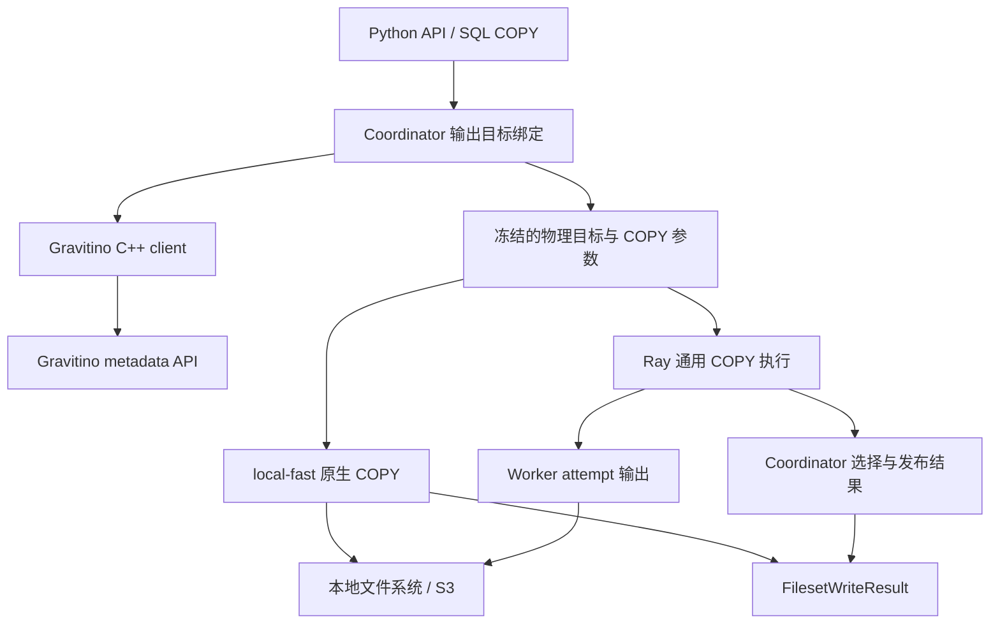

# Vane Gravitino 详细设计与 Roadmap

状态：M1/M2 Fileset v1 实现与专项验收完成，尚未发布 provider。更新日期：2026-10-22。

M1/M2 设计与验收跟踪：[AstroVela/vane#1060](https://github.com/AstroVela/vane/issues/1060)。

本文确定 Vane 下一阶段的 Gravitino 集成方向：**先完成 Fileset 数据写入，再补元数据发现，随后接入 Iceberg REST 读取与写入。认证扩展、credential vending 和凭据自动刷新后置。** 每个阶段独立交付，以正确性和故障测试通过作为稳定发布条件。

当前已实现的行为以 [Gravitino 使用说明](GRAVITINO.md) 为准。本文后续阶段的接口、数据结构、里程碑和验收要求属于目标设计，不能作为已发布能力说明。构建、安装、测试与发布沿用 [DEVELOPMENT.md](DEVELOPMENT.md) 和 [RELEASE.md](RELEASE.md)，本文只规定本功能的实施范围与验收要求。

实施进展：M0 文档已完成；M1 已加入输出绑定、local-fast `write_files`、本地目录准备和精确结果结构。M2 已加入 Ray S3 写入、committed manifest 精确清单、Parquet/CSV 分区与空输入、并发批次、worker 丢失重试、用户中断及提交未知/结果不可用验证。worker 计划无 Gravitino token、attachment 或 GVFS 目标，重试只使用冻结的物理路径。返回值保留通用 COPY 的清理状态与诊断；actor 丢失后的 pending teardown 限制见第 8.5 节。

真实 Gravitino `1.3.0` 的本地写入、S3 分区写入与 Ray 写读共 12 项已通过固定镜像的 Docker 验收。S3 使用 HTTP 对象存储模拟器，真实 metadata catalog 配置 `disable-filesystem-ops=true`，不代表已完成生产对象存储性能或兼容性验证。可安装 base/provider、COPY/fsspec 回归和基础发布测试的验证记录见第 13 节。M3 及后续阶段尚未实现；认证扩展继续后置。第 2 节能力表保留实施前的调研基线。

## 1. 设计结论

1. 保留现有 C++ Catalog、FileSystem 和 Python 薄封装。Gravitino 负责资源发现与位置解析，数据读写交给 Vane 现有文件格式和执行引擎。
2. Fileset 写入复用普通 COPY 管线。先实现 Parquet/CSV 的新增输出批次，不实现目录替换、文件原地追加或 Fileset 事务。
3. 在 coordinator 上完成写入授权检查、位置选择与路径解析；同一次执行的所有 task、attempt 和 finalize 使用同一个物理目标。
4. 提供返回本次成功输出文件清单的写入接口。Ray 的清单来自已提交的 selected attempts；普通目录 glob 仍是文件枚举，不具有提交可见性语义。
5. Iceberg 使用原生格式能力与标准 Iceberg REST Catalog 协议。先验证与 Vane DuckDB fork 匹配的 provider，再谈功能发布。
6. 继续支持已有静态 Bearer token 和显式存储配置；新增认证方式、凭据托管和自动刷新不进入前几个里程碑。

首个稳定交付目标是：用户能从一个 Fileset 读取数据，在 local-fast 或 Ray 上处理，写入另一个 Fileset，并准确读取这次写入产生的结果。

## 2. 调研基线与当前能力

本次代码基线：

| 项目 | 基线 | 用途 |
| --- | --- | --- |
| Vane | `95acdea830eb1fff407f0e09f4b97ee7b0a02e83` | 判断现有实现与需要修改的边界 |
| Daft | [`00259b898aa9f173c0d087bc3f6ee0f1f3566edb`](https://github.com/Eventual-Inc/Daft/commit/00259b898aa9f173c0d087bc3f6ee0f1f3566edb) | 本次调研取得的 main 快照；固定引用避免分支变化 |
| Gravitino 服务端测试 | 仓库 CI 固定的 `1.3.0` 镜像及 digest | 已有兼容性证据 |
| Gravitino 协议参考 | 官方 `1.3.1` 文档 | 设计参考；不等于已通过该版本兼容性测试 |

Vane 已有能力如下，不能重复作为新增项目计算工作量：

| 能力 | 当前状态 | 主要依据 |
| --- | --- | --- |
| 连接现有 FILESET catalog | 已有；不创建远端 catalog | [gravitino_catalog.cpp](external/duckdb/extension/gravitino/gravitino_catalog.cpp) |
| schema/Fileset 元数据管理 | 已有创建、发现、修改、删除等入口，具体操作范围见使用说明 | [vane/catalog.py](vane/catalog.py) |
| Fileset 文件发现与读取 | 已有原生 `FILE`、`gravitino_files`、GVFS 读取；支持绝对本地路径与 S3 | [gravitino_functions.cpp](external/duckdb/extension/gravitino/gravitino_functions.cpp)、[gravitino_client.cpp](external/duckdb/extension/gravitino/gravitino_client.cpp) |
| named locations | 已有确定性选择与缺失报错 | [gravitino_client.cpp](external/duckdb/extension/gravitino/gravitino_client.cpp) |
| Fileset 内容写入 | 未实现；GVFS 文件系统明确拒绝写入 flags | [gravitino_filesystem.cpp](external/duckdb/extension/gravitino/gravitino_filesystem.cpp) |
| Ray 文件读取 | 已有 coordinator 解析、worker 使用物理路径的路径 | [分布式扩展契约](DISTRIBUTED_EXTENSIONS.md) |
| RELATIONAL catalog 表扫描 | 当前 Gravitino attach 不支持 | [gravitino_catalog.cpp](external/duckdb/extension/gravitino/gravitino_catalog.cpp) |
| 认证与存储访问 | 可选静态 Bearer token；存储凭据由 Vane 单独配置 | [GRAVITINO.md](GRAVITINO.md) |
| 自动化验证 | 有模拟服务、真实 Gravitino、local-fast/Ray 读取与元数据测试 | [test_gravitino.py](tests/fast/test_gravitino.py)、[test_gravitino_live.py](tests/fast/test_gravitino_live.py) |

现有 Ray 普通 COPY 已具备不可变 attempt 输出、selected-attempt finalization 和提交结果分类。新增 Fileset 写入应接入这些能力，避免再创建一套调度和提交协议。参见 [普通 COPY 写入](DISTRIBUTED_EXTENSIONS.md#ordinary-copy-format-file-writes)、[copy_outcome.py](vane/runners/copy_outcome.py) 和 [committed_copy.py](vane/runners/ray/committed_copy.py)。

## 3. 从 Daft 参考什么

| Daft 代码中的做法 | Vane 的设计选择 |
| --- | --- |
| Gravitino 层发现资源，然后分派给已有格式实现；当前包含 Postgres、Iceberg、Hive/Parquet 路径 | 采用这层职责划分。Fileset 使用文件读写，Iceberg 使用 Iceberg provider |
| GVFS 对接已有对象存储的读取、写入、列举能力 | 复用 Vane 的 FileSystem 与 COPY，先解决输出目标绑定 |
| Python Arrow 输出流通过 `BytesIO` 缓冲文件后写出 | Vane 使用原生流式 COPY；内存消耗不应随整个输出文件大小增长 |
| GVFS client/location 有缓存 | 第一版不引入跨执行位置缓存；先保证 prepared statement 和元数据更新的可见性 |
| namespace/table 创建删除、Gravitino Iceberg append/overwrite 仍有未实现入口 | 不将这些入口视为已成熟的通用 catalog CRUD 或 Iceberg 写入方案 |

依据为固定版本的 [catalog 实现](https://github.com/Eventual-Inc/Daft/blob/00259b898aa9f173c0d087bc3f6ee0f1f3566edb/daft/catalog/__gravitino/_catalog.py)、[Python 文件系统](https://github.com/Eventual-Inc/Daft/blob/00259b898aa9f173c0d087bc3f6ee0f1f3566edb/daft/io/gravitino_filesystem.py) 和 [Rust GVFS 实现](https://github.com/Eventual-Inc/Daft/blob/00259b898aa9f173c0d087bc3f6ee0f1f3566edb/src/daft-io/src/gravitino.rs)。这里参考的是代码行为，不能用连接器文档里的功能名称推断所有格式都支持读写。

Vane 的取舍是优先完成已有原生 Fileset 路径，并把 Ray 故障语义作为发布条件；暂不为对齐功能列表同时加入多个数据库连接器。

## 4. 第一版范围与不变量

### 4.1 支持范围

首个稳定版本包括：

- 已存在的 FILESET catalog、schema 和 Fileset；已有元数据 API 仍可单独使用。
- Parquet、CSV 输出；首批存储为 local-fast 的本地文件系统和 S3，Ray 的 S3 共享存储。
- 每次写入创建独立输出批次；同一 Fileset 可容纳多次执行的结果。
- 返回精确文件清单、行数和恢复所需的运行标识。
- local-fast 与 Ray 使用相同业务接口，保持各自实际支持的故障与可见性语义。

第一版不包含 Fileset 根目录覆盖、已有文件替换、原地 append、跨 Fileset 原子操作、跨查询 exactly-once、自动删除历史批次、自动创建 schema/Fileset。MANAGED 和 EXTERNAL Fileset 的数据写入路径相同，删除语义继续由现有元数据 API 和服务端决定。

### 4.2 必须保持的不变量

| 编号 | 不变量 |
| --- | --- |
| I1 | `gvfs://fileset/<alias>/<schema>/<fileset>/...` 的 alias 始终是当前连接的 attachment 名称 |
| I2 | `READ_ONLY`、事务限制、路径与格式检查在任何写入副作用之前完成 |
| I3 | 同一次执行的解析结果冻结；task 重试不得重新查询 Gravitino 并切换位置 |
| I4 | 新一次执行重新绑定位置；不复用上次 prepared execution 的根目录或结果文件 |
| I5 | worker 不接收 Gravitino attachment 或 token，不查询 Gravitino |
| I6 | 结果清单只包含本次成功发布的文件；不通过扫描整个输出目录拼装结果 |
| I7 | 元数据写入、文件输出发布、Iceberg catalog commit 是三个不同操作，不互相充当成功证明 |
| I8 | 已提交但结果不可取、提交结果未知都不得触发整次写入自动重跑 |
| I9 | 关闭或删除 attachment、修改 Fileset 元数据不能成为正在执行任务的隐式重定向机制 |
| I10 | 所有新增 API 都经过现有 runner；不把 Ray 不支持的操作悄悄转为 local-fast |

## 5. 组件结构



Gravitino 扩展负责标识解析、元数据协议与 Fileset 约束。通用 COPY 负责格式编码、分片输出、统计与结果发布。Python 封装只组织参数和返回值，不传输数据行，不缓冲整个文件，不创建独立的 Gravitino Python SDK 执行通道。

Iceberg 属于另一条格式与 catalog 路径，不能通过把 Fileset 中的 Parquet 文件 glob 出来实现。

## 6. 对外 API 设计

以下为 Fileset v1 的目标接口。M1 已实现无分区的 local-fast 路径；启用的能力与限制见使用说明，后续阶段仍需对应验收。

### 6.1 推荐入口：写入独立批次

在现有 `GravitinoCatalog` 上新增：

```python
result = catalog.write_files(
    relation,
    schema="features",
    name="embeddings",
    path="daily/2026-10-22",
    format="parquet",
    compression="zstd",
)

# 精确读取这次成功写入的文件；不会纳入其他批次或失败 attempt。
written = connection.read_parquet(list(result.files))
```

拟议签名：

```python
class GravitinoCatalog:
    def write_files(
        self,
        relation: DuckDBPyRelation,
        schema: str,
        name: str,
        path: str = "",
        *,
        format: Literal["parquet", "csv"] = "parquet",
        compression: str | None = None,
        partition_by: Sequence[str] | None = None,
    ) -> FilesetWriteResult: ...
```

接口约束：

- `relation` 必须属于该 catalog 的连接；不隐式搬运另一连接的数据或重新解释 relation SQL。
- `path` 是 Fileset 内的相对输出前缀。每次调用在此前缀下分配独立、不可复用的运行目录；空值也不会直接覆盖 Fileset 根目录。
- 新批次包含新数据文件，不修改以前批次。重复调用会产生两个批次，不具有业务去重含义。
- 第一版没有 `overwrite`、调用方指定 `run_id` 或删除后重写选项。
- `partition_by` 按 COPY 的列名和类型规则验证；其发布门槛包含分区文件名与路径边界测试，可在最初实验版本明确拒绝，在稳定版启用。
- `compression=None` 使用对应格式默认值；具体 codec 仅接受已加载 COPY provider 支持的值。
- 第一版不开放任意 `**kwargs` 绕过输出模式、文件命名或返回统计约束。CSV 固定为 UTF-8、逗号分隔并包含 header；后续通过显式参数增加配置。
- 该方法执行一次并返回结果，不返回一个可能因多次求值而重复写入的懒执行 relation。

输出目录和 part 文件名属于实现细节。调用方使用结果中的文件清单和恢复字段，不拼接内部 attempt/manifest 路径。

### 6.2 结果结构

`FilesetWriteResult` 是新增的不可变元数据对象。稳定版至少包含：

| 字段 | 类型 | 语义 |
| --- | --- | --- |
| `logical_path` | `str` | 请求的 GVFS 输出前缀，用于展示来源 |
| `location_name` | `str` | 本次绑定实际选中的 named location |
| `format` | `str` | 实际写入格式 |
| `files` | `tuple[str, ...]` | 本次成功结果的精确物理文件路径，顺序不代表数据行顺序 |
| `rows_written` | `int` | 对成功文件汇总的行数，不累加失败 attempts |
| `bytes_written` | `int` | 成功文件的字节数，不包含废弃 attempts 和控制文件 |
| `operation_id` | `str` | 用于定位本次调用和错误的标识；不是跨执行幂等键 |
| `base_path` | `str` | 恢复或检查工具使用的物理输出基址 |
| `run_id` | `str \| None` | 通用 COPY 发布协议的标识；没有该协议时为 `None` |
| `manifest_path` | `str \| None` | 存在持久提交 manifest 时返回；local-fast 不伪造此保证 |
| `cleanup_state` | `Literal["complete", "pending"]` | COPY runner 的清理状态；不改变数据提交状态 |
| `cleanup_warnings` | `tuple[str, ...]` | 原有 COPY 协议产生的清理诊断；调用方保留结果后独立处理 |

只在成功后构造该对象。若结果不完整，返回明确错误，不返回伪成功的空文件列表。

返回物理路径是为了固定本次写入对象：后续 Fileset location 改变，不应让旧结果悄悄读到新目录。旧文件仍可能被外部删除或修改，结果对象不等于不可变存储快照。接口不包含 Gravitino token 或存储密钥。

`files` 保存字面文件名，不把文件名转成 glob 表达式。读取方若会自动展开 glob，遇到注册根中的特殊字符时需要使用字面路径入口，例如 `vane.open_file` 配合格式 reader；文件清单本身不改变已有格式 reader 的路径解释规则。

### 6.3 现有 writer 与 SQL

`write_parquet`、`write_csv` 及 SQL COPY 继续使用既有执行通道和返回类型；不把当前返回 `None` 的 Python writer 改成 `FilesetWriteResult`。新的返回值通过 `catalog.write_files` 和底层内部 COPY 结果接口提供。

直接使用 GVFS 的 SQL COPY 和 writer 必须经过同一个输出绑定入口。第一版只开放经过验证的目录追加组合，例如 SQL 中的目录输出、`APPEND` 和生成唯一文件名；文件替换、单个固定文件路径和覆盖选项在执行前拒绝。不同组合的支持列表随实现写入 [GRAVITINO.md](GRAVITINO.md)。

`write_file(path, format=...)` 当前没有完整 COPY 选项面，不能仅因格式存在就宣称所有 GVFS 输出组合已支持。推荐入口负责建立固定的批次和目录语义。

普通目录追加的可见性仍按 COPY 行为解释。需要稳定批次结果时使用 `write_files` 返回的清单或已有 manifest reader。

## 7. 输出绑定与路径设计

### 7.1 为什么需要绑定阶段改动

现有 [bind_copy.cpp](external/duckdb/src/planner/binder/statement/bind_copy.cpp) 会根据输出字符串决定 remote/local、临时文件与存在性检查，再构造格式 bind data。仅放开 `GravitinoFileSystem::OpenFile` 写入检查，会让这些决策仍看到 `gvfs://`，并可能把依赖 attachment 的路径交给 worker。

M1 引入通用、带操作意图的 `FileSystem::ResolveWriteTarget` 输出目标解析入口。现有 `CanonicalizePath` 不能直接代替它，因为字符串规范化本身不验证 attachment 的写入权限和输出模式。

普通文件系统默认保留已有路径和行为。通用入口返回类似以下的 coordinator 侧绑定结果：

```text
FileWriteTarget
  path
  requires_rebind
  properties
```

M1 的通用结构只包含物理路径、重绑定要求与 provider 自己解释的诊断属性。Gravitino 在属性中返回 `location_name`；输出模式使用传入的 COPY 信息校验，remote/local 策略继续由 COPY 判断。结构中不放 token，通用 FileSystem 不解释 Gravitino 字段。worker 只接收完成校验的物理输出与必要的 COPY 参数。

实现这个 hook 时需要同时考虑 SQL COPY 和 relation-backed COPY。不能先把 relation 转成 SQL 字符串再重建查询，否则可能丢失不可 SQL 化的数据源或执行状态。

有 `CopyFunction::plan` 的格式可能在普通 COPY 绑定前执行计划改写。这类路径也必须走输出校验，或在第一版明确拒绝 GVFS 输出，不能绕过 hook。首批范围限定为已验证的 Parquet/CSV。

### 7.2 绑定顺序

1. 识别当前连接的 attachment、schema、Fileset 和请求的输出模式。
2. 检查 `READ_ONLY`、auto-commit、参数、路径和格式能力；禁止未支持的覆盖组合。
3. 从 Gravitino 获取 Fileset 元数据并校验返回对象，确定 location。
4. 构造物理根与输出前缀；随后才计算 remote/local 策略、临时文件策略和格式 bind data。
5. 让绑定后的 COPY、序列化内容、worker sink 和 finalize 全部使用同一物理路径。
6. 执行准备阶段分配本次输出命名空间，验证 provider/存储模式后启动任务。

绑定阶段允许只读元数据请求，不创建目录、占位文件、manifest 或远端资源。`EXPLAIN` 和 `PREPARE` 不能制造写入副作用。

Gravitino attachment 已声明无需在隔离规划环境和 worker 上重放。新增输出必须保持该契约：不仅替换最终 `file_path`，还要审计 `CopyInfo`、格式 bind data 和可序列化逻辑计划中的残留 GVFS 字符串。若某条计划路径必须重新解析 attachment，第一版就应拒绝该路径，不能把 token 加入 worker 快照绕过问题。

### 7.3 位置选择和路径规则

保留现有选择顺序：attachment 的 `LOCATION_NAME`，否则 Fileset 的 `default-location-name`，否则 Gravitino 1.3 的保留名称 `unknown`。指定的名称不存在则报错，不任取 map 中第一个条目。

保留 `s3a://` 到 `s3://` 的转换和已实现的 Hadoop 本地路径处理。注册根目录按字面处理，不能把其中的 `*`、`?` 或 `[]` 当作 glob。相对路径保持现有 NUL、绝对路径、反斜线、`.`/`..`、百分号转义等限制；写入路径额外拒绝 glob 通配符。

输出 part 名称由 COPY 生成，分区值必须通过已有编码机制生成并验证；不得允许分区值或自定义名称逃逸出该执行的输出前缀。存在于注册根中的字面特殊字符与用户请求的输出 glob 需要分别处理，避免误伤现有合法读取。

这里提供的是路径拼接约束，不是操作系统沙箱。符号链接、挂载点和外部服务端的权限仍由实际存储系统控制。

### 7.4 新鲜度、事务与并发修改

使用带 GVFS 输出的 prepared statement 时，每次 `EXECUTE` 重新绑定并校验写权限。一次执行内复用已经解析的目标，不因任务失败、结果获取或 finalize 再次解析。第一版不建立跨执行 location cache。

Fileset 内容写入与现有远端元数据写入一样要求 auto-commit；明确事务中的写入在产生副作用前失败。普通 SQL `ROLLBACK` 无法撤回对象存储写入。

若管理员在执行期间修改 location 或删除 Fileset，本次执行仍使用已绑定目标；存储对象被删除时正常失败。Vane 不持有 Gravitino 远端租约，也不承诺对并发管理操作实现可串行化。需要修改或删除活跃 Fileset 时，由任务调度和管理流程协调。

低层 `GravitinoFileSystem::OpenFile` 的任意写入不能成为绕过上述检查的入口。第一版可继续拒绝原始 GVFS 写 handles，由完成绑定的 COPY 向物理文件系统写出；一般文件系统 delete/move/append 能力不属于本阶段。

## 8. 写入、失败和可见性语义

### 8.1 local-fast

每次 helper 调用写入独立目录，使用原生 COPY 的目录输出与文件统计。必须收集本次 COPY 返回的真实文件记录，而不是写完后列目录推测结果。

本地目录在目标、模式与 COPY 格式/源绑定校验之后准备：先创建缺失的输出前缀祖先目录，再由 COPY 创建本次独立运行目录。对象存储前缀不需要创建目录。该准备属于写入执行，不属于 EXPLAIN/PREPARE 等只读绑定。

第一版 local-fast 的保证是成功调用返回精确文件集。它不额外承诺持久 manifest、目录级原子发布或进程崩溃后的自动恢复。中途失败可能留下部分输出；清理范围只能是本次调用拥有的文件，不得删除整个用户前缀。

如果本地 COPY 已完成但 Python 结果转换失败，也必须报告“已写入但结果不可用”，不能自动再次执行 relation。S3 单文件成功不等于整个批次成功。

### 8.2 Ray

沿用 [通用 COPY](DISTRIBUTED_EXTENSIONS.md#ordinary-copy-format-file-writes) 的执行协议：

1. coordinator 为本次 COPY 分配输出命名空间。
2. 每个 task attempt 写入自己的不可变对象；失败重试使用不同路径。
3. coordinator 只选择最终有效 attempts 的文件记录。
4. 通用 finalizer 发布 manifest/commit 状态。
5. 确认成功后，Python 从该执行结果构造 `FilesetWriteResult`。

不新增 Gravitino 专属 Ray task 类型，不让每个 worker 调用 Gravitino，不调用元数据修改 API 充当文件提交。

首版稳定支持 S3 共享命名空间。Ray 下的 node-local 输出不纳入稳定 Fileset 结果接口，因为 coordinator 和后续读者可能无法访问那些文件。共享 POSIX 文件系统需单独验证现有 COPY 支持的发布模式与跨节点可见性；单机 Ray 的本地路径测试不足以证明多机支持。

### 8.3 状态与返回约定

| 状态 | 可以证明的事实 | 对外行为 |
| --- | --- | --- |
| `VALIDATED` | 参数、元数据、模式和计划校验完成，尚无输出 | 失败可修正配置后重新发起 |
| `WRITING` | 可能已经生成部分文件 | task 级重试按现有 COPY 契约；不自动重新提交整个调用 |
| `PUBLISHING` | Ray 正在发布 selected files 的结果 | 发布失败需分类，不能一概视为未写入 |
| `COMMITTED` | Ray 发布成功，或 local-fast COPY 确认完成 | 返回精确结果；两种 backend 的持久恢复能力不同 |
| `FAILED` | 已知执行未成功完成 | 返回原始原因和可用的运行标识；可能有残留文件 |
| `UNKNOWN` | 无法确定发布是否成功 | 保留可能已发布的文件，抛出 outcome-unknown 错误 |

复用 [CopyOutcomeUnknownError 与 CopyResultUnavailableError](vane/runners/copy_outcome.py) 的分类，不把它们包装成普通可重试网络错误。local-fast 的结果转换路径若缺少同等表达，应在通用 COPY 层补齐，而不是在 Gravitino helper 中捕获异常后重跑。

### 8.4 读者看到什么

| 读取方式 | 保证 |
| --- | --- |
| 读取成功返回的 `result.files` | 只读取本次确认成功的文件 |
| 读取 Ray 已提交 manifest | 只读取该 manifest 选择的文件 |
| `catalog.files(...)`、递归 glob 或第三方直接列举目录 | 看到物理上存在的匹配文件，可能包含其他批次、失败 attempt 或未提交输出 |

第一版不改变 `catalog.files` 的枚举语义，不让目录浏览暗中承担事务读取职责。需要一致的批次读取时必须使用明确清单。需要长期表快照、并发事务或覆盖语义时，进入 Iceberg 路径。

S3 的文件存在性检查与随后写入之间有竞争窗口，不能靠 `exists` 后 `PUT` 宣称原子排他创建。独立执行命名空间用于避免覆盖；内部随机 ID 也不是跨查询业务幂等键。对象存储复制再删除不能作为目录原子 rename。

### 8.5 空输入、取消和恢复

Parquet 空输入默认写出合法的零行文件以保留 schema；CSV 空输入写出 header，列类型由读取方显式指定，不能宣称 CSV 保留了完整类型。结果必须为 `rows_written=0`，文件清单来自实际 writer 行为。分区空输入若不能产生可读取结果，实验版明确拒绝，稳定版必须补齐该行为。

取消任务后，停止调度新 attempts；仅在可以证明输出属于本次执行且未被发布引用时清理。cleanup 失败是次级诊断，不能掩盖最初错误或改写提交状态。取消与 commit 竞争时，以通用 COPY 观察到的提交结果为准：已提交可返回成功 receipt，不能在返回后仅因中断标志仍存在而改报失败。

worker 丢失后，有剩余执行容量时验证 task 重试与 selected files。全部 worker 丢失不承诺自动恢复集群。已有 Ray teardown 在 actor 丢失后可能保留待清理控制状态：若数据已提交，receipt 返回 `cleanup_state="pending"` 和诊断，随后关闭连接仍可能报清理错误。这不允许重跑 COPY；通用 Ray 生命周期清理的改进独立跟踪，不在 Gravitino 层绕过 ownership fence。

Ray 恢复复用 [committed_copy.py](vane/runners/ray/committed_copy.py) 的检查与人工处置入口。观察到 `UNCOMMITTED` 不足以证明此前 marker 写入失败。强制 abort 是显式放弃本次结果的操作，须确认原始 COPY 已停止；它不是 exactly-once fence，也不能作为 helper 的自动重试步骤。

第一版不引入后台 GC。孤立 attempt 的长期清理需要后续独立生命周期设计，并区分已提交、已知失败和结果未知。

### 8.6 错误与诊断

保留底层元数据、存储与 COPY 的原始错误分类，在可获得时附加 `operation_id`、执行阶段、输出基址和 `run_id`。参数错误、资源不存在、格式未支持应与执行失败、已提交但结果不可用、提交结果未知区分。只有通用 COPY 的结果分类可以决定重试建议，不能根据错误文本中包含 timeout 就重试。

日志不记录完整请求 headers、token 或存储密钥。继续沿用现有 Gravitino 元数据 mutation 不自动重试的行为；新增文件写入不改变该规则。性能诊断记录元数据解析耗时、输出统计与 finalize 耗时，便于分辨控制面和数据面瓶颈。

## 9. 元数据发现扩展

Fileset 写入稳定后，补 metalake 范围的 catalog、schema、table 发现，缩小与 Daft 在资源浏览方面的差距。

现有 `GravitinoCatalog` 表示已经 attach 的 FILESET catalog，不改变这个含义。新增独立、连接绑定的 `GravitinoMetalake` 元数据入口，复用 C++ client 与现有 endpoint/token 配置逻辑，不要求先存在一个 FILESET attachment。

拟议接口包括：

```text
GravitinoMetalake.connect(connection, endpoint, metalake, token=...)
  list_catalogs()
  load_catalog(catalog)
  list_schemas(catalog)
  list_tables(catalog, schema)
  load_table(catalog, schema, table)
```

只查询统一 Gravitino metadata API，例如 `/api/metalakes/{metalake}/catalogs/...`；服务端地址使用现有部署前缀规则。

列表返回结构化标识，保留 catalog/schema/table 各字段，不靠点号拆分名称。详情显式加载，避免每次列举都扇出到所有表。若服务端提供分页则显式处理；沿用现有响应体和发现数量限制，达到限制要报错或返回明确 continuation，不能静默截断。

`load_table` 返回 provider、格式和元数据，不立即创建可执行的 `Table` 对象。发现成功不代表 Vane 支持扫描，更不代表支持写入。能力字段应区分已验证可用、明确不支持和尚未验证。

此阶段不放宽现有 FILESET attach 对 catalog 类型的限制，不实现 catalog 创建/删除，不引入 Hive/Postgres 自动扫描，不从 catalog properties 自动导入存储密钥。对新元数据响应沿用现有日志和敏感字段处理规则。

## 10. Iceberg 路线

### 10.1 接入边界

Gravitino 的统一 metadata API 与 Iceberg REST API 是不同接口；Iceberg REST endpoint 应显式配置，不从 `8090/api` 猜测端口和路径。[官方 Iceberg REST 服务文档](https://gravitino.apache.org/docs/1.3.1/iceberg-rest-service/)说明了这一区分及标准协议入口。

发现层可以帮助用户选择表，但执行层使用匹配 Vane 的原生 Iceberg provider。绑定参数应显式表示 REST URI、warehouse/catalog 路由和原生 attachment 名称，使用 provider 已支持的配置方式。确切封装签名在 provider 兼容性验证后确定，不提前冻结对上游实现细节的假设。

Gravitino 的 storage location 不能直接替代 Iceberg 表 metadata、snapshot 和 manifest。读取底层 Parquet 时必须由 Iceberg provider 处理 schema、分区与 delete file 等语义。

### 10.2 先做兼容性验证

在承诺 Iceberg 功能前完成一次有明确退出条件的验证：

- 选定 Iceberg 扩展源码 revision，证明能基于当前 Vane DuckDB fork 构建与加载。
- 在真实 Gravitino Iceberg REST 服务上 attach，读取一个已存在的表。
- 确认 provider 的 bind、序列化、scan split 和 worker 依赖是否满足 Vane 分布式契约。
- 列出实际支持的表格式版本、delete file、time travel、namespace 与存储组合。
- 验证固定 artifact 身份、可选 provider 安装和 coordinator/worker 一致性。

仓库 [分布式扩展文档](DISTRIBUTED_EXTENSIONS.md) 中的 Iceberg 注册示例是接口说明，不能当作已交付 provider 的证据。上游 DuckDB 可用的扩展也不能直接当作与 Vane ABI 匹配的二进制。

若验证失败，保留已经完成的 Fileset 功能，单独排期解决 provider 适配；不退回普通 Parquet 扫描冒充 Iceberg 读取。

### 10.3 读取阶段

先发布 local-fast 读取，再发布 Ray 读取。每个版本明确其支持矩阵，对未支持的表特性报错。

Ray 的 coordinator 解析表并固定 snapshot，生成可序列化 scan splits。workers 使用冻结的物理文件和扫描元数据，不自行取“最新 snapshot”。至少验证投影与过滤正确性、分区裁剪、schema evolution、空表，以及 delete file 的正确处理或显式拒绝；不能静默忽略删除记录。

worker 的存储配置使用 Vane 已支持的显式路径。现有连接快照不运输 `CREATE SECRET` 对象，因此不能把“coordinator 能读”当作“Ray 能读”的证据。若选定 provider 必须让 worker 重新访问 REST 或依赖未运输的 secret，应先完成必要适配，或暂时只发布 local-fast。

### 10.4 写入阶段

Iceberg 读取稳定后才开始写入，优先已有表的 append。CREATE TABLE/CTAS、overwrite、UPDATE/DELETE/MERGE 分开验收。

workers 写不可变 data files 并返回提交所需统计；coordinator 汇总 selected attempts 后执行 Iceberg catalog commit。采用 provider 适合的 [FILE_ARTIFACT 或 CALLBACK_SINK](DISTRIBUTED_EXTENSIONS.md#distributed-writes) 契约，不在 Python 层自行修改 Iceberg metadata JSON。

COPY artifact 发布成功不等于 Iceberg catalog commit 成功。并发冲突重试、commit 结果未知、孤立文件清理分别服从 Iceberg provider 的协议；未知结果不能直接重跑整个写入。只有通过真实冲突与故障测试后才宣传事务能力。

Fileset 和 Iceberg 不共享“覆盖目录”接口；两者的写入语义在 API 名称和文档中保持明确。

## 11. 认证后置的具体含义

前述里程碑使用已有静态 Bearer token，或使用已有配置允许的无 token 服务；数据存储继续使用 Vane 显式配置。无需实现新的 Basic/OAuth/OIDC、credential vending、自动刷新、Kerberos 或 impersonation。

保留现有行为：Gravitino token 留在查询连接，存储配置通过已支持的 session/connection 路径传递给 Ray。不要把 `CREATE SECRET` 当作可自动跨 worker 运输的方案，也不要依赖 worker 主机上恰好存在的持久凭据。参见 [连接快照契约](DISTRIBUTED_EXTENSIONS.md#build-and-loading)。

凭据过期按底层现有错误返回；此阶段不承诺长任务中的自动续期。绑定对象和结果中只存位置与运行状态，使以后增加凭据来源时不需要改变 Fileset 标识、写入清单和提交协议。

## 12. 代码改动边界

| 模块 | 拟议改动 | 不承担的职责 |
| --- | --- | --- |
| `extension/gravitino/gravitino_client.cpp` 及 headers | 提取可复用的 Fileset 解析结果，返回选定 location 与物理根；后续添加只读发现 API | 不执行数据读写，不发布 COPY manifest |
| `extension/gravitino/gravitino_catalog.cpp` | 写入入口复用 READ_ONLY/auto-commit 检查；维持 FILESET attach 边界 | 不把 Fileset 伪装成事务表 |
| `extension/gravitino/gravitino_filesystem.cpp` | 实现带操作意图的解析适配，复用已有路径规则 | 不复制 Parquet/CSV writer，不允许低层入口绕过检查 |
| `src/planner/binder/statement/bind_copy.cpp` 与 FileSystem 接口 | 在存储策略判断前解析输出，持有冻结绑定，支持必要 rebind | 不加入散落的 `if scheme == gvfs` 特判 |
| COPY 逻辑计划、序列化和 Ray translator | 传输已解析的物理目标；检查无 attachment 重放依赖 | 不在 worker 查询 Gravitino |
| `src/vane_py/pyrelation.cpp` 及绑定 | 新增内部可返回 COPY 结果的调用路径，保留已有 writer 返回类型 | 不通过写完列目录或重跑获得结果 |
| `vane/catalog.py` 及结果类型模块 | `write_files` 参数封装、连接归属检查、不可变结果；后续 metalake discovery | 不引入 Python 数据缓冲与私有提交协议 |
| 测试与 CI | 增加写入、故障和真实服务验证 | 不依赖开发机已有 extension、secret 或未固定服务版本 |
| 文档 | 实现通过后更新 `GRAVITINO.md` 的实际能力矩阵 | 不提前把本文目标写成已支持功能 |

上表中的 `extension/` 和 `src/planner/` 路径位于 `external/duckdb/` 内。通用 COPY 变动应单独审查普通本地路径与 S3 路径的兼容性；不能只跑 Gravitino 测试。

## 13. 测试与稳定性门槛

### 13.1 功能与边界测试

| 测试组 | 必测场景 | 判定依据 |
| --- | --- | --- |
| 目标绑定 | named location 优先级、缺失位置、`s3a`、本地 Hadoop 路径 | 选中唯一且可解释的物理目标 |
| 写入前拒绝 | READ_ONLY、显式事务、错误格式、错误参数、不支持的存储模式 | 无数据文件和提交控制文件产生 |
| 路径边界 | 注册根包含字面 glob 字符、非法相对路径、分区值包含特殊字符 | 无意外 glob、编码歧义或越界输出 |
| 准备与重绑定 | EXPLAIN/PREPARE、EXECUTE 之间改变 location、执行期间改变 location | 规划无写入；新执行更新目标；重试保持原目标 |
| Parquet/CSV | 本地与 S3、空输入、NULL、非 ASCII 文本、嵌套类型的格式限制 | 写回行数与内容正确；不支持类型显式失败 |
| 分区输出 | 多分区、NULL 分区、空输入、分区列保留规则 | 清单、行数与正确读取一致 |
| 并发写入 | 两次 helper 写同一前缀 | 结果集不重叠、不覆盖；每个结果只包含自身文件 |
| Ray 重试 | worker 中途失败、任务重试、重复结果到达 | selected files 中没有失败 attempt 的重复行 |
| 发布故障 | manifest/marker 前后失败、响应丢失、coordinator 中断 | 正确区分失败、已提交、未知；不盲目重跑 |
| 结果故障 | 已提交后 Python 结果转换或回传失败 | 报告结果不可用，不重复写入 |
| 清理与取消 | 用户取消、cleanup 失败、未知结果留存 | 不删除其他批次和可能已提交文件 |
| 计划运输 | 逻辑计划 round-trip、物理 worker bind、extension 身份检查 | 无 token/attachment 重放；worker 不能访问 Gravitino 也能完成写入 |
| 回归 | 普通物理路径 COPY、已有读取与元数据 CRUD | 原有行为保持；无未声明返回类型改变 |

Ray 写入复用当前统一的 FTE 执行路径，分别验证正常执行和故障注入后的行为；不虚构另一套普通 Ray 模式或切换开关。测试数据要能暴露重复、丢失与错误分区，不能只断言“输出文件存在”。

### 13.2 真实服务与发布验证

保留当前固定 Gravitino `1.3.0` fixture。在真实服务上增加 Fileset 本地/S3 写读闭环；S3 模拟器验证协议行为，真实对象存储验证作为发布证据补充，二者不混称。

Gravitino `1.3.1` 应单独固定版本和镜像 digest 加入兼容性验证，通过后才扩大支持声明。Iceberg REST 使用独立 fixture，不把普通 Gravitino metadata 测试当作 Iceberg 覆盖。

测试依照 [Python 测试工作流](DEVELOPMENT.md#python-tests) 先运行受影响用例，再运行 Vane base/release suite；涉及通用 COPY 和 native binding 时补对应回归。真实外部服务使用 `external_service` 标记，自建 Ray 集群使用 `real_ray` 和 `ray_cluster_owner`，完整 fast suite 保持仓库规定的分进程 launcher。

扩展构建、安装与 provider 发布遵守 [开发流程](DEVELOPMENT.md)，不使用 editable install。稳定发布还要求安装后的 base/provider 组合通过测试，coordinator 与 workers 使用完全匹配的 artifact。

### 13.3 性能验证

以相同配置下直接写入物理路径的普通 COPY 为基线，记录元数据请求次数、绑定时间、吞吐、峰值内存、输出文件数与 finalize 时间。首次实验数据出来前不编造吞吐目标。

必须满足的结构性要求是：一次执行不按行或按 task 请求 Gravitino；不在 Python 缓冲整个输出；同一冻结目标不因 task 重试重新解析；CSV/Parquet writer 的主要资源开销保持在原生 COPY 路径。若结果文件数很大，要测量文件清单构造开销，避免把数据面内存问题换成无界诊断或目录扫描。

### 13.4 本次 M1/M2 验收记录（2026-10-22）

所有用例使用非 editable 安装后的 base 与匹配的签名测试 provider；测试 provider 使用 CI 测试信任身份，不作为发布产物。测试按非 Ray、共享 Ray、自建多节点 Ray 分进程运行。

以下测试记录来自以 `95acdea830eb1fff407f0e09f4b97ee7b0a02e83` 为基线的开发工作区，包含未纳入本 PR 的其他本地改动。准备 Draft PR 时已将本功能单独整理并同步到 `f54912b6993d8c19c65e2d26e3965e5e24dcfb2e`，适配新的连接锁入口；历史测试记录不代表同步后提交已完整重跑。PR 提交的完整构建与运行验证以该提交的 CI 结果为准。

| 验证 | 结果与边界 |
| --- | --- |
| Gravitino 专项（mock + live） | 147 passed：128 非 Ray、17 共享 Ray、1 用户中断、1 自建两节点 worker 丢失重试；单列后两项用于单独记录故障验收 |
| 真实 Gravitino `1.3.0` | 上述专项中 12 项；固定 CI digest 的 Docker 镜像，本地/S3 分区与空输入、Ray、CRUD 和读取通过 |
| S3 | 本地 HTTP 对象存储模拟器；真实 metadata catalog 的服务端 FS 操作关闭，Vane 使用显式存储设置；未替代生产 S3 资格验证 |
| 既有 COPY / connection / fsspec | 191 passed、1 skipped；skip 为既有 httpfs fixture 安装能力检测 |
| Vane 基础发布测试 | `scripts/run_release_tests.sh` 全部通过：1888 非 Ray + 72 共享 Ray = 1960 passed，83 skipped；包含可选 SDK 未安装的既有 skip |
| 路径与计划边界 | 每次 helper 一次 Fileset GET；计划 pickle 无 token、attachment、GVFS 目标；worker/重试期间 metadata 服务失效仍完成数据写入 |
| 提交与结果故障 | manifest 发布失败、marker 响应和读回失败、已提交后 manifest/结果转换失败；精确分类、恢复标识与不重复提交验证通过 |
| worker 丢失与清理 | 存活节点接管 task；失败 attempt 不在结果中；已提交但清理 pending 时保留 receipt、诊断和已存在批次，不绕过通用 ownership fence |

基础发布测试使用 `scripts/run_release_tests.sh`；格式、copyleft inventory 与差异空白检查沿用仓库开发流程。真实测试结束后只清理本次创建的唯一命名容器、metalake 与临时目录，保留镜像缓存。

## 14. Roadmap 与 PR 拆分

按能力门槛推进，不用未经验证的日期替代验收。M1/M2 是首批投入重点，M3 可以在 M2 的执行契约确定后独立推进。

| 阶段 | 交付物 | 依赖 | 退出条件与发布范围 |
| --- | --- | --- | --- |
| M0：固定契约 | 本设计、当前能力矩阵、输出绑定接口草案、故障用例清单 | 无 | 统一 Fileset 批次/结果语义；记录 Iceberg provider 尚待验证 |
| M1：local-fast Fileset 写入（已完成） | 通用输出解析 hook、native COPY 结果通道、`write_files` 接口；本地/S3 Parquet/CSV | M0 | 写读闭环、READ_ONLY、事务、路径、空输入、rebind、结果错误及真实服务验证通过 |
| M2：Ray 与稳定 Fileset v1（已实现并专项验收） | 物理目标运输、selected files 结果、S3 写入、分区与并发、清理状态和故障恢复说明 | M1 | 当前 FTE 路径的正常执行、worker 丢失重试、发布未知、取消与不重复写测试通过；支持矩阵已固定；发布仍走独立 artifact 流程 |
| M3：资源发现 | metalake catalog/schema/table 列表和详情；能力标识 | M0；不依赖新认证 | 不要求 FILESET attachment；名称、响应限制、错误类型与真实服务测试通过；只发布 metadata discovery |
| M4：Iceberg provider 验证与本地读取 | 固定源码/ABI、真实 REST attach、local-fast 表扫描 | M0；M3 只提供发现便利 | provider 可发布、支持特性矩阵与负向测试完成；失败则独立排期适配 |
| M5：Iceberg Ray 读取 | 固定 snapshot、可运输 splits、worker 数据访问 | M4 | 本地/Ray 结果一致，删除语义正确或明确拒绝，worker 无隐式 secret/REST 依赖 |
| M6：Iceberg 写入 | 已有表 append，随后分别增加 CTAS 与其他 mutation | M5 与写入 provider 验证 | 并发冲突、selected attempts、catalog commit 未知、清理边界均通过 |
| M7：按需求扩展 | 更多格式、存储、catalog connector 与认证能力 | 具体用户需求和独立设计 | 每项独立能力声明、测试与发布；不反向阻塞 M1–M6 |

建议按以下大小拆 PR，使通用框架变动和连接器变动可分别审查：

| PR | 范围 | 主要验收 |
| --- | --- | --- |
| A | 输出目标解析契约、默认物理文件系统实现、COPY 集成 | 普通 COPY 回归；规划无副作用 |
| B | Gravitino 写入目标绑定、写权限/路径/rebind 校验 | local-fast 与序列化边界测试；危险模式提前拒绝 |
| C | COPY 结果通道、`FilesetWriteResult`、Python helper | 一次求值、精确清单、既有返回类型兼容 |
| D | Ray 端到端与故障测试，必要的通用 COPY 适配 | worker 不调用 Gravitino；重试不产生结果重复 |
| E | 真实服务与 S3 fixture、支持矩阵、使用示例 | 可安装 artifact 的完整写读闭环；Fileset v1 发布门槛 |
| F | metalake 发现 API | 资源名称和能力语义；不混入表扫描 |
| G | Iceberg provider spike 和兼容性记录 | 有可运行结果或明确阻塞点；决定 M4 实施范围 |
| H 及后续 | Iceberg 本地读取、Ray 读取、append 分别提交 | 每个阶段独立满足对应正确性门槛 |

排期时先估算 A–E。Iceberg 适配量取决于 G 的结果，不提前承诺与 Fileset 同一个版本完成。这个顺序允许较早交付实际可用的文件输出，而不会把首次发布绑定在完整 catalog、事务和认证体系上。

M1 的实验接口在 M2 验收后固定为 Fileset v1 的参数、结果字段和错误语义，实际支持矩阵见使用说明。后续以增加可选参数和能力为主，不改变 alias 含义、现有 writer 返回类型或已返回文件清单的解释。接口稳定不意味着所有 backend 和存储组合都支持，支持矩阵随每次发布维护。

## 15. 后续事项与决策边界

| 事项 | 当前决定 | 重新评估条件 |
| --- | --- | --- |
| metadata/location cache | 暂不跨执行缓存 | 元数据延迟成为实测瓶颈，且有明确失效与刷新协议 |
| Fileset overwrite | 第一版不提供 | 有独立一致性设计；先评估用户需求是否应由 Iceberg 满足 |
| 跨查询幂等写入 | 第一版不承诺 | 定义持久业务幂等键、原子竞争和可查询提交状态 |
| 后台清理 | 暂不加入 | 生命周期记录能可靠区分已发布、失败、未知与活跃运行 |
| JSON/Lance 等输出 | 在 Parquet/CSV 稳定后评估 | 原生 writer、结果统计、Ray 运行与目标文件系统能力经过验证 |
| Hive/Postgres | 先发现，不自动扫描 | 出现明确场景且原生 provider 可复用 |
| HDFS/其他云存储 | 第一版不扩展 | 原生 filesystem 与多节点测试可用；Gravitino 支持不等于 Vane 支持 |
| catalog 创建/删除 | 保持管理面范围外 | 有明确管理 API 需求与独立删除语义设计 |
| 认证、vending、刷新 | 后置 | 用户需要集中凭据管理或长期运行，另行设计凭据生命周期 |

Gravitino Fileset 是存储位置和文件资源的管理入口；其服务端支持的存储集合比当前 Vane connector 更广，不能据此自动扩大 Vane 的支持范围。[官方 Fileset 文档](https://gravitino.apache.org/docs/1.3.1/fileset-catalog/)用于核对资源和位置协议，最终功能声明始终以对应版本的实现与测试结果为准。
