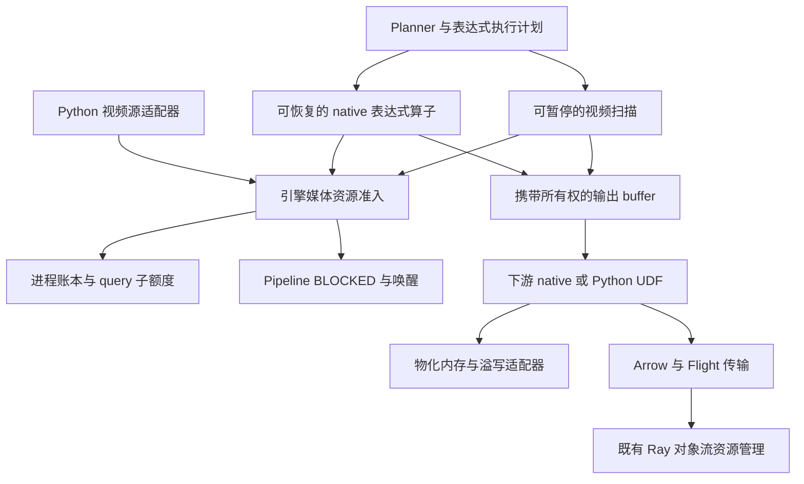
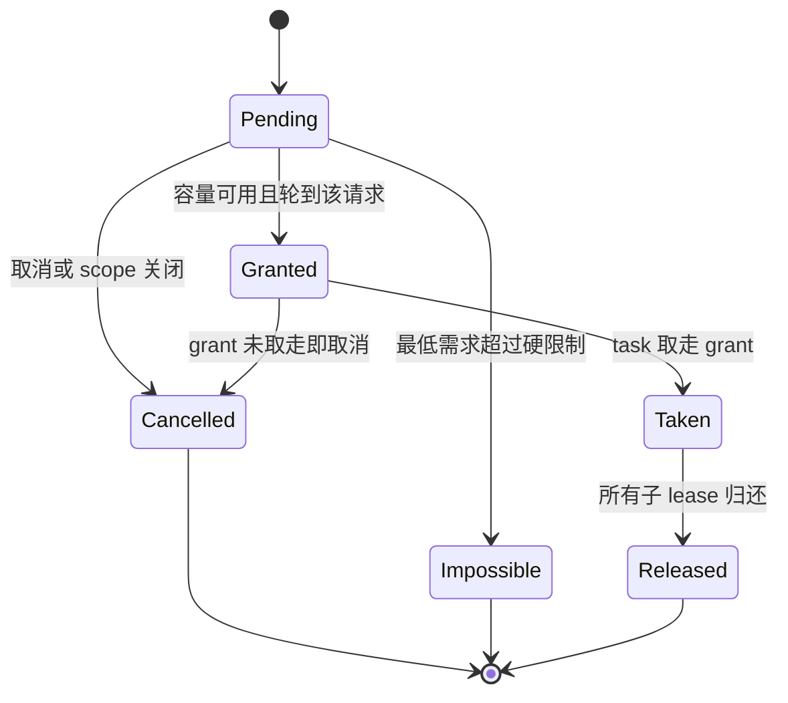
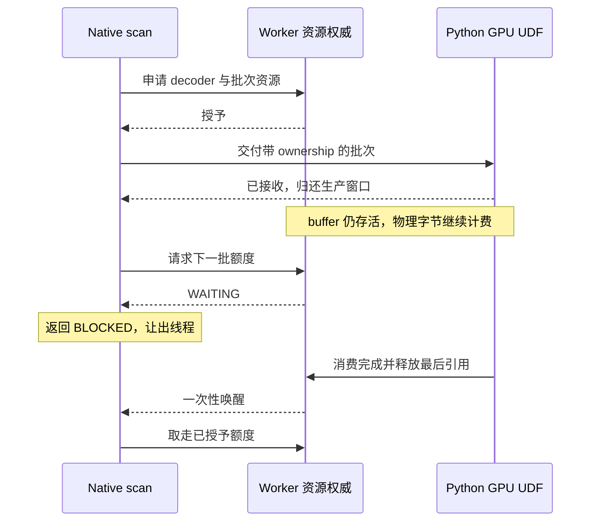

# Native 多模态算子反压与资源准入详细设计

状态：分阶段实现中，decoder 准入已合入集成分支，第二批接入扫描原始像素 buffer 的字节准入。更新日期：2026-10-27。

Native 媒体处理需要在解码和分配大块内存之前取得资源额度，并在额度不足时暂停当前 pipeline task。下游消费、预算移交或资源释放后，调度器恢复执行。目标是同时覆盖视频扫描和图片、音频、视频重型 scalar 函数，使媒体处理速度受下游消费能力和 Worker 可用预算约束。

本设计面向 Vane 执行引擎、native_media 扩展和 Python/Ray runtime 的维护者。主要决策是：在引擎公共层提供非阻塞准入、字节额度和所有权协议；native 媒体计算保留在 C++；沿用现有 pipeline 唤醒和分布式对象流控制；分阶段接入 Python 视频源。精确记账覆盖受管分配，codec 内部不可完整观测的内存另用保守预留和压力监测控制，不承诺进程 RSS 的硬上限。

现有使用契约见 [Native media 扩展](NATIVE_MEDIA_EXTENSIONS.md)、[视频帧 API](VIDEO_FRAME_API.md)、[IMAGE 类型](IMAGE.md) 和 [Python source execution](DATASOURCE_EXECUTION.md)。除以下实施记录外，下文的类型名、配置名和指标仍是目标设计，不表示当前安装版本已经提供。

构建、格式化、安装和测试遵循 [DEVELOPMENT.md](DEVELOPMENT.md)；provider 交付遵循 [Native media 发布流程](NATIVE_MEDIA_RELEASE.md)。本设计只补充功能范围和验收条件。

### 首批实施记录

集成分支 `native-media-backpressure-dev` 基于 `main`；本次移植使用的 main 提交为 `80056fc06ffa6d414096b341acb8a8efe30bfb6b`。首批实现由 `feature/decoder-admission` 提 PR 到该集成分支，完整功能验收后再提 PR 合回 `main`。

- [media_resource.hpp](external/duckdb/src/include/duckdb/execution/media_resource.hpp) 和 [media_resource.cpp](external/duckdb/src/execution/media_resource.cpp) 提供 C++11 公共原语：整组 decoder/bytes 额度授予、FIFO 请求、非阻塞 `PollOrArm`、move-only lease、scope 关闭和快照。已领取的 lease 不会被 scope 关闭撤销；未领取的 grant 会归还容量。通知在资源锁外执行，沿用 `InterruptState` 的弱引用和执行 epoch。
- 宿主 `DatabaseInstance` 构造时取得同一 runtime 的资源池，扩展从宿主实例取得它。不能让静态链接引擎的 loadable extension 自行调用进程 getter，否则会形成独立额度。
- [video_functions.cpp](external/duckdb/extension/video/video_functions.cpp) 将视频扫描接到 `poll_function`；申请 `{1 decoder, 0 bytes}`，获准后才打开 cursor。等待时保留文件位置，已有输出先交付；EOF、frame limit、错误和 local state 析构先关闭 cursor，再归还 slot。
- 实验开关 `VANE_NATIVE_MEDIA_MAX_CONCURRENT_DECODES` 在首次创建数据库时解析并固定，必须在导入 Vane 前配置。未设置或空字符串保持关闭；正整数启用；无效值报错。它尚未实现第 13 节的完整配置系统，也没有与 Python 的 decoder 池合并。
- [C++ 测试](external/duckdb/test/api/test_media_resource.cpp) 覆盖向量授予、取消/释放竞态、回调重入、异常隔离、真实 pipeline 暂停/恢复及取消、LIMIT/下游错误清理；[Python 测试](tests/fast/test_native_media_admission.py) 覆盖进程配置和可选 provider 的并发多文件、skip、LIMIT、错误后复用。provider 测试需要与当前 base 匹配的 native_media artifact/runtime。

首批不是 M1/M2 的完整交付：当时 bytes 仅作为预留原语，尚未连接实际 allocation/buffer；flow lease、buffer ownership、物化移交、按 query 公平调度、最低推进资源、scalar 挂起和 Python/Ray/FTE 全链路验收仍待实现。decoder lease 会跨批次持有；相互依赖的媒体路径在最低推进资源完成前不属于该实验开关的支持范围。首批不得以“统一多模态字节反压”或“RSS 硬限制”对外宣称。

首批开发工作区验证记录（该工作区还含有其他未提交改动；以下结果不替代独立 PR 分支的完整构建验收）：

- C++ `[media-resource]`：默认关闭时 12 个用例、1949 条断言通过；设置 `VANE_NATIVE_MEDIA_MAX_CONCURRENT_DECODES=1` 后 12 个用例、1956 条断言通过，包含宿主数据库之间实际共享容量的检查。
- 已安装包的 admission、native_media、视频帧、视频表达式、索引及 UDF process 相关套件：108 passed、177 skipped。当前缺少匹配的 native_media SDK/runtime/provider，真实 codec 集成用例未运行；部分音频用例另因缺少 soundfile 跳过。视频 adapter 已通过 C++17 语法检查。
- `scripts/run_release_tests.sh`：非 Ray 分片 1888 passed、76 skipped；共享 Ray 分片 72 passed、5 skipped；独立集群分片的 2 个用例因缺少 openai 包跳过。总计 1960 passed、83 skipped，无失败。本机 socket 相关检查在允许监听端口的环境中运行。
- 格式、源码许可证和文档链接检查通过。已按非 editable 的增量流程重新安装 base；安装包 SourceID 与当时开发工作区的 DuckDB 源码树一致。

### 第二批：扫描原始像素 buffer 的字节准入

本批在已合入的 decoder 准入之上，接入原始像素 allocation 的所有权：

实现分支为 `feature/media-output-admission`，从集成分支合入 #1095 后的 `e30ab91c0` 开始，目标仍为 `native-media-backpressure-dev`。

- `VANE_NATIVE_MEDIA_MAX_OUTPUT_BYTES` 是独立、默认关闭、首次创建数据库时固定的进程级额度；通过宿主 `DatabaseInstance` 访问，覆盖该 runtime 内各扫描创建的原始像素 buffer。
- 视频扫描在下一次 `Next()` 前取得一整批像素额度；批次按容量缩小，单帧无法容纳时明确报资源错误。不会先解码/分配整批再等待，也不会把资源错误当成 `skip`。
- `AllocateMediaVector` 在取得等额纯 bytes lease 后创建数值存储，保留 allocator，先实际释放 allocation，再归还额度。普通引用、slice 和嵌套 IMAGE/LIST 引用共享 owner；scope 结束不撤销仍存活的 buffer。
- 每批使用新的像素 owner，避免可复用 `VectorCache` 留住额度。普通 pipeline 与已有 batch 路径一样，在拉取下一批之前清除已消费的中间 chunk、表达式和 sink 输入引用。
- 输出 bytes 与 decoder 使用不同的 FIFO 队列。持有 decoder 的扫描可以申请下一批 bytes，不被排在前面的 decoder 等待者挡住；等待 decoder 时不持有新的输出 bytes。
- provider CI 已包含 `test_native_media_admission.py`；在同一入口增加一帧/两帧额度、并发文件、排序、LIMIT、失败后复用及永久超额用例。核心测试用可控 allocator 和假扫描验证释放次序、引用存活、小容量完成及取消，不依赖 provider。

这是 M1/M2 的下一增量，不是完整媒体内存预算。此处精确约束原始像素 allocation 的申请容量；metadata、vector 初始化缓存、分配器开销、codec/reference frames、转换 scratch、下游 deep copy、Arrow/传输复制不属于该额度。copy 仍由接收执行域分配，并不沿用原像素 lease。统一分配/移交协议、独立 flow window、最低推进资源、scalar 挂起和 Python 权威统一仍按后续里程碑实施。相互依赖的媒体执行路径尚不属于实验开关的支持范围。

本批独立分支验证记录：

- 从集成分支创建独立 worktree，完整构建并非 editable 安装到独立虚拟环境；复用已安装的第三方依赖。首轮安装包的 SourceID 为 `50dbb9e40364d69497f0d4acc61e85001c2dcacc`，与该轮 DuckDB 源码树一致。原生测试使用 CI 相同的 `VANE_ENABLE_TEST_EXTENSION_SIGNING_KEY=ON` 配置。
- C++ `[media-resource]`：默认关闭时 21 个用例、2262 条断言通过；decoder 容量 1、输出容量 64 bytes 时 21 个用例、2272 条断言通过。`[image],[output-lease],[execution_batch]`：49 个用例、162099 条断言通过。
- 后续将 `LogicalType` 的前置声明对齐为 `struct`，通过 `-Werror=mismatched-tags` 检查；修正后的源码树 ID 为 `c359c56ea7195a4ed4c9a9a99da0e67a1048a88e`。原生目标已重建，上述两组准入和 49 个回归用例均再次通过。
- 已安装包的 admission、native_media、视频帧、表达式、索引、固定形状 IMAGE、IMAGE 转 TENSOR 和 UDF process 测试：321 passed、181 skipped。admission 文件的 20 个配置用例通过，4 个真实 codec 用例因缺少匹配的 native_media provider 跳过；其余跳过主要来自可选 provider 和 soundfile。真实视频 adapter 已通过 C++17 语法检查，真实解码仍须由匹配 provider 的 CI 验证。
- 首轮发现现有 UDF collector 清理测试在 50 ms unregister 超时后立即检查异步交接事件的竞态；改为有超时的事件等待，保留 executor 最终释放和恰好关闭一次的断言，整组复测通过。
- 完整 release gate 和 provider CI 的结果在[跟踪 issue #1093](https://github.com/AstroVela/vane/issues/1093)关联的本批 PR 中维护。

### 第三批：原生扫描到 UDF 接收队列的独立生产窗口

实现分支为 `feature/media-flow-window`，从集成分支合入 #1099 后的 `5d411f35f` 开始，目标仍为 `native-media-backpressure-dev`。

- 新增默认关闭的 `VANE_NATIVE_MEDIA_MAX_INFLIGHT_OUTPUT_BYTES`。必须在 import Vane 前配置正整数；空值关闭，零、无效值和溢出均报错，首次创建数据库后固定。宿主保存配置，每个 scan edge 创建一个窗口供其并行 worker 共享；不同 scan 的 flow 窗口独立，原始像素物理额度仍是进程级共享。
- 扫描在下一次 `Next()` 和像素 allocation 前非阻塞取得 flow credit，按 flow/物理额度的较小值缩批。单帧超过窗口立即报资源错误，`skip` 不吞掉此错误。先申请 flow，再申请原始像素 bytes；等待物理额度时持有 flow，但不新增像素分配。
- `MediaFlowTicket` 与原始 allocation lease 分开。DataChunk 的引用、复制、选列、slice、append、move 保留票据；像素 owner 也保留票据，独立的 Vector/slice 不会因 chunk 重置而提前归还额度。普通 deep copy 或 Arrow 导出不会自动构成接收确认。
- 普通和 materialized ExecutionBatch pipeline 的投影、过滤和 streaming LIMIT 保留输入票据。带票据输入绕过过滤算子的短批缓存，避免一帧窗口在缓存首选批次前耗尽。当前仅支持终点为 `PhysicalStreamingUDF` 的这类线性路径；开启窗口后，直接收集结果、先排序/聚合/物化再进入 UDF，以及其他中间算子明确报不支持。尚未对物化路径删除票据或无限等待。
- UDF 接收队列在复制前预留 `pending_bytes + reserved_bytes + incoming_bytes <= task_input_max_bytes` 的 payload 容量，复制成功并提交队列后才在接收锁外确认 flow。对于此路径，单批大于接收容量会永久失败，不使用旧路径的空队列超额放行。接收前 BLOCKED、复制失败和已关闭接收端不会确认；已接收后 BLOCKED 的重试不会重复入队或重复归还。
- 接收 payload 支持 primitive、固定 primitive ARRAY/IMAGE/TENSOR、STRUCT 和非内联字符串，并在复制前递归计算其新副本需求。动态 LIST/MAP、嵌套 ARRAY 或字符串 ARRAY 暂不支持；动态 IMAGE 应先 cast 成固定形状。此额度不包括 validity、allocator slack、metadata 对象、codec/scratch 和后续任务/SHM 副本，不是 RSS 限制。暂存输入保留已确认票据的 provenance，使短批重组和拒绝后的恢复继续使用相同 payload 口径。
- 拆批按实际选中行和剩余行重新计量，并检查两者之和等于原待处理 payload；变长字符串不按行数比例扣减。被任务域拒收的 planned submit 与未拆分尾部同时计入 `pending_bytes`，重试期间不能借此腾出容量并确认新输入。
- flow 接收确认只将源端生产窗口移交给已预留的 **C++ UDF ingress 队列**，不代表 Python task、SHM 或 Ray 对象存储已经接收。任务域仍执行现有 task/data admission。ingress 字节压力沿用现有短批提交机制，首选 compute batch 大于 flow 窗口仍能推进。
- scan teardown 关闭窗口，取消等待者及未确认的生产票据；即使外部 view 存活，也无需等待它才能完成控制清理。这个操作不会撤销 view 的实际像素 lease。

[核心测试](external/duckdb/test/api/test_media_flow.cpp) 不依赖 provider，覆盖接收提交/拒绝、两条 sink 路径、重试、复制分配失败和回滚、回调重入、取消/确认竞态、slice/Arrow 引用及一帧扫描经过过滤进入阻塞 UDF。真实视频的 1/2 帧窗口、慢 task/actor、短批、LIMIT、接收超额、错误后复用和不支持的物化路径接入现有 [provider CI 文件](tests/fast/test_native_media_admission.py)。实际执行结果在本批 PR 中记录。

本批仍不是完整 M1/M2：`ORDER BY → fetchall` 的物化/溢写预算交接、重型 scalar 可恢复执行、相互依赖路径的最低推进资源、Python/native 权威统一及 Ray/FTE 全链路验证留在后续批次。

## 1 设计结论

1. 在同一 Vane 核心 runtime 的 Worker 进程内共享媒体准入状态，向 DatabaseInstance、query、operator 分配子额度。不同查询不能各自拥有一个独立的全额媒体池。
2. 分开管理解码器生命周期、受管物理内存和生产者输出窗口。输出离开队列可以归还生产窗口，但实际存活的 buffer 必须继续记账。
3. 所有等待通过 `BLOCKED` 和一次性唤醒完成。资源不足时不占用 pipeline 线程等待 semaphore、条件变量或内存轮询。
4. 视频扫描通过现有 `TableFunction::poll_function` 接入；重型 scalar 通过可恢复的 native 表达式算子接入。普通 scalar 回调内部不能承担调度等待。
5. 按字节额度形成执行批次。单行不可分割结果保留原有返回语义和硬限制；单行最低工作集超过可用硬预算时明确报错。
6. 在准入前校验一条执行路径的最低推进资源，包含下游需要的内存和 codec slot。物化边界必须明确移交记账或溢写，不能无限等待上游释放自己持有的数据。
7. Ray 继续管理 task/actor 和跨进程对象流。本地媒体分配由 Worker 内的 C++ runtime 管理，不新增逐帧 driver RPC。
8. 以小预算、慢消费者、多查询、取消和物化链路作为正确性门槛；吞吐测试不能替代这些检查。

## 2 当前实现与缺口

以下审计记录实施前的代码基线 `95acdea830eb1fff407f0e09f4b97ee7b0a02e83` 及当时 checkout 中相关执行路径；新增能力以首批实施记录为准。实现时仍应以符号和契约定位代码，避免依赖行号。

| 路径 | 已有机制 | 本设计需要补充的部分 |
| --- | --- | --- |
| Python streaming UDF | 任务准入、输入字节窗口、输出字节窗口、等待与唤醒、输出 lease | 将可复用的底层语义用于 native；不把所有 Python scalar 一概视为 streaming UDF |
| Python 视频 DataSource | 进程内 FIFO decoder 准入、内存水位、`_DataSourceWait`、decoder 关闭时释放 permit | 与 native 使用同一进程准入权威，随后接入输出和临时内存记账 |
| Native 图片和音频 scalar | 同步处理输入 chunk，输入/输出/像素等硬限制，批次输出上限 | 执行前资源准入、按字节拆分、暂停和恢复、存活输出记账 |
| Native 视频 scalar | 同步构造单行 IMAGE 或 LIST，单行及批次上限 | 可恢复的行级执行及不可分割结果的完整预留 |
| Native 视频扫描 | `max_partition_bytes` 限制输出批次，task/线程限制并行度 | decoder 准入、共享内存额度、等待资源时返回 `BLOCKED` |
| Native pipeline | 下游 operator/sink 阻塞时停止当前 task 推进 | 在开始一次高膨胀解码前判断预算，而不只在结果到达下游时阻塞 |
| Ray native fragment | 已有对象流和分区调度约束 | 将本地 codec/heap 使用纳入 Worker 内治理，不重复计算对象存储份额 |

主要实现依据：

- [physical_udf_inout.cpp](external/duckdb/src/execution/operator/projection/physical_udf_inout.cpp)：`StreamingInputWouldBlock`、`StreamingOutputBackpressured`、`StartStreamingOutputHandoffLocked`。
- [udf_admission.py](vane/execution/udf_admission.py) 和 [udf_task_admission.py](vane/execution/udf_task_admission.py)：本地和 Ray UDF 的准入生命周期。
- [video_reader.py](vane/datasource/video_reader.py) 和 [_video_admission.py](vane/datasource/_video_admission.py)：Python 视频源的进程级准入。
- [video_functions.cpp](external/duckdb/extension/video/video_functions.cpp)：`VideoGlobal`、`VideoLocal`、`ScanVideo`。
- [video_frame_functions.cpp](external/duckdb/extension/video/video_frame_functions.cpp)、[image_functions.cpp](external/duckdb/extension/image/image_functions.cpp)、[audio_functions.cpp](external/duckdb/extension/audio/audio_functions.cpp)：同步媒体 scalar 执行。
- [pipeline_executor.cpp](external/duckdb/src/parallel/pipeline_executor.cpp)：source、operator、sink 的阻塞传播。
- [query_resource_graph_builder.py](vane/runners/ray/query_resource_graph_builder.py)：native fragment 的资源单元定义及其与引擎内存管理的职责划分。

当前 image/audio 的 256 MiB 批次输出上限，以及视频的单行和批次上限，属于资源错误边界。它们不提供“预算暂时不足时等待，释放后继续”的控制。视频扫描的有界批次也不包含全部 codec reference frames、转换缓冲和下游状态。

已有 `test_video_decoder_admission.py` 使用 Python 视频 backend，验证的是 Python DataSource 与 native pipeline 的协作，不能充当 native_media decoder 准入已经实现的证据。

## 3 目标和实施边界

### 3.1 完整目标范围

| 类别 | 接入范围 | 执行单位 |
| --- | --- | --- |
| 视频扫描 | `native_video_frames`、`native_read_video_frames`，含索引读取和错误策略 | decoder session 和有界帧批次 |
| 图片处理 | 解码、编码、resize、crop、颜色转换及会分配大缓冲的计算 | 一行或按字节划分的行组 |
| 音频处理 | 解码、resample、Tensor 输出 | 一个不可分割的 waveform 结果及其内部阶段 |
| 视频 scalar | `video_frames`、`video_keyframes`、按索引取帧及索引构建 | 单个 scalar 结果 |
| 元数据探测 | 会打开媒体或调用 codec 的 metadata/probe | 小而有界的探测步骤 |
| 混合链路 | native → Python UDF、Python UDF → native、连续 native 算子 | 有明确所有权的执行批次 |
| 执行环境 | local-fast、Ray native worker、FTE attempt | 每个进程中的独立执行实例 |

纯 FILE 字段读取、不会产生大输出的轻量逻辑继续使用原执行路径。将函数纳入管理应依赖显式注册的执行能力和成本契约，不能依赖函数名是否含有 `native_`。

### 3.2 不纳入本次实现

本次不增加 GPU codec，不增加跨 Worker 的解码缓存，不改变 FILE 凭据/I/O 路径，不将 scalar LIST 变成多行结果，不实现对任意第三方 codec 调用的抢占，也不使用户保存的所有 Python/Arrow 结果受媒体池总量约束。

Python UDF 用户代码和其子进程内部的任意分配仍遵循现有执行契约。本设计复用准入和所有权语义，不宣称能够追踪任意 Python 堆分配。

## 4 必须保持的不变量

| 编号 | 不变量 |
| --- | --- |
| I1 | 每次受管大分配之前已经取得足额 reservation；实际增长不能先发生、后补记账 |
| I2 | 同一物理 allocation 在同一账本中只记一次；多个引用不重复扣费，多个副本分别扣费 |
| I3 | 生产者窗口归还、所有权移交、物理内存释放是三个不同事件 |
| I4 | 暂时无额度返回等待；永久超限返回资源错误；两者不能混用 |
| I5 | 等资源不占用执行线程；控制消息、取消和错误投递不依赖数据窗口腾出空间 |
| I6 | decoder slot 从实际打开前持有到 codec context 关闭后；下游阻塞期间不能虚假归还 |
| I7 | 输出和 retained input 即使离开算子队列，仍有可追踪的物理所有者 |
| I8 | 等待、grant、取消、析构和迟到回调竞态不能丢失唤醒或重复归还资源 |
| I9 | 新执行和新 attempt 使用新 epoch；旧回调不能唤醒 prepared statement 的下一次执行 |
| I10 | 非选中分支不额外执行媒体 I/O；NULL、错误分类、行对应关系和函数求值次数不因重写而改变 |
| I11 | 本地物理内存账本与 Ray object-store 账本边界明确；序列化期间同时存在的副本同时记账 |
| I12 | 能释放资源的下游路径保留最低推进资源；不可满足的路径不进入无解等待 |
| I13 | query 结束可清除执行状态；仍由客户端持有的输出只能在真实释放或预算移交后注销 |
| I14 | 新协议由宿主引擎提供，扩展不能维护一个绕过宿主额度的私有全局池 |

## 5 组件结构与作用域



### 5.1 资源权威

`MediaResourceRuntime` 位于宿主引擎，拥有线程安全的进程级账本。一个 Vane runtime 进程内的多个 DatabaseInstance 注册到同一权威；每个实例再创建 query 和 operator scope。Ray 的一个 native Worker 中共享该 runtime，本地多个连接不能各自扩大进程总额。

该进程级范围不跨越其他进程，也不跨越另一个独立加载的引擎 runtime。多个 Ray worker、Python subprocess、独立 Vane 进程的总容量仍由部署和现有集群资源配置约束。不能把“每进程限制”标注成“整台机器限制”。

进程容量在 runtime 创建时确定，DatabaseInstance 和 query 设置只能收紧自己的份额。连接修改配置不能提升进程总上限；多实例注册不能采用各实例预算相加。显式部署容量优先于自动计算值。

### 5.2 与已有资源管理的关系

| 组件 | 继续负责的范围 | 新接口关系 |
| --- | --- | --- |
| TaskScheduler / PipelineExecutor | 线程、task 推进、阻塞与恢复 | 接收一次性唤醒，不执行内存轮询 |
| BufferManager | 其管理的 buffer、eviction 和持久/临时存储 | 接收能够由其管理的物化结果；实际接受后才能移交原额度 |
| TemporaryMemoryManager | 算子临时内存份额与外部执行决策 | 提供协调信息，不当作硬分配器或现成的等待服务 |
| MediaResourceRuntime | decoder、受管媒体分配、opaque codec 预留、输出窗口 | 负责本地准入和所有权 |
| Python UDF admission | Python executor 的 slot/task 生命周期 | 复用 lease 和唤醒契约；现有 Ray 调度权威不迁移 |
| QueryResourceManager | Ray 任务、对象流和物化 frontier | 保留跨进程治理；仅接收必要的 Worker 诊断，不逐帧批准 |

`TemporaryMemoryManager` 当前可以在某些路径给予超过目标的 reservation，也没有媒体所需的 wait/wakeup 协议，见 [temporary_memory_manager.cpp](external/duckdb/src/storage/temporary_memory_manager.cpp)。因此不能仅调用 `Register()` 或 `UpdateReservation()` 就宣称实现了硬准入。

媒体池与 `memory_limit` 的关系必须在配置解析时明确。第一阶段限制媒体自己管理的驻留资源，并为其余引擎工作留空间；不将两个独立限额之和误称为一个已统一的进程内存上限。后续若接入统一分配权威，必须证明同一 allocation 不会在媒体池和 BufferManager 中重复扣费。

### 5.3 引擎与扩展边界

公共协议只包含资源需求、执行标识、lease 和 callback，不包含 FFmpeg、libsndfile 或图像库类型。宿主核心保持现有 C++11 要求；native_media 内部可继续使用 C++17；Arrow/Flight 边界保留自己的构建标准。

宿主提供导出的资源访问和注册接口，扩展按匹配的引擎身份加载。公开结构或序列化协议变化必须进入版本兼容检查，遵循 [分布式扩展契约](DISTRIBUTED_EXTENSIONS.md)。扩展静态变量不能替代宿主共享账本。

## 6 资源模型与记账

### 6.1 三类额度

| 类型 | 内容 | 生命周期 |
| --- | --- | --- |
| `DecoderLease` | 实际打开的 decoder context；编码器等有独立并发类别 | 从打开前到关闭后 |
| `MemoryLease` | 受管输入副本、输出 allocation、转换/重采样 scratch、codec envelope | 跟随实际内存或不可撤销的预留 |
| `FlowLease` | 当前 producer 到 consumer 边上的未接收输出字节/批次 | 消费者明确接收且建立所有权后可归还 |

slot 按资源类别描述，例如持久视频 decoder 与短期 codec 调用，但仍由同一权威协调。是否还设置总 codec 上限由进程配置决定。类别拆分不能用来突破同一个实际总上限。

已有 [UDFOutputLease](external/duckdb/src/include/duckdb/execution/udf_executor.hpp) 的 `Handoff()` 与 `Release()` 已经区分生产推进与物理所有权。新协议沿用这一语义，首先抽取足够小的公共原语，不要求先替换整个 Python UDF runtime。

### 6.2 容量约束

记进程媒体预算为 `B`，仍由媒体域承担的未释放唯一受管 allocation 总量为 `A`，opaque codec envelope 为 `E`，尚未兑现的已授予 reservation 为 `R`，保留给下游推进且尚未使用的额度为 `P`。已经成功移交到其他实际容量权威的 allocation 进入目标域账本，不继续重复计入 `A`。

```text
A + E + R + P <= B

active_decoder_slots[class] + reserved_decoder_slots[class]
    <= decoder_capacity[class]
```

每次从 reservation 兑现 allocation，做 `R → A` 转换，不能先加 `A` 再永久保留相同的 `R`。进程预算、DatabaseInstance 硬上限和 query 硬上限必须同时满足；query/operator 的公平份额可以是可借用的软目标。

`E` 不再重复包括已经进入 `A` 的 codec frame buffer。对不可观测分配，只能约束预留值，不能证明库内真实字节始终小于该值。因此上述不等式是受管账本保证，不是整个进程 RSS 的等式或上界。

Flow window 有自己的边界：`outstanding_flow_bytes <= edge_window`。它不加入上面的物理内存总和，以免同一份输出重复记账；同一输出可同时占用物理容量和生产窗口，因为两者解决不同问题。窗口与软 batch target 分开派生：启用一条边之前，窗口至少能容纳当前允许的一个原子结果；显式硬窗口连单行都容纳不了时，应判为配置/资源不满足，不能永久等待。

### 6.3 具体计费规则

- 按 allocation 容量记账，包括 alignment、vector capacity、StringHeap/ARRAY/LIST 子缓冲、FILE/provenance 和必要元数据，不只计算逻辑像素字节。
- 原始输入已属于另一受管 owner 时保留其 token，不再重复记输入值大小。复制 encoded bytes、materialize Arrow 或展开 lazy block 时，为新 allocation 另取额度。
- 共享一个大 buffer 的短 slice 仍可能钉住完整 allocation。不能按 slice 行数比例归还物理额度。
- 重新分配期间旧、新两个 buffer 同时存活，必须为峰值预留；旧 allocation 真正释放后才减账。
- row 发生可忽略的格式错误后，尚被 vector/heap 引用的失败分配仍计费，直到实际释放。
- decoder 的 packet、reference frames、转换 scratch 与最终输出分别归类。输出转移不能顺带归还仍在使用的 codec 额度。
- `GetAllocationSize()` 和输出 schema 可以用于诊断或估算，不能单独作为多个共享引用的精确所有权账本。

### 6.4 Codec 的不可抢占边界

每个 codec adapter 声明有界 probe、打开 context、解码/转换步骤和输出结果的需求。运行前先取得当前不可中断步骤的完整 envelope，再进入库函数。外部压力导致额度不足时，在库调用之前等待。

现有 [MediaReader](external/duckdb/extension/media_common/media_reader.cpp) 安装了 `get_buffer2` callback，并约束 frame 尺寸。可利用这个边界增强 frame 分配记账，但它不覆盖 FFmpeg 所有内部申请，也不覆盖其他 codec 库。

不能在 codec allocation callback 中等待引擎唤醒，不能把库的任意 `ENOMEM` 或 `EAGAIN` 当作可恢复的预算暂停。若实际需求超过已取得的不可中断 envelope，adapter 记录资源错误并清理本次调用；不在 codec 状态可能已改变后盲目重试。可恢复增额只发生在 adapter 明确定义的安全边界。

内存压力监测在独立控制路径中采样。高水位暂停新 session/新工作准入，低水位恢复；释放、取消和已经获得推进额度的下游必须仍可运行。采样值和宿主容器限制的解释需要单独验证，不能在每个 pipeline task 中调用阻塞式内存探测。

### 6.5 输出所有权

为底层 allocation 建立 `MemoryOwnership` token，由实际 buffer owner 持有。`DataChunk::Reference`、dictionary/slice、STRUCT/LIST/ARRAY 子向量、Arrow export 需要保留相应 token；deep copy 生成新的 token。

账本只保存 allocation 标识、计数和诊断元数据，不反向强持有 buffer，以免形成所有权环。物理额度归还应与 allocation 的实际释放顺序一致，不能在 wrapper 析构开始时就提前注销仍在销毁中的大缓冲。

现有 [VectorBuffer](external/duckdb/src/include/duckdb/common/types/vector_buffer.hpp) 的 auxiliary data 已有 Arrow 用途。实现应增加可组合的资源所有权挂载方式，不能覆盖现有 Arrow auxiliary，也不能只在 `DataChunk` 外壳附加一个析构回调。引用可能越过 chunk 的生命周期。

所有权变换规则：

| 事件 | FlowLease | MemoryLease |
| --- | --- | --- |
| 结果进入 producer 输出队列 | 占用 | 占用 |
| consumer 接收并持有同一 buffer | 可按协议 handoff | 同一 token 继续持有 |
| consumer 深拷贝 | 接收成功后 handoff | 新副本先申请；原 allocation 最后引用释放后归还 |
| 写入受管物化存储 | 目标接受后 handoff | 目标预算实际承担后移交，或复制完成后释放源 |
| 输出转为 Arrow 零拷贝视图 | 按客户端边界协议 handoff | Arrow release callback/底层 owner 继续持有 |
| query 取消，但客户端仍持有已导出 buffer | 停止生产并撤销待发数据 | 已导出 allocation 继续记账或已由客户端结果域承担 |

移交失败时原 owner 保持有效；不能先释放原额度、再申请目标额度。`Handoff()` 不等于物理 `Release()`。现有 lazy descriptor 的 [ownership_tokens](external/duckdb/src/include/duckdb/execution/external_block.hpp) 可复用其传播思路，但本设计还必须覆盖 materialized vectors。

### 6.6 微批次和不可分割结果

目标批次按字节形成，行数只作为上限。固定尺寸视频帧可以在写入前计算整行 payload；可变图片/音频结果先做有界 probe，再决定单行需求。

```text
batch_target = min(operator_target, available_flow_window,
                   available_memory_for_output, existing_function_batch_cap)
```

若下一行放不下当前剩余空间，先返回已有行，再处理下一行。若一行大于软批次目标但未超过硬限制，可以独占一个有完整 reservation 的批次；仍不能越过进程或 query 硬上限。

`video_frames()` 的 LIST 和音频 Tensor 属于不可分割 scalar 值。输出长度未知时，先按该行允许的上界和 scratch 峰值取得完整不可撤销 reservation，再开始构造；已知可信尺寸时使用验证后的上界。不能让多个半成品 LIST 各占一部分预算后一起等待增额。

若最低工作集连独占执行也无法满足，应抛出明确的资源错误，列出所需字节、限制和可用的 streaming API。原有 `max_output_bytes`、`max_output_frames`、像素及输入限制继续有效。将输入 chunk 拆小可以避免多个合法行累加触发单次调用上限，但不能规避任何单行限制。

## 7 非阻塞准入协议

### 7.1 拟议接口

以下是接口草图，用于定义职责，非可直接编译的头文件：

```cpp
enum class AdmissionStatus { GRANTED, WAITING, IMPOSSIBLE, CLOSED };

struct MediaExecutionId {
    string query_id;
    string attempt_id;
    uint64_t execution_epoch;
    idx_t operator_id;
    idx_t local_state_id;
};

struct MediaDemand {
    MediaResourceVector slots;
    idx_t tracked_bytes;
    idx_t opaque_codec_bytes;
    idx_t flow_bytes;
    MediaProgressClass progress_class;
};

class MediaAdmissionRequest {
public:
    AdmissionStatus PollOrArm(const InterruptState &interrupt);
    MediaGrant TakeGrant();
    void Cancel();
};

class MediaResourceScope {
public:
    unique_ptr<MediaAdmissionRequest> Request(const MediaDemand &demand);
    void Close();
};
```

`MediaGrant` 分别持有 decoder、memory、flow 子 lease，能把 output reservation 转为 buffer ownership。所有 lease 的 release 幂等、移动不抛异常、析构不抛异常。分配 reservation 可以收缩；扩张必须经过新的准入，或消费已经授予的行级完整预留。

### 7.2 请求状态



同一个暂停点保存一个 request handle，恢复后重新 poll 该 handle，不重复入队。`Granted` 已扣减容量，等待 task 调度期间不能被另一请求抢走；取消一个尚未取走的 grant 必须归还全部预留。

`TakeGrant()` 成功后，资源所有权转交给返回的 grant/子 lease。原 request handle 随后析构或取消，不能撤销已经转移的物理所有权。

`IMPOSSIBLE` 只用于相对于静态硬限制/已验证最低工作集无解的请求。当前容量被其他活跃查询占用属于 `WAITING`。资源错误不由一次瞬时内存水位样本决定。

### 7.3 唤醒和锁

状态检查、回调登记和授予决策必须在同一同步协议内完成，以处理“资源先释放，task 后返回 BLOCKED”的竞态。唤醒持有弱 task 引用及 execution epoch，并复用 [InterruptState](external/duckdb/src/include/duckdb/parallel/interrupt.hpp) 的一次性语义。

控制锁内只修改账本、请求和待通知列表。通知在解锁后发送；不在资源锁内调用 codec、I/O、Python、Ray 或下游 operator。buffer 析构可能发生在其他算子锁内，release 快路径应使用不会反向调用执行器的原子记账/释放队列，由安全的控制路径执行实际通知。

释放队列从空变为非空时必须主动通知控制路径；排空不能依赖下一次数据 task 来申请资源，否则所有 task 都阻塞时释放事件无人处理。控制路径本身不申请媒体数据额度，并在 runtime shutdown 时完成剩余清理。

scope 关闭先禁止新 grant，取消 pending 和未领取 grant，再通知等待 task 进行清理。回调不能强持有整个 query。进程 runtime 中的账本/token 可以在 query 销毁后继续活到最后一个已导出 buffer 释放。

### 7.4 公平性

query 之间轮转服务，每个 query 内同类请求 FIFO。小请求可以在不持续绕过老请求的前提下使用余量；大请求达到等待阈值后停止为新生产工作分配其所需余量，使其最终可获得预算。已有 decoder context 不被任意抢占。

已持有输入且能释放资源的消费/完成步骤优先于开启新的上游 session。公平性承诺针对可满足且最终释放资源的请求；无限慢的外部消费者不能获得完成时限保证，但其他请求不能因为它占住唯一执行线程而饥饿。

## 8 视频扫描接入

### 8.1 状态与持有资源

`VideoLocal` 增加资源 scope、当前 request、decoder lease、workspace lease 和执行 epoch。cursor 保留文件位置、帧索引、时间选择和索引验证状态；跨批次暂停不重新打开文件或重新解码已输出帧。

| 状态 | 持有的资源 | 可执行动作 |
| --- | --- | --- |
| `WAIT_OPEN` | 有界 FILE/任务描述符及 pending request | 等待 probe/open 与首个推进步骤的资源 |
| `OPEN` | decoder slot、codec envelope、cursor | 准备下一步，不预取无额度的帧 |
| `WAIT_OUTPUT` | 仍打开的 decoder 及必要 reference frames | 等待输出/转换额度，允许取消 |
| `PRODUCING` | 上述资源及已授予的当前批次 reservation | 解码、验证、转换、输出 |
| `FILE_DONE` | 尚未移交或释放的输出 token | 关闭当前 decoder，再进入下一文件 |
| `FINISHED` | 仅可能存在下游持有的输出 token | 不再读文件或申请资源 |

首次 probe 也必须有预算。`VideoFrameCursor`/`MediaReader` 构造路径可能执行容器探测，不能先构造 cursor 再补申请。probe 得到更准确的尺寸后，在安全边界调整后续 demand；它不能为了估算精确输出而完整解码一次。

### 8.2 Poll 协议

将现有普通 table-function callback 替换为 `poll_function`，沿用 [physical_table_scan.cpp](external/duckdb/src/execution/operator/scan/physical_table_scan.cpp) 的 early-finish 和外部等待注册。

```text
PollVideo(output, interrupt):
    检查取消与执行 epoch
    清理本地已经不再使用的上一批引用
    若全局 frame_limit 已满足: 返回 FINISHED，不 probe 或打开文件

    循环:
        如果当前没有 cursor:
            若所有文件完成:
                有输出则返回 HAVE_MORE_OUTPUT，否则返回 FINISHED
            若 output 已有行: 先返回 HAVE_MORE_OUTPUT
            为下一文件创建或恢复 open request
            若硬限制无法满足: 抛出资源错误
            若尚未获得 grant: 注册唤醒，返回 BLOCKED
            取走 grant，打开 cursor

        计算下一不可中断步骤及输出需求
        尝试取得该步骤的 reservation
        如果暂时不足:
            若 output 已有行: 先返回 HAVE_MORE_OUTPUT
            否则创建或恢复 request，注册唤醒，返回 BLOCKED

        在 grant 内推进 cursor
        若当前文件结束: 关闭 cursor 和 decoder lease，继续循环
        若当前帧被过滤: 检查取消，继续循环
        构造一行
        把新 allocation 的 token 附到输出底层 buffer
        更新帧数、错误策略和文件进度
        若全局 frame_limit 满足: 关闭当前生产状态
        若达到字节目标或全局 frame_limit: 返回 HAVE_MORE_OUTPUT
```

`BLOCKED` 和 `FINISHED` 必须返回空 chunk。已经有部分输出时先交付，不把已填充的 output 与等待状态一起返回。下一批需要等待时再登记有效的暂停点，避免对仍在运行的批次重复注册回调。

没有输出的过滤路径继续检查 packet/frame 级取消，直到得到输出、资源等待或 EOF。本阶段复用既有三态 poll 契约，不虚构一个空 `HAVE_MORE_OUTPUT` 来表示 CPU 时间片耗尽；若后续增加纯调度让出，应先定义有实际重新调度通知的引擎协议。

单个 task 不创建独立的后台预取队列。已有 pipeline 并行度可以保留，但每个活跃 local state、暂存帧和未交付 chunk 都必须进入统一账本，不能假定“有 N 个线程所以这些缓冲免费”。

### 8.3 与现有视频契约的关系

- `max_partition_bytes` 仍是完整 emitted payload 的硬限制。新额度可能让一个批次更小，不改变行内容。
- `read_task_count` 仍选择文件任务分组；实际同时打开的 decoder 受准入限制。任务多不意味着必须同时打开全部文件。
- `frame_limit` 的全局顺序和单任务语义保持现状；达到限制时撤销尚未使用的 reservation。
- `on_error='skip'` 只处理格式错误。取消、额度不足导致的永久资源错误、I/O 与 allocation failure 仍传播。
- indexed cursor 在暂停后继续使用同一验证和时间状态；不因预算变化重复计算 frame index、丢弃已输出前缀或改变 seek 语义。
- decoder slot 只在 context 真实关闭后归还。跨批次归还 slot 而保留 context 会使并发计数失真。

## 9 重型 scalar 的执行设计

### 9.1 函数注册和计划节点

在重型函数上注册 `ManagedFunctionInfo`，描述资源类别、probe/prepare/step 能力、结果行语义、是否支持安全恢复、不可分割输出上界和协议版本。函数注册时只提供行为描述，不打开文件、不申请 decoder。

planner 将需要受管执行的表达式编译为 `NativeMediaExpressionProgram`。projection 使用拟议的 `LogicalMediaProject` / `PhysicalMediaProject`；其他表达式上下文通过相应 operator 的可恢复求值入口执行同一 program。普通标量计算可以作为同步步骤嵌入，不为每个算术函数引入新调度边界。

现有 [UDFProjectRewriter](external/duckdb/src/optimizer/udf_project_rewriter.cpp) 可作为提取表达式和保持列绑定的参考，但它只允许 projection，并拒绝短路表达式中的 UDF。不能直接复用这些限制来缩减已有 native scalar 的 SQL 支持范围。

优化器使用显式能力标记，不通过函数名匹配。新的节点必须支持 EXPLAIN、计划序列化、worker 重建、必要的列裁剪和类型传播。跨进程只序列化稳定函数标识、配置和表达式，不序列化 function pointer、scope 指针、lease 或 cursor。

### 9.2 执行状态

每个 local state 保存：输入引用及其 owner、选中行集合、当前行/子表达式位置、已完成结果、probe 结果、pending request、当前 grant 和 execution epoch。暂停后从该位置恢复，不能重跑已完成的 I/O 或 volatile 表达式。

建议的 adapter 阶段如下：

```text
准备被选中的输入行
    → 有界 probe
    → 计算原子步骤或整行结果的最低工作集
    → 申请资源
    → 执行 codec / 转换步骤
    → 绑定结果 ownership
    → 交付当前微批次
```

`PhysicalMediaProject::Execute` 可返回 `BLOCKED`、`HAVE_MORE_OUTPUT`、`NEED_MORE_INPUT`。现有 pipeline 已支持 operator 阻塞后的恢复；实现必须验证 materialized 和 ExecutionBatch 两条路径，不能只完成 source poll。

完整输入 chunk 可以包含大量短 FILE 描述符，但解码后的结果必须按字节逐步产出。保留大输入时引用原 owner，尽早释放不再需要的列和子结果；不能先同步执行整个表达式树，再按输出行数切块。

### 9.3 表达式求值语义

| 上下文 | 必须满足的规则 | 默认启用条件 |
| --- | --- | --- |
| 顶层 projection | 每个输入行有且仅有对应结果；保留 passthrough 列和 NULL | 行级对应与错误测试通过 |
| 嵌套函数 | 按依赖执行，保留需要复用的中间结果；不得重复 volatile 调用 | 跨暂停点结果缓存和清理完整 |
| CASE / COALESCE | 保存分支 selection mask，仅对原语义需要的行求值 | 分支掩码和恢复测试通过 |
| AND / OR / filter | 遵守执行器已有选择向量、NULL 和短路规则，不额外求值未选中行 | filter 内的暂停与恢复完整 |
| ORDER BY / aggregate 参数 | 在正确的逻辑位置计算排序键或参数，结果通过物化适配器 | 对应物化边界已支持 |
| JOIN 条件及 outer join | 保持候选行对、NULL 扩展和求值位置 | join 的可恢复条件执行已经实现 |
| window、相关子查询、lambda 等其他入口 | 审计其表达式执行位置和生命周期 | 有明确受管执行入口与语义测试 |

例如 `CASE WHEN keep THEN decode_image_file(file) ELSE NULL END` 不能被改写成对所有行先解码后选择；未选中的坏文件必须保持不触发解码的行为。

实验阶段只对已覆盖的上下文启用受管 scalar，并在显式严格实验模式下于计划阶段拒绝未覆盖场景。稳定版默认切换前必须补齐原有合法调用的覆盖，或单独评审兼容性策略；不能把旧路径静默标为“已经受管”。

### 9.4 单行结果和临时数据

图片解码、转换和编码适配器应报告输入副本、decoded pixels、输出及 scratch 在各阶段的最大重叠量。能在阶段边界释放的中间结果及时释放；执行过程不依赖未来一定能扩张预算。

音频 resample 的未知输出长度、LIST/Tensor 容量增长和旧/新缓冲重叠必须包含在整行 reservation。若 adapter 暂时无法给出可信的较小上界，使用现有资源参数允许的保守上界，接受并发度降低，不能用均值估计代替必要容量。

视频 LIST 仍以一个完整值交付。内部可以在安全边界让出线程，但完整结果预留不能被别的 task 抢走；在返回一行前不能把半个 LIST 交给下游。用户需要无限长帧流时仍使用 `read_video_frames`。

### 9.5 微批次与算子融合

目标是以实际可用字节形成小批次，同时避免逐像素或逐样本调度。相邻的 decode、resize、convert 可以在同一 native program 中执行并提早销毁中间结果；融合只是一项后续优化，正确性不能依赖融合是否发生。

单行执行已获得完整预留时，较小 batch target 不应造成重复打开 codec。用户设置的 UDF `batch_size` 仍只控制 UDF 的计算批次；不把它当作上游所有 native 算子的统一解码行数。

## 10 防死锁与最低推进资源

### 10.1 必须区分的等待

| 场景 | 处理方式 |
| --- | --- |
| 其他 query 暂时占用预算 | 排队，资源释放后唤醒 |
| 下游消费缓慢 | 停止新的生产，保留已产生数据的所有权 |
| 当前行最低工作集超过硬容量 | 资源错误，不进入等待 |
| 上游占满预算，下游需要新缓冲才能消费 | 使用事先保留的推进额度，或减小并发/微批次 |
| 物化算子等待 EOF，同时保留全部上游额度 | 移交到物化预算或溢写，不能等 EOF 才归还全部生产窗口 |
| 持久 decoder 占满全部 slot，下游需要另一个 codec | 在开启上游前保留下游 slot；无法满足时降低同时活跃路径或报错 |

### 10.2 最低工作集

为当前可执行的依赖路径计算 `ProgressRequirement`，描述完成至少一个有限消费步骤所需的资源向量，包含：

- 不能在该步骤中关闭的 decoder/context 和其内存；
- 被下游持有、完成当前步骤前不能释放的输入 allocation；
- 下一消费者的 codec slot、scratch 与一个合法输出单位；
- 必要的 Arrow/Flight 序列化、深拷贝或物化转换峰值。

planner 提供依赖关系和资源类别；有界 probe 后补全尺寸。首次放行上游之前保留路径所需的推进额度。新的上游生产不能消耗这部分余量；已经持有输入的消费步骤可以把它转为实际 reservation。使用后仍受进程总预算约束。

不能简单固定“留 10%”就声称消除了所有死锁。所留容量必须足以满足当前路径中至少一个合法消费步骤。若预算不足，减少活跃 query/path、缩小可分割微批次；一个最小合法路径仍放不下时明确报错。

需求尚未确定时允许进入有预算的 probe，但不允许同时启动无限多个等待升级的半成品工作。probe 后的升级由权威统一选择可完成的路径；未选中的工作释放可回收 probe 状态，不持有一部分不可回收预算等待其他工作释放同类资源。

### 10.3 Slot 也有依赖

假设视频扫描保持一个 decoder 打开，下游还要打开另一个媒体 codec。如果配置的实际总上限只有一个，单纯 FIFO semaphore 会产生永久等待。

本设计要求资源需求包含这两个同时存活的 context。对于这条路径，最低 slot 数是两个；只有容量满足才启动，或由经过验证的 adapter 提供能够真实关闭并恢复上游 context 的替代执行方式。没有这样的恢复能力时应报告限制不足，不能通过提前归还仍打开的 decoder slot 来“解决”。

新 session 可以排队等待；已经占有 context 的路径优先完成消费和关闭。slot 和对应的 memory demand 原子授予，避免拿到 slot 后等待打开所需内存、或拿到内存后等待同一批请求占用的 slot。

### 10.4 物化边界

排序、hash join build、某些 aggregate 和最终结果收集器必须声明如何接收媒体 allocation：

1. **复制到受管存储。** 目标先取得内存或溢写能力，再复制；重叠期间两个 allocation 分别计费，随后释放原 buffer。
2. **共享 allocation 并移交预算。** 只有目标预算能够对该 allocation 承担实际容量约束时才允许原子移交。
3. **不可接受。** 目标没有有界接收/溢写能力时，规划或运行阶段明确报告资源限制；不能仅删除原 token。

`TemporaryMemoryManager` 的估算 reservation 不自动满足第二种条件。对任意堆分配仅改 owner 标签，会使记账变好看但失去真实限额，不能作为实现。

移交后媒体生产窗口可以继续推进。物化结果由目标引擎内存域治理，可能继续增长并溢写，因此媒体池限制不等于整条 query 的最终结果大小限制。

### 10.5 进展的可验证条件

对每条等待依赖，诊断能够给出请求者、资源 owner、可释放路径和等待原因。对于纯预算等待，至少有一个有限步骤具备可执行的推进资源，或者请求已被判为永久超限。

不通过超时周期性放行一个无预算的大任务来保证进展。超时可以用于诊断/取消，但不能证明原等待图是安全的。即使所有数据 task 都处于 `BLOCKED`，取消和完成控制路径也必须可运行。

## 11 与 Python UDF 及分布式执行衔接

### 11.1 Native 输出进入 Python UDF

UDF sink 继续使用现有输入窗口和任务准入。接收一个 native batch 时，它必须保留底层 ownership，或在转换为 Arrow/进程间输入时先取得目标容量再复制。

上游 flow handoff 发生在 UDF 已经可靠接收输入后。若 UDF 尚未接收，native producer 保留自己的输出及额度并暂停；若 UDF 已接收但尚未执行，物理 allocation 由其输入队列 owner 继续持有。

内存额度还要覆盖一个合法的输入转换步骤。否则 native 把整个池填满后，UDF 无法创建 Arrow 输入副本，仍可能阻塞全链路。

### 11.2 Python UDF 输出进入 native

对 Ray lazy ref 输入，保留已有 ObjectRef lease，只 materialize 当前需要的有界切片，并对本地新分配取得额度。不能为了执行一个 native 函数提前 materialize 整个大 ref bundle。

小 slice 可能仍钉住完整 ObjectRef；对象存储侧继续按真实持有关系记账，本地媒体侧记录新创建的物理副本。两个域描述不同存储，不能以“相同数据”作为只记一份的理由。

对本地已 materialize 的 UDF 输出，复用或适配现有 owner；缺少可传播 ownership 的桥接路径必须补齐后才能进入完整受管范围。

### 11.3 Arrow 与 Flight

Arrow 零拷贝导出需将 token 保留至相关 buffer 的最后 owner 释放。序列化/压缩的临时副本也属于峰值需求，不能在发送函数返回时就假定网络或下游已不再引用输入。

进入 Ray object store 后，现有 QueryResourceManager 接管目标对象的跨进程流控制。本地 buffer 在实际释放前仍记本地账；本地 release 不代替 ObjectRef release，远端接收也不代替本地物理销毁。

仅依靠本地侧 flow handoff 不能扩大 Ray generator 的预取窗口。两边窗口都满足才继续生产，沿用原有 bounded generator 和传输容量限制。

### 11.4 FTE 与重试

每个 attempt 创建新 scope、epoch、cursor 和本地 lease。预算临时不足属于等待，不应引发 FTE 重试；格式错误和永久资源错误沿用明确分类，不能靠重复 attempt 解决同一个确定性超限。

同进程 attempt 取消后撤销 pending、关闭 context、释放非导出缓冲。进程丢失时本地 allocation 随进程消失，driver 按既有任务/对象协议清理远端记录。新 worker 重新准入，不继承旧进程的 permit 或地址。

所有迟到的通知都校验 query、attempt 和 execution epoch。原生 plan 序列化保持现有 provider 身份校验，不能把本地所有权对象编码进任务 payload。

### 11.5 Python 视频源统一

增加 Python 可调用的宿主准入适配器，使 connection-bound `VideoFrameSource` 通过同一个 C++ scope 取得 decoder permit，并继续通过 `_DataSourceWait` 返回 readiness。原 Python FIFO 队列和 C++ 队列不能同时成为权威，也不能对一个 decoder 扣两次 permit。

迁移先统一 slot、请求、取消和唤醒；输出、Arrow 副本和 PyAV 内存记账另设明确验收阶段。只统一 slot 后，不能宣称 Python 视频内存已经全部进入新账本。

现有 `VANE_MAX_CONCURRENT_DECODES` 及内存水位环境变量需要明确的兼容映射和优先级。无执行 context 的独立 Python 数据源、纯 Python File value 方法仍保持原契约，除非它们显式注册到同一 runtime。fork 子进程重新初始化 runtime 和请求状态，不能继承父进程中的活跃 permit。

## 12 取消与对象生命周期

### 12.1 清理顺序

1. 将 scope 标记为关闭，阻止新请求、新 grant 与新 I/O，使迟到数据通知只进入清理路径。
2. 撤销 pending request 和尚未领取的 grant，使用当前执行仍有效的终止唤醒通知等待 task；不能先作废其 interrupt epoch，导致清理通知也被丢弃。
3. 通知下游不再接收新的输出，清理未开始执行且无人使用的排队结果；对正在执行的 codec 只设置取消标志，保留它仍引用的行状态和缓冲。
4. 等待正在进行的不可抢占 codec 调用返回，在其安全边界关闭 cursor、context、scratch 和未完成行状态。
5. 归还 decoder permit 及不再使用的预留；已移交/导出的 token 由实际 owner 负责。
6. 清除 query/operator 控制状态和回调，退役本次执行 epoch；保留仍需服务外部 buffer release 的最小账本状态。下一次执行使用全新 epoch。

RAII 为异常路径提供兜底，但不能仅依赖正常 `Finalize`；异常、early finish 和 worker teardown 都要进入同一幂等清理逻辑。

### 12.2 必须覆盖的竞态

| 竞态 | 预期结果 |
| --- | --- |
| grant 在 `BLOCKED` 返回前到达 | epoch/登记协议保留唤醒，task 不永久挂起 |
| grant 与取消同时发生 | 只有一个终态；未消费资源全部归还 |
| 多次 close / destructor / cancel | 不重复释放，不出现负计数 |
| 旧执行回调到达新 prepared execution | 回调失效，不访问新 local state |
| 下游 LIMIT 结束，而上游尚在等 permit | 无需等待资源恢复即可结束 |
| output 被多个 slice 或 Arrow view 引用 | 最后一个引用释放后才归还物理容量 |
| query 结束但客户端仍保存结果 | 结果保持有效；其资源归属可解释，不假报已全部释放 |
| codec 调用期间取消 | 返回后清理；不宣称能从任意库调用中即时抢占 |

正常完成后，待执行请求、未领取 grant、活动 decoder 和内部 scratch 应为零。输出计数只有在下游/客户端也释放或完成预算移交后才归零。测试必须区分这两种生命周期。

## 13 配置与兼容策略

### 13.1 拟议配置

下表为配置契约草案，名称在实现前统一审定。进程配置由 Worker/runtime 创建入口传入；SQL connection 配置只能收紧 query 范围，不能重配同进程其他连接的总容量。

| 配置 | 作用域 | 语义和拟议默认策略 |
| --- | --- | --- |
| `media_memory_limit` | 进程/runtime | 受管 allocation、opaque envelope 和预留额度的总预算；显式部署值优先，自动值在 M0 校准后冻结 |
| `media_max_open_decoders` | 进程/runtime | 实际同时打开的 decoder 总量；类别子限额仍受此上限约束 |
| `media_query_memory_limit` | query | 可选的 query 硬上限，只能小于等于进程容量 |
| `media_output_target_bytes` | query/operator | 软批次目标，拟以现有视频扫描的 10 MiB 目标作为初始基线；合法大行可独占一批 |
| `media_decode_mem_high_pct` / `media_decode_mem_low_pct` | 进程/runtime | 新工作准入的压力回滞阈值；不能阻断释放与已获准的推进路径 |
| `native_media_execution_mode` | 实验期开关 | `legacy`、`managed_scans`、`managed`；后者要求调用场景已有受管执行入口，否则绑定/规划时报错 |

用户已有的 `max_partition_bytes`、`max_output_bytes`、`max_pixels`、`max_input_bytes` 等仍是每个 API 的内容/资源限制。媒体池预算控制多个工作同时驻留的总量，两类配置不能互相替代。

在完整验收之前，实验模式不默认开启；默认切换后无需用户为每个媒体函数再包一层 UDF。切换分阶段发生，发行说明必须给出实际覆盖的 backend 和函数范围。

### 13.2 容量解析

自动进程预算从部署给该 Worker 的容量、引擎配置和可识别的进程限制中计算，并为普通查询、codec 未观测内存、传输和 runtime 留余量。不能在多个 worker 中各自把整台机器可用内存当作自己的完整容量。

自动比例、绝对上下限和 decoder 默认数量需要在 M0 的小内存容器、常规 CPU Worker 和多 Worker 同节点场景中校准。它们属于默认启用前的发布阻塞项；确定性测试始终显式传入容量，不能依赖测试机空闲内存。

进程硬容量在 runtime 存续期固定。query 配置在每次执行开始时形成快照；prepared statement 下一次执行取得新 scope 和适用的执行配置，不复用旧 lease。已有 backend 绑定语义保持现状。

实验开关切回 `legacy` 只影响新执行。正在运行的受管查询仍按原协议排空和销毁，不能清空账本使存活 buffer 变成未计费数据。

### 13.3 现有 Python 配置迁移

统一 Python 视频源时，新显式 runtime 配置优先于兼容环境变量；无新配置时，把 `VANE_MAX_CONCURRENT_DECODES` 和现有水位设置解析到统一权威一次。冲突值必须有清楚的配置诊断，不能让 Python 和 C++ 各取一套值。

`VANE_TEST_RAY_OBJECT_STORE_BYTES` 仍只用于专门测试 Ray object-store 容量，不用于生产媒体池，也不改变生产 cluster 的资源配置。

### 13.4 错误行为

临时预算不足不暴露为 SQL 格式错误，不触发 `on_error='null'/'skip'`，也不触发任务重试。永久超限、物化目标不支持所需容量、codec 超出已验证的原子工作集，都以资源错误传播。

错误至少说明资源类别、当前操作、所需最低量和硬限制。单行 LIST 过大时提示相应 streaming API。错误消息不能把“放大并发数”作为普遍解决方法，因为这样可能增加峰值内存。

## 14 观测与诊断

`EXPLAIN` 显示媒体算子的受管执行类型、函数、batch target、资源类别和物化边界；不把每个轻量表达式扩成独立资源节点。profile 提供当前值、峰值和累计等待，不只提供总执行时间。

| 指标 | 单位或类型 | 用途 |
| --- | --- | --- |
| `media_active_decoders` | gauge，按类别 | 验证实际 context 并发 |
| `media_pending_requests` | gauge，按原因 | 区分 slot、memory、flow、pressure 等待 |
| `media_allocated_bytes` | bytes，当前/峰值 | 唯一受管物理 allocation |
| `media_reserved_bytes` | bytes，当前/峰值 | 已获准尚未兑现的 reservation |
| `media_codec_envelope_bytes` | bytes，当前/峰值 | 不可精确跟踪部分的保守预留 |
| `media_progress_reserved_bytes` | bytes，当前/峰值 | 尚未兑现的下游推进额度 |
| `media_retained_input_bytes` | bytes，诊断分类 | native 当前引用的输入；共享内存不重复加进总量 |
| `media_output_window_bytes` | bytes，当前/峰值 | 尚未 handoff 的生产窗口 |
| `media_handed_off_live_bytes` | bytes，诊断分类 | 已交给下游但物理内存仍存活 |
| `media_wait_seconds` | duration，按原因 | 控制路径和慢消费者诊断 |
| `media_grants` / `media_cancellations` | counter | 生命周期和取消核对 |
| `media_impossible_requests` | counter，按资源类别 | 静态容量不够与临时拥塞区分 |
| `media_batches` / `media_output_rows` | counter | 吞吐和实际批次大小 |
| `media_budget_transfers` | counter，按目标域 | 物化与结果移交是否生效 |

分类指标不一定互斥，不能把所有 profile 字段相加当作总内存。总量只使用第 6 节定义的唯一账本。

调试快照可按 query/operator/attempt 展示等待依赖和 lease owner。常规指标避免逐帧、逐 allocation 的高基数标签。RSS/USS、object-store 占用与受管账本分别展示，不能把 envelope 估计标成已测量 codec 字节。

## 15 行为示例

### 15.1 慢 GPU 消费者



GPU UDF 接收输入并不保证 native 可以无限继续解码。物理预算仍可阻止新的输出；下游可使用预留的转换/推进空间完成工作。

### 15.2 可检查的合成容量示例

以下数值仅用于可控测试模型，不代表真实 codec 的内存上界：进程预算 `B=256 MiB`，两个 session envelope 各 `32 MiB`，已有 scratch `16 MiB`，保留的下游推进额度 `64 MiB`。

此时留给其他受管 allocation 和未兑现 reservation 的容量最多是：

```text
256 - 2 × 32 - 16 - 64 = 112 MiB
```

即使两个 producer 的 flow window 各为 `64 MiB`，它们也不能同时创建 `128 MiB` 新输出。物理容量先限制到 `112 MiB`；接收 handoff 只释放 flow，不改变这个物理约束。释放输出后新工作恢复。

如果下游最小消费步骤实际需要 `80 MiB`，则该模型中的 `64 MiB` 推进预留不合法。必须在启动时调整预留/并发，不能等整个池被上游填满后再发现不足。

### 15.3 排序与结果收集

对于 `native decode → ORDER BY → fetchall`，排序输入需要进入受管物化/溢写域；最终收集器再按结果域的契约持有数据。如果始终让所有结果占用同一个媒体生产窗口，source 可能在 EOF 之前被永久阻塞。

`fetchall` 或用户保存全部 Arrow batch 仍可能积累大量结果。此设计保证生产、移交和失败有明确边界，不保证用户收集任意大小结果时仍只占用一个媒体 batch 的内存。

## 16 验证方案

### 16.1 公共原语与状态机

新增不依赖 native_media provider 的 C++ 测试，使用可控假 codec 和可控容量验证协议。这些测试应进入基础 native 验证，不依赖真实空闲内存、GPU 或网络速度。

| 测试 | 核心断言 |
| --- | --- |
| 多 query 竞争 slot/bytes | 总量不越界，同一 query 不能靠多 request 独占 |
| slot 与 memory 联合申请 | 不产生部分授予后的循环等待 |
| grant 先于 BLOCKED 返回 | 唤醒不丢失，执行只恢复一次 |
| grant 与 cancel 并发 | 未领取额度归还恰好一次 |
| close / 析构重复执行 | 计数非负，无二次释放 |
| 大请求与持续小请求混合 | 可满足的大请求不会被无限绕过 |
| demand 超过硬容量 | 立即得到永久超限，不进入无解队列 |
| 预算转换与收缩 | reservation/allocated/progress 转换守恒 |
| resize 和缓冲扩容 | 旧、新分配重叠也不超账本容量 |
| 所有数据 task 阻塞时取消 | 控制路径仍完成清理 |

现有 [test_udf_output_lease.cpp](external/duckdb/test/api/test_udf_output_lease.cpp) 可扩展公共 lease 生命周期覆盖；native owner 仍需自己的 buffer 引用测试。

### 16.2 Buffer 与边界所有权

覆盖 flat、constant、dictionary、slice、STRUCT、LIST、ARRAY、IMAGE/Tensor、Arrow view、Flight 转换以及 lazy/materialized/mixed ExecutionBatch。

必须验证一个大 allocation 的多个小 slice 只记一次完整物理容量；引用不复制额度，deep copy 不遗漏新额度；chunk 提前析构不能让仍存活的 vector/Arrow view 失去 token。移交目标申请失败时原 owner 仍有效。

增加取消后客户端继续持有 Arrow batch 的用例：query 控制状态退出，数据可读，最后一个外部引用释放后账本归零。单纯检查 query 返回时所有字节都是零会掩盖提前归还问题。

### 16.3 Native 视频集成

建议新增 `tests/fast/test_native_media_backpressure.py`，明确加载匹配的 native_media 并设置 native backend。

| 场景 | 核心断言 |
| --- | --- |
| 1 或 2 个执行线程，1 个 decoder，多条查询，慢消费者 | 每条查询完成，无线程饥饿，行数与帧校验一致 |
| 下游窗口耗尽 | producer 在规定窗口和已授予工作范围内停止解码 |
| 多 task、多文件 | 打开的 decoder 不超过上限；完成后下一个文件公平取得 slot |
| 等 permit、等 memory、等 flow 时取消 | 无需外部资源恢复即可完成控制清理 |
| LIMIT 提前完成 | 关闭 cursor、撤销请求，不继续读取后续文件 |
| `skip` 下转换或格式失败 | 有效前缀遵循原契约，失败分配不漏记 |
| 单帧超过硬容量 | 清晰资源错误，无无限重试或截断输出 |
| 索引读取跨多次暂停 | frame index、时间、DTS 和来源关联保持一致 |
| paused decoder 后接另一个 codec | 足够 slot 时推进；不满足最低 slot 时明确拒绝 |

不能仅运行已有 Python backend 的 decoder starvation probe 来通过这一阶段。

### 16.4 Scalar 与 SQL 语义

覆盖大输入 chunk 的图片解码、未知长度音频、多行大 LIST、单行超限、混合 NULL、格式错误、重复 FILE、volatile 参数、嵌套函数及同一表达式的多次引用。

`CASE`、`COALESCE`、AND/OR 测试放入未选中的坏文件，检查未发生额外 I/O。filter、outer join、aggregate/window 参数和排序键分别验证暂停前后的行对应关系及求值位置。prepared statement 连续执行及取消后再执行验证 epoch 隔离。

结果与原 backend 契约比较；浮点音频使用现有允许的误差标准，不把不同 codec 的浮点逐字节相等作为新要求。

### 16.5 混合链路与物化

至少覆盖以下执行形态，使用明确且较小的预算：

- native 视频扫描 → 慢 subprocess/Ray UDF → writer；
- Ray UDF lazy ref → native 图片转换 → 下游 UDF；
- native decode → native resize → native encode，多阶段重叠内存；
- native 输出 → sort、hash join build、aggregate、最终结果收集；
- 物化目标拒绝接收、触发溢写、溢写失败；
- 一个消费者长期保留 buffer，同时其他 query 继续推进。

物化测试必须验证数据完整和 EOF 可达，不能只检查峰值字节。对于预算小到不可能容纳最低工作集的配置，预期结果是资源错误而不是测试超时。

### 16.6 Ray 与 FTE

在已安装匹配且签名验证通过的 provider 上验证本地与多 Worker 行为。覆盖 query close、attempt 重试、worker 丢失、迟到回调、ObjectRef 未释放和本地 buffer 已释放的不同组合。

并发 native fragment 共享同一个 Worker 容量；多个 Worker 各有独立预算。测试同时检查本地媒体账本和现有 QueryResourceManager 的 task/output lease，不把一个域归零当作另一个域已清理的证据。

直接调用 `ray.init()` 的测试标记 `real_ray` 和 `ray_cluster_owner`；共享集群测试使用仓库 fixture。必须依赖 CUDA 的测试另加 `gpu`，基础反压验证使用 CPU 慢消费者即可完成。

### 16.7 内存与性能

确定性测试以账本不变量和实际 allocation hook 为硬断言。真实 codec 压力测试单独记录 RSS/USS、allocator 缓存、codec envelope、object-store 与吞吐，按稳定工作集验证内存不随已处理总行数持续增长。

采用短输入与十倍长输入、不同分辨率、不同 worker 数和慢消费速率，观察稳定阶段。RSS 容差由具体 codec/allocator 环境标定，不能用一个固定小误差替代真实物理内存理解。

无压力基线比较小图片、大图片、音频、视频和纯轻量 SQL。新增控制路径不应为每帧产生 driver RPC，不应为每个标量值创建一个调度 task。默认启用前记录吞吐和延迟回归；超过预先约定阈值的回归必须解释和处理，不以未测量的性能收益作为结论。

### 16.8 执行和验收入口

具体构建及已安装包测试命令以 [DEVELOPMENT.md](DEVELOPMENT.md) 为准。实施后先跑受影响测试，再跑 Vane base release suite；完整 fast suite 使用仓库 launcher，保持 non-Ray、共享 Ray 和 test-owned Ray 分进程运行。

已有回归集包括：

- [test_datasource_readiness.py](tests/fast/test_datasource_readiness.py)、[test_video_decoder_admission.py](tests/fast/test_video_decoder_admission.py)、[test_udf_early_finish.py](tests/fast/test_udf_early_finish.py)；
- [test_native_media_extensions.py](tests/fast/test_native_media_extensions.py)、[test_read_video_frames.py](tests/fast/test_read_video_frames.py)、[test_video_expressions.py](tests/fast/test_video_expressions.py)；
- [test_udf_stream_result_collector.py](tests/fast/test_udf_stream_result_collector.py)、[test_query_resource_manager.py](tests/fast/test_query_resource_manager.py)；
- [test_ray_native_media_extensions.py](tests/fast/test_ray_native_media_extensions.py)、[test_ray_fte_fault_injection.py](tests/fast/test_ray_fte_fault_injection.py)。

核心假 codec 测试必须执行；真实 native_media 路径由专门的 provider 测试任务执行。未安装 provider 导致整组 skip 时，只能说明该环境未覆盖，不能作为 native 接入验收通过。发布任务需要检查所需用例确实执行。

## 17 代码落点

新增路径是建议名称，落地时可按引擎目录约定调整；职责边界保持如下。

| 位置 | 修改内容 |
| --- | --- |
| 拟新增 `src/include/duckdb/execution/media_resource.hpp` 及实现 | runtime、scope、demand、request、grant、lease 和诊断 |
| 引擎 runtime / DatabaseInstance / query context | 进程权威注册、实例/执行 scope、epoch 和关闭路径 |
| [vector_buffer.hpp](external/duckdb/src/include/duckdb/common/types/vector_buffer.hpp) 及 allocation owner | 可组合的 ownership 挂载、引用传播、精确分配生命周期 |
| [external_block.hpp](external/duckdb/src/include/duckdb/execution/external_block.hpp) 及 materialization | native 与 lazy ref 边界、所有权桥接和副本预算 |
| [udf_executor.hpp](external/duckdb/src/include/duckdb/execution/udf_executor.hpp) | 抽取/适配公共 lease 语义，保持现有行为测试 |
| [table_function.hpp](external/duckdb/src/include/duckdb/function/table_function.hpp)、[physical_table_scan.cpp](external/duckdb/src/execution/operator/scan/physical_table_scan.cpp) | 复用 poll 协议，补充需要的清理与观测 |
| [video_functions.cpp](external/duckdb/extension/video/video_functions.cpp) | scan poll、decoder 生命周期、按额度组批 |
| [media_reader.hpp](external/duckdb/extension/media_common/include/media_reader.hpp) 及 codec adapters | probe/open/step 预算、scratch/frame 所有权、安全恢复边界 |
| 拟新增 managed expression planner/operator | 资源能力标记、程序化表达式执行、selection mask、暂停恢复和序列化 |
| 各表达式执行上下文及物化 sink | filter/join/window 等语义接入，预算移交和溢写适配 |
| `src/vane_py/` 与 [video_reader.py](vane/datasource/video_reader.py) | Python source scope bridge、兼容设置和 wait token 适配 |
| [query_resource_graph_builder.py](vane/runners/ray/query_resource_graph_builder.py) 及 worker bootstrap | 保留现有跨进程资源图，传递本地进程配置和必要诊断 |
| Native C++ 与 fast/provider 测试 | 状态机、所有权、执行语义、跨边界和故障验证 |

表中拟新增引擎路径以 `external/duckdb/` 为前缀。只有涉及公共协议和所有权的代码进入核心；codec 依赖和格式逻辑留在可选扩展。

## 18 实施里程碑

各阶段独立评审和验收。完成视频扫描不等于所有 native scalar 已受管；统一 decoder slot 不等于统一全部 Python codec 内存。

| 阶段 | 交付内容 | 验收门槛 |
| --- | --- | --- |
| M0 基线与契约 | 函数/表达式入口清单、分配和所有权审计、codec envelope 测量、默认容量校准、确定性失败用例 | 明确所有权边界、最小工作集和默认策略；核心方案不依赖未经证实的 TMM 硬限制 |
| M1 公共协议 | 进程账本、scope、lease、非阻塞请求、epoch、buffer token、必要的物化/结果域适配 | 原语和所有权测试通过，预算守恒，取消竞态不泄漏，无需加载 provider |
| M2 Native 视频扫描 | poll 接入、实际 decoder 准入、输出记账、local-fast 与 Ray scan、慢 UDF 边界 | 小线程池和小预算下完成；索引/skip/LIMIT 正确；物化与传输路径具备已验证接收方式 |
| M3 重型 scalar 实验覆盖 | 图片、音频、视频 scalar adapter；projection/filter/短路程序；按字节批次 | 受支持上下文语义一致；未知行大小不导致增额死锁；未覆盖上下文明确可见 |
| M4 完整执行边界 | 其他原有表达式上下文、sort/join/window/collector、双向 UDF 混合、Ray/FTE 故障 | 合法旧调用覆盖完成，物化 EOF 可达、重试隔离、provider 兼容通过；具备默认启用条件 |
| M5 Python 视频源统一 | 单一 slot 权威、配置兼容、输出/Arrow 生命周期适配及 fork 行为 | 混合 Python/native 查询共享容量；无双重扣费；明确已覆盖与 opaque 内存范围 |

默认启用采用新的匹配 base/provider 组合，在 canary 工作负载中同时观察正确性、等待原因、受管峰值与 RSS。回退只切换新执行的实验模式或回退完整兼容版本，不在活跃查询中卸载资源权威或替换协议。

每个阶段更新 [NATIVE_MEDIA_EXTENSIONS.md](NATIVE_MEDIA_EXTENSIONS.md) 的已实现行为和相应 API 文档。只有当前阶段真实落地的能力才进入使用说明；设计文档不替代功能验收记录。

## 19 方案取舍

| 方案 | 适用价值 | 未作为完整方案的原因 |
| --- | --- | --- |
| 调低线程数或批次行数 | 可作为运维缓解和对照实验 | 无法表达单行膨胀、codec 工作集和跨 query 总量 |
| codec 内阻塞式 semaphore | 实现局部并发限制简单 | 等待者可能占满调度线程，资源持有者无法恢复 |
| 只检查 RSS 水位 | 可观察非受管内存和系统压力 | 检测滞后，不能提供每次分配前的确定额度 |
| 只使用 TemporaryMemoryManager | 与已有引擎资源协调 | 现有接口不是媒体硬准入和等待服务 |
| 先生成整批再切块 | 易接现有输出接口 | 峰值已经发生，不能控制解码前膨胀 |
| 每个 native 函数包装为 Python/Ray UDF | 可借用现有 UDF 接口 | 引入执行边界和转换，不适合作为 native 路径的默认架构 |
| 给全部 native 算子新增独立线程池 | 可隔离某些长时间阻塞依赖 | 仍需所有权和预算，且容易增加不受控队列；本阶段复用引擎 task 调度 |
| 仅附加 chunk 析构回调 | 改动局部 | vector、slice、Arrow 等引用可以超出 chunk 生命周期 |

## 20 实施前需要冻结的参数

以下项目影响实现或默认启用，应在对应里程碑内形成可验证决定：

1. **M0：容量默认值。** 进程自动预算比例/上下限、decoder 默认数、压力采样来源及容器环境解释；发布前以已记录的环境矩阵冻结。
2. **M0：codec 工作集契约。** 各 codec 哪些分配精确受管、哪些使用 envelope，动态尺寸和不可恢复超额如何分类；不得用平均 RSS 充当最坏工作集保证。
3. **M1：ownership ABI。** 在 allocator/buffer owner 中如何组合 token、如何保持 Arrow auxiliary、哪些通用复制路径需要适配；通过跨 C++ 标准和 provider 兼容测试固定。
4. **M1 至 M4：物化适配清单。** 每种接收算子的实际容量权威、复制/共享/溢写方式，以及失败时原 owner 的保留规则。
5. **M3 至 M4：表达式覆盖清单。** 列出全部原有合法重型 scalar 上下文及对应的恢复入口；默认启用不能靠静默回退掩盖未覆盖路径。
6. **M5：Python 配置和独立执行入口。** 确定兼容环境变量的优先级、无 context 场景的范围，以及 PyAV/Arrow 输出的实际受管边界。

完成标准是：受支持链路在有限预算下能够完成、暂停或返回明确的永久资源错误；所有存活数据都有可解释的 owner；取消不依赖资源恢复；现有 SQL、类型和分布式执行语义保持成立。
