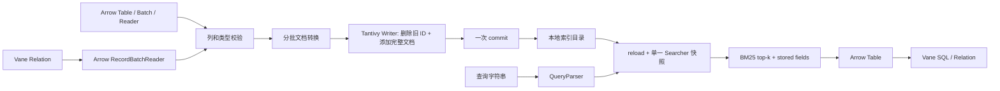

# Vane 基于 Tantivy 的全文检索设计

## 目标与范围

提供一个可持久化、可更新、可通过 Vane SQL 数据流输入输出的全文检索能力。Tantivy 负责倒排索引、词项位置、QueryParser 和 BM25；Vane 适配层负责输入约束、主键语义、生命周期、Arrow 输出和与现有 Relation API 的组合。

本版本实现 `vane.search.FullTextIndex`，采用独立索引目录与显式操作 API。索引在调用进程中运行，不增加基础 wheel 的 Rust 构建步骤，不修改 DuckDB 内核。`search` extra 安装 `tantivy>=0.25.1,<0.26`，`all` extra 也包含该依赖。许可证记录在 [THIRD_PARTY.md](../../THIRD_PARTY.md)。

非本版本目标包括：分布式分片与全局 BM25、对象存储索引、中文词典分词、数据库事务联动、CDC、SQL `CREATE INDEX`、谓词下推、向量混合排序及自动索引维护。

## 数据路径



Arrow 是已经存在的公共边界，避免在 DuckDB 执行器中引入新的 ABI 或跨语言对象生命周期。Relation 通过 `to_arrow_reader(batch_size=...)` 提供批次；结果通过 `connection.from_arrow()` 或 `connection.register()` 进入 SQL。调用者对 SQL 组合保持控制，没有隐式注册全局表名。

## API 与 schema

| 操作 | 行为 |
| --- | --- |
| `FullTextIndex.create(path, id_column=..., text_columns=..., tokenizer='default')` | 独占创建目录并保存 schema/manifest |
| `FullTextIndex.open(path)` | 验证 manifest 版本和 Tantivy schema |
| `upsert(source, batch_size=8192) -> int` | 一个调用一个提交，返回输入行数 |
| `delete(ids) -> int` | 精确主键删除，一个调用一个提交，返回输入 ID 数 |
| `search(query, limit=10, offset=0, fields=None, conjunction=False) -> Arrow Table` | 刷新快照、解析查询、返回按 BM25 排序的结果 |

主键输入仅接受非空、无 NUL、最多 512 UTF-8 字节的字符串。使用字符串统一避免整数溢出、浮点 ID 精度丢失及隐式转换碰撞。用户负责通过 SQL CAST 明确 ID 的表示。

Tantivy schema 中 `_vane_id` 为 raw tokenizer 的 stored text，倒排只保存 basic 信息，用于精确删除。每个文本字段都为 stored text，并设置 `index_option='position'`，以支持短语和 BM25。所有文本列使用同一个内置分词器。允许 `default`、`en_stem`、`whitespace`、`raw`，防止重新打开时依赖未注册的自定义 tokenizer。

NULL 文本不添加到 Tantivy Document；查询恢复存储字段时将缺失恢复为 NULL。空字符串仍是已存储的空字符串。主键及所有配置文本列必须是 Arrow string/large_string，禁止默默把数字、列表或对象转成字符串。额外输入字段在转换前投影掉，不进入索引。

结果列为用户主键名称、`_score: float32`、全部配置文本列。即使结果为空也使用显式 schema，避免后续 SQL 将空结果推断成 NULL 类型。`_score` 和 `_vane_id` 保留，避免输出或内部 schema 冲突。

## 索引目录与生命周期

```text
<index-root>/
  vane-search.json
  index/
    meta.json
    ... Tantivy segments and lock files ...
```

`vane-search.json` 保存 `format_version: 1`、`id_column`、`text_columns`、`tokenizer`。根目录通过 `mkdir(exist_ok=False)` 独占创建，不能覆盖已有索引，也不接受已有空目录。Tantivy 创建完成后，先写临时 manifest，再 rename 发布。

初始化失败时保留目录供检查，不自动递归删除。没有最终 manifest 的目录不能当成有效 Vane 索引打开。这一发布流程避免打开部分初始化索引；它不是跨数据库事务，也不承诺断电下目录项的额外 fsync 保证。

打开时严格检查字段集合、格式版本、列名、分词器，再根据元数据重建期望 schema，与 `Index.open().schema` 比较。Tantivy 负责底层 segment 和格式检查。元数据不用于任意对象反序列化，不执行代码。格式升级需要显式迁移方案，当前不提供原地升级。

## 写入与失败语义

每次修改创建一个 writer，设置 `num_threads=1` 和 64,000,000 字节目标 heap。固定单线程避免每次操作按机器 CPU 数启动大量索引线程。heap 是 Tantivy 的目标缓冲预算，不是进程总内存上限。

每行先验证主键并构造 Document，随后 `delete_documents(_vane_id, key)`，最后 `add_document()`。Tantivy 的操作序号保证该删除只影响先前操作，包含本次调用早先写入的同一 ID；因此同一批或跨批重复主键最后一行生效。这是完整替换而非字段 patch。

数据流消费结束后调用一次 `commit()`。校验、读取、文档构造或提交抛出异常时调用 `rollback()`；无论成功或失败，最终调用 `wait_merging_threads()` 结束后台合并并释放 writer。提交前失败的整个调用不对读者可见。提交过程中发生 I/O 故障，以及提交完成后的清理故障，可能有不确定结果；不能跨磁盘异常承诺 exactly-once。

`batch_size` 只控制 Python 行对象转换的最大行数，输入 reader 给出更大 batch 时会再次切片。不会调用 `read_all()` 或把整个输入转换成 Python list。Tantivy 可以在提交前刷新 segment，所以内存受批次和 writer 缓冲影响，临时磁盘占用仍可能随一次大操作增长。失败后临时 segment 的回收由 Tantivy 管理。

Relation 创建的 reader 由适配层关闭；调用者提供的 Arrow reader 不被主动关闭。`delete()` 接受迭代器，迭代中失败也回滚。返回计数用于报告处理量，不被当成索引文档总数。

## 并发与读取一致性

一个实例持有 Python `Lock`，串行化完整写入，以及 search 的 `reload/parse/searcher` 阶段。不同实例或进程由 Tantivy 的目录 writer lock 保护；抢锁失败向上抛出，没有隐藏重试、跳过批次或抢占。

reader 使用 `Manual` reload policy。每次查询显式 `reload()`，获得一个 searcher 并在整个 top-k 和 stored-field 读取过程中保留它。匹配地址不跨 searcher 使用，避免并发 commit/merge 后地址指向不同的 segment。

获取 searcher 后释放实例锁，因此查询计算可与后续写入并行。本次读取继续使用自己的快照；后续查询刷新到最新可见提交。多个实例间没有共享 Python 锁，但其快照仍遵循 Tantivy 的提交可见性。

源表与索引没有原子一致性：Vane ROLLBACK 不能回滚已提交的 Tantivy 更新。可重试的稳定主键 upsert/delete 是应用恢复的基础。变更字段或分词规则应构建新目录，验证后在应用层切换索引引用；本实现不提供原地重建或切换服务。

## 查询与资源边界

使用严格 QueryParser，支持字段、短语、布尔表达式；默认 OR，可选 `conjunction=True`。`fields` 只影响未限定词项，不限制显式字段引用。解析失败直接报错，无静默 fallback。

结果按 BM25 分数排序，分数相同的次序不构成 API 合约。删除、重写和 segment 合并可能改变词频统计、评分及顺序。不同独立索引的 BM25 分数不应直接视为全局排名。

`limit + offset <= 10000` 限制 collector 的结果窗口，结果和存储文本在 Python 端物化。它不限制查询表达式复杂度，也不保证总内存或执行时间。若应用接收不受信任的查询，服务层应自行限制请求长度、并发、超时和返回体积。本模块没有网络监听接口。

## 验证与 CI

[回归测试](../../tests/fast/test_full_text_search.py) 使用真实 Tantivy 索引覆盖：

- BM25 相对排序、短语、AND/OR/NOT、默认字段及 offset。
- 无结果固定 Arrow schema、NULL、string/large_string、额外列投影。
- 重复主键、跨批次覆盖、删除和跨句柄可见性。
- 验证失败与数据流异常的整体回滚、异常后的写锁释放。
- 独占目录创建、manifest 版本/模式异常及竞争 writer。
- 分词器重新打开，包括预分词中文。
- 可选依赖错误提示，以及真实 Vane Relation → 索引 → Arrow → SQL 回路。

正常安装环境执行：

```bash
scripts/run_installed_pytest.sh tests/fast/test_full_text_search.py
scripts/run_release_tests.sh
python -I scripts/check_copyleft.py
scripts/format root --changed
```

Linux Python 3.12 的 wheel CI 在安装本次构建的 Vane wheel 后安装 Tantivy，并执行整个全文检索测试文件，包含原生 Relation 回路。没有安装 Tantivy 的基础 fast-test 环境跳过该文件。性能基准、分布式扩展、跨大版本迁移不属于当前验证结论；本实现没有性能提升百分比承诺。

## 后续演进

后续可在明确事务与存储协议后增加分区索引、分布式路由和全局词频统计，或接入 SQL table function。可扩展每字段分词、中文词典分词、过滤字段、highlight 与游标式分页，但需要同时定义 schema 版本、资源约束和回归测试，不能仅增加 API 参数。

## 参考

- [Tantivy](https://github.com/quickwit-oss/tantivy)
- [tantivy-py](https://github.com/quickwit-oss/tantivy-py)
- [Python bindings API](https://tantivy-py.readthedocs.io/en/latest/api/tantivy/tantivy.html)
- [用户文档与完整示例](USER_GUIDE.md)
